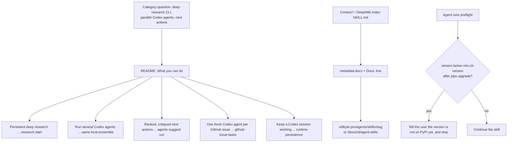

# Name the jobs, link every skill's page, and say when a skill needs an unreleased CLI (AEO checklist G-3, G-6, G-9)

## Summary

An aio run on 2026-10-25 asked ChatGPT and Claude category questions such as "Is there a CLI
that runs persistent deep research from the terminal?" and "a tool to run multiple Codex agents
in parallel and compare implementations". Vidbyte appeared in 0 of 36 answers; the engines cited
competitors' GitHub READMEs whose headings name the job. This README's headings named only
sections (Install, Quickstart, Commands). Separately, no SKILL.md linked its vidbyte.pro page,
and every skill's setup reference told the agent to `pipx upgrade vidbyte-cli` to reach its
`min-cli-version`, which installs 0.2.0 and so cannot reach the 0.3.x versions 20 of the 23
skills need.

This change:

- **G-6** adds "What you can do" to README.md: five `###` headings phrased as the jobs people
  ask about, each with 55 to 74 words, one command or skill, and one vidbyte.pro link. Every job
  was checked against the vidbyte-cli 0.2.0 wheel on PyPI.
- **G-9** gives every `skills/*/SKILL.md` a `metadata.docs` URL and a closing `Docs: <url>`
  line: `vidbyte.pro/agents/skills/<slug>` for the 19 skills cerredz/Vidbyte lists, and
  `vidbyte.pro/docs/cli/agent-skills` for the 4 it does not yet list. The writing contract and
  the template now require both.
- **G-3** adds one conditional sentence after the upgrade commands in the canonical
  `references/setup.md`, then regenerates the 23 byte-identical copies.

## Flow chart



## Usage example

```bash
npx skills add cerredz/vidbyte-cli --skill github-issue-tasks
vidbyte-cli runtime same-host-ensemble "Add retries with backoff to the HTTP client" --roles 3
```

A skill's frontmatter and its last line after this change:

```yaml
metadata:
  min-cli-version: "0.2.0"
  status: stable
  docs: "https://vidbyte.pro/agents/skills/research-a-competitor"
```

```text
Docs: <https://vidbyte.pro/agents/skills/research-a-competitor>
```

## How it works

- **Jobs, not features.** Each heading uses the words of an aio category question. A heading
  stays only if the released CLI or a published skill does that job: the research, ensemble,
  suggestion, and persistence commands are all in the 0.2.0 wheel (`research start` and `watch`,
  `runtime same-host-ensemble`, `agents suggest run`, `runtime persistence --strength 1-6`), and
  `github-issue-tasks` has `min-cli-version` 0.2.0. The "6 at `--strength 1`, up to 100 at
  `--strength 6`" figures are the wheel's `_PERSISTENCE_REPEAT_COUNTS`. Prices (2¢ per
  ensemble or persistence launch, the $5.00 research cap) match "What runs where".
- **The docs link is metadata plus text.** The frontmatter key serves tools that read
  metadata; the closing line serves indexes that read the Markdown body. The Agent Skills
  format types `metadata` as a string-to-string map, the website reads only `name`
  (`skillMarkdownSource.js`), and the validators require the six existing fields without
  rejecting others, so `docs` is additive.
- **One canonical setup file.** `docs/agent-skills/write-agent-skill/SKILL.md` section 7 and
  the validators require every `references/setup.md` to be byte-identical to the canonical copy,
  so the sentence is written once and copied to all 23 skills. It is conditional ("If
  `vidbyte-cli --version` is still below the skill's `min-cli-version` after upgrading"), so it
  never fires for the three skills whose `min-cli-version` is 0.2.0, and it stays true after the
  next release reaches PyPI.

## Files

| File | Change |
| --- | --- |
| `README.md` | New "What you can do" section with five job headings |
| `skills/*/SKILL.md` (23) | `metadata.docs` and a closing `Docs:` line |
| `docs/agent-skills/write-agent-skill/references/setup.md` | The conditional sentence after the upgrade commands |
| `skills/*/references/setup.md` (23) | Regenerated from the canonical copy |
| `docs/agent-skills/write-agent-skill/SKILL.md` | `metadata.docs` row, Docs line, example, and review-checklist item |
| `docs/agent-skills/write-agent-skill/references/skill-template.md` | `docs` key and the closing line |

## Risks

- The 4 skills without a page link the general guide. When cerredz/Vidbyte lists one of them
  (checklist V-26), both its `metadata.docs` and its last line must change to its own page.
- The date in "on 2026-10-26 PyPI had 0.2.0" ages, but the sentence stays true because the
  condition is checked against the installed version, not the date.
- `skills/improve-my-aeo/SKILL.md` already failed strict YAML parsing on `main` (an unquoted
  `: ` in its description). This change does not touch that line; it is reported in the PR.

## Verification

- Every `scripts/test-*.py` (six suites) passes with a scrubbed environment under Python 3.11,
  including the website entry comparison for `what-else-needs-doing`.
- An independent check parses every SKILL.md frontmatter as YAML and confirms that
  `metadata.docs` equals the closing `Docs:` URL and that the URL is the skill's page exactly
  when cerredz/Vidbyte `origin/main` lists the slug: 23 checked, 0 wrong.
- `cmp` confirms all 23 `references/setup.md` copies equal the canonical file.
- The five README examples parse against an installed vidbyte-cli 0.2.0 (`--help` appended, so
  nothing is sent); `--bogus` on the same command exits 2 as a negative control.
