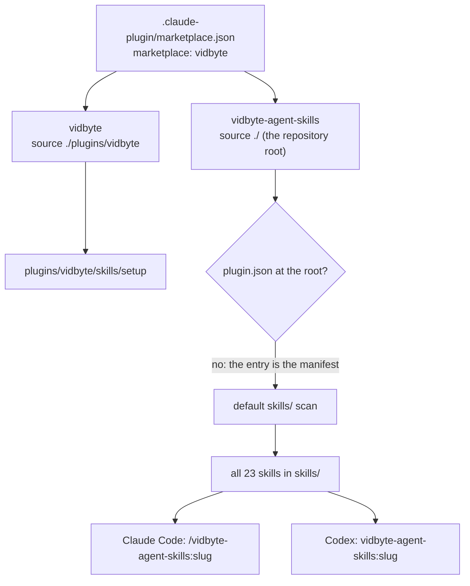

# Offer the agent skills as one plugin in this marketplace (AEO checklist G-10)

## Summary

This repository is a plugin marketplace named `vidbyte` (`.claude-plugin/marketplace.json`),
and Claude Code and Codex both read it. Until now it listed one plugin, `vidbyte`, whose only
skill is `setup`. The 23 agent skills in `skills/` installed only through
`npx skills add cerredz/vidbyte-cli`, so someone browsing the marketplace in `/plugin` or
`codex plugin list` found setup and no agent skills. G-10 is done when "the marketplace offers a
plugin that bundles the skills". #34 already did the rest of G-10 (the marketplace description,
the keywords, and the `vidbyte` plugin's homepage).

This change adds a second marketplace entry, `vidbyte-agent-skills`, whose `source` is the
marketplace root (`"./"`). The root has no `plugin.json`, so the entry is the plugin's manifest,
and the default `skills/` scan picks up every skill in `skills/` with no copy and no list to keep
in sync. A skill added to `skills/` joins the plugin automatically. The entry sets no
`version`, so installed copies follow the repository's commits. Its homepage is
https://vidbyte.pro/docs/cli/agent-skills, which answers 200.

What the documentation says (fetched 2026-10-27, raw Markdown from code.claude.com):

- Marketplace reference, plugin sources: "Relative path | the string itself | A directory inside
  the marketplace, resolved from the marketplace root. Must start with `./` ... `"."` on its own
  means the root itself"
- Marketplace reference, entry and plugin.json: "**No `plugin.json`**: the entry is the manifest
  regardless of `strict`."
- Plugins reference, standard layout: "Skills | `skills/` | One `<name>/SKILL.md` per skill."
- Plugins reference: "When a marketplace entry whose `source` is the marketplace root lists
  specific `skills` subdirectories, only those subdirectories load, and the plugin's default
  `skills/` directory isn't scanned." This entry lists none, so the default scan applies.
- Plugin loading: "To let users track commits instead, leave `version` out of both the manifest
  and the entry."

## Flow chart



## Usage example

```bash
# Claude Code
claude plugin install vidbyte-agent-skills --marketplace cerredz/vidbyte-cli

# Codex
codex plugin marketplace add cerredz/vidbyte-cli
codex plugin add vidbyte-agent-skills@vidbyte

# Unchanged: the skills CLI, one skill or all of them
npx skills add cerredz/vidbyte-cli --skill resolve-pr-conflicts
```

## Files

| File | Change |
| --- | --- |
| `.claude-plugin/marketplace.json` | New entry `vidbyte-agent-skills` (`source: "./"`, display name, description, author, homepage, repository, license, keywords). The marketplace description now says it holds setup and the agent skills as one plugin |
| `README.md` | Install lines for the plugin in Claude Code and Codex, under "Install the agent skills" |

## Risks

- **Always-on context.** Claude Code lists every skill's description in each session, about
  4,100 tokens for the 23 skills (`claude plugin details`). The plugin is opt-in, and
  `npx skills add --skill <slug>` still installs one skill.
- **Duplicate skills.** Someone who installs the plugin and also runs `npx skills add` gets each
  skill twice, under two names (`/resolve-pr-conflicts` and
  `/vidbyte-agent-skills:resolve-pr-conflicts`). The README presents them as alternatives.
- **The plugin copy holds the whole repository.** A root source copies the repository into the
  plugin cache (244 tracked files, about 5 MB today). Only `skills/` loads: `docs/agent-skills/` and
  `plugins/vidbyte/` are not scanned, which both agents confirm below.
- **Anthropic's plugin directory submission is unchanged.** It submits `plugins/vidbyte`, which
  this change does not touch.
- **Codex.** OpenAI's docs do not say whether `"./"` is a valid Codex source, so it was tested
  (below) rather than assumed.

## Verification

- `claude plugin validate --strict .` (Claude Code 2.1.311): passed with 0 errors, 0 warnings
  and 0 advice. `claude plugin validate --strict ./plugins/vidbyte` still passes.
- Claude Code, in a scratch `CLAUDE_CONFIG_DIR`: `claude plugin marketplace add <worktree>`,
  then `claude plugin install` for both plugins. `claude plugin details vidbyte-agent-skills`
  lists `Skills (23)`, exactly the folders in `skills/`; `vidbyte` still lists `Skills (1) setup`.
- Codex 0.163.0, in a scratch `CODEX_HOME`: `codex plugin marketplace add <worktree>`, then
  `codex plugin add` for both plugins. `codex debug prompt-input` (renders the model-visible
  prompt with no model call) lists the 23 `vidbyte-agent-skills:` skills and `vidbyte:setup`, and
  nothing else from this repository. On `origin/main` the same steps list only `vidbyte@vidbyte`.
- `npx skills@1.7.4 add <path> --list` finds the same 23 names before and after this change.
- The six `scripts/test-*.py` and the `too-many-meetings` unittest suite pass, run in a scrubbed
  environment.
