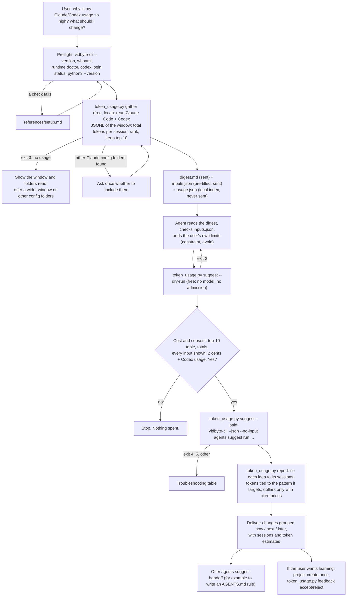

# cut-my-agent-token-usage

## Summary

Add the public agent skill `skills/cut-my-agent-token-usage/`. Claude Code and Codex usage grows
every month, and nobody can say which sessions, projects, or habits drive it. The tools show a
running total at best. They do not show that one session re-sent a 30,000-token file on every one
of its next 160 requests, that sixteen subagents used nine tenths of another session's tokens, or
that an agent polled the same command forty times.

The skill ranks sessions by the tokens they used and asks for advice through that lens, as the
user asked: "get the sessions that are using the most tokens, compile these, and then prompt the
suggestion agent for some advice through the lens of 'given that these use the most usage, what do
you suggest'". A bundled, stdlib-only Python script reads every Claude Code and Codex transcript of
a time window (default: the last 7 days), totals the tokens of each session (fresh input, cache
reads, cache writes, output), keeps the top 10, and compiles a profile of each: what it was about,
its models, its costliest turns, and what made them costly (large tool results such as whole-file
reads, repeated identical tool calls, compactions and context-limit hits, long pasted prompts,
subagent fan-out). It redacts secrets, emails, and home paths, and pre-fills the Suggestion Agent's
typed inputs from the numbers. After the user's yes, one `vidbyte-cli agents suggest run` (2 cents
at `--count 8`, plus model usage on the user's own Codex account) returns ranked changes. Each
change is tied back to the sessions that motivated it, with an upper bound on the tokens it could
save, computed from those sessions' own numbers.

## Flow chart



## Usage example

```bash
npx skills add cerredz/vidbyte-cli --skill cut-my-agent-token-usage
```

Then, in the coding agent:

```text
> my claude code and codex usage keeps going up. which sessions use the most tokens, and what should I change?
```

The agent runs the preflight, then:

```bash
python3 "<skill>/scripts/token_usage.py" gather --days 7
```

It reads `digest.md` and the pre-filled `inputs.json`, adds any limit the user stated ("keep the
largest model for design work"), checks the request for free, shows the user the top-10 table and
every value that will be sent, and asks: "This runs the Vidbyte Suggestion Agent once. It costs 2
cents from your Vidbyte balance, plus model usage on your own Codex account. It changes no files.
Run it?" After a yes:

```bash
python3 "<skill>/scripts/token_usage.py" suggest --out "<out_dir>" --paid
```

which runs, from inside `<out_dir>`:

```bash
vidbyte-cli --json --no-input agents suggest run \
  --goal "These are the 10 Claude Code and Codex sessions that used the most tokens on this machine in the last 7 days ... Given that these use the most usage, what should I change so the same work costs fewer tokens? ..." \
  --category simplification --category leverage --category quick_wins --category risk_prevention \
  --count 8 --horizon any \
  --outcomes "[all] ..." --outcomes "[all] The 10 heaviest sessions, S1 to S10, used ..." \
  --mistakes "[S1 S3] Whole-file reads: ..." --mistakes "[S2] Repeated identical tool calls: ..." \
  --context "[all] ..." --capability "..." --constraint "Keep the largest model for design work." \
  --files digest.md \
  --idempotency-key "cut-my-agent-token-usage:20261011:3f9a1c"
```

Then `python3 "<skill>/scripts/token_usage.py" report --out "<out_dir>"` writes `report.md`: each
idea with its source sessions and the tokens tied to the pattern it targets.

## How it works

- **Gather (free, local).** `token_usage.py gather` reads:
  - Claude Code: `<config dir>/projects/*/<session-id>.jsonl` and the subagent transcripts in
    `<config dir>/projects/*/<session-id>/subagents/*.jsonl`. The config dir is
    `$CLAUDE_CONFIG_DIR` if set, else `~/.claude`, plus every `--claude-dir`. Other `~/.claude*`
    folders with transcripts are reported, never read unasked.
  - Codex: `$CODEX_HOME` or `~/.codex`, `sessions/YYYY/MM/DD/rollout-*.jsonl` and
    `archived_sessions/rollout-*.jsonl`. Titles come from `session_index.jsonl`.
  - Only files modified inside the window are opened, and only records with a timestamp inside it
    count. `--project-dir` keeps sessions whose `cwd` is that folder or below it.
- **Formats confirmed on real files** (Claude Code 2.1.296; codex-cli 0.161.0, plus older rollouts
  back to 0.91):
  - Claude Code writes one `assistant` record per content block, and every block of one API
    response repeats the same `message.usage`. The script counts each `message.id` once. Usage has
    `input_tokens`, `cache_read_input_tokens`, `cache_creation_input_tokens`, and `output_tokens`;
    `<synthetic>` records (local error messages) carry zeros and are skipped. A response is one
    "request". Subagent transcripts (`isSidechain: true`, with a `.meta.json` holding the
    subagent's description) are counted inside their parent session, as subagent tokens.
    `system/compact_boundary` records carry `compactMetadata.trigger` (`auto` means the context
    limit forced it, `manual` means `/compact`) and `preTokens`. Usage-limit stops are
    `isApiErrorMessage` records such as "You've hit your session limit". The transcripts do not
    hold Claude Code's small background requests (titles, safety checks), so those are not
    counted; the `cost-state` record's totals include them and are not used.
  - Codex reports tokens two ways. `event_msg/token_count` carries `total_token_usage`
    (cumulative) and `last_token_usage` (one request). Since 0.160, `token_usage_record` carries
    one request's `usage` with a `response_id`. The cumulative total is never used, because a
    thread forked from another (SDK and subagent threads) starts with the parent's usage already in
    it, so summing totals counts the parent twice. The script sums `token_usage_record.usage` once
    per `response_id`; it also includes the compaction request, which `token_count` misses. Before
    the first `token_usage_record` in a file (older Codex), it sums `last_token_usage` and skips a
    `token_count` whose `total_token_usage` equals the previous one, because Codex re-emits the
    last count on resume. Codex `input_tokens` includes `cached_input_tokens`, so fresh input is
    `input - cached`; `output_tokens` includes reasoning. Compactions are `compacted` records;
    a compaction counts as a context-limit hit when the request before it filled at least 80% of
    `model_context_window`. Subagent threads (`source.subagent.thread_spawn.parent_thread_id`)
    are counted inside their parent when the parent is in the window.
- **Rank.** Each session's total is fresh input + cache reads + cache writes + output, subagents
  included. Sessions are ranked by that total and the top 10 (`--top`) are kept. The window totals
  cover every session read, so the top-N share is real. Sessions started by programs (Claude Agent
  SDK, `codex exec`, the Codex SDK, automations) are counted and labelled; `--interactive-only`
  ranks only sessions a person typed into. The session the skill runs in is left out when the host
  exposes its id.
- **Compile.** For each top session: tool, origin, project (the folder's last name, redacted), title,
  the first two prompts (redacted, 300 characters), models with their tokens, prompts, requests,
  duration, token breakdown, average and peak context per request, compactions, usage-limit stops,
  subagents, and the three costliest turns. A turn is one prompt and all the work until the next
  prompt, subagent requests included by time. Each costly turn lists its causes: many requests, a
  large context re-sent on each request, large tool results, repeated identical calls, compactions,
  a long pasted prompt, or subagent fan-out.
- **Patterns, measured.** A tool result's size is its characters ÷ 4 (an estimate, labelled as one).
  Every later request in the same conversation re-sends it, until a compaction, so its carried
  cost is its size times the number of later requests. The script reports, per session:
  - large tool results (over about 5,000 tokens; whole-file reads, meaning a Claude Code `Read`
    with no `offset` or `limit` or a Codex `cat`/`Get-Content`/`type` with no range, apart from
    long command output) and their carried cost;
  - repeated identical tool calls (the same tool with the same input three or more times; failures
    counted) and the tokens of the requests that repeated them;
  - tokens re-sent above 100,000 tokens of context, which is what compacting earlier or starting a
    new session per task could at most save;
  - long pasted prompts (over 8,000 characters) and their carried cost;
  - subagent tokens.
  These overlap, so the digest says never to add them.
- **Digest and inputs.** `digest.md` holds the window totals (by kind, model, and tool), the top-N
  share, and one profile per session, tagged `S1` (heaviest) to `S10`, at most 60,000 characters.
  `inputs.json` is pre-filled from the numbers: the goal in the user's framing, `outcomes` (window
  totals, the top-N share, the three heaviest sessions, usage-limit stops), `mistakes` (one value
  per detected pattern, with its measured tokens, its sessions, and its cause), `context` (how
  tokens add up, the models used, sessions started by programs), and `capability` (the user can
  edit CLAUDE.md and AGENTS.md and choose models). The coding agent adds `constraint`, `avoid`, and
  `success` only from the user's own words. `usage.json` keeps real session ids and paths and is
  never sent.
- **Redact before writing.** The redactor is copied from `pick-up-where-my-sessions-left-off`:
  API-key and token formats (`sk-`, `sk_live_`, `ghp_`/`gho_`/`ghu_`/`ghs_`/`ghr_`, `github_pat_`,
  Slack, AWS key ids, Google `AIza`, `vb_live_`/`vb_test_`, JWTs, PEM private keys, `0x` + 64-hex
  keys), `Bearer` and `Authorization:` values, credentials in URLs, `.env`-style and `*KEY*` /
  `*TOKEN*` / `*SECRET*` / `*PASSWORD*` assignments, email addresses, absolute home paths in every
  spelling (shown as `~`), and the login name (shown as `[user]`). It runs over every prompt,
  title, file path, command, and subagent description before anything is written, and again over
  `inputs.json` values before the run.
- **Run.** `token_usage.py suggest` validates `inputs.json` (allowed keys, counts, lengths, session
  tags), builds the argv, and runs `vidbyte-cli` without a shell, from inside the output folder,
  with `--files digest.md` as a relative path, so the file's path that reaches the model holds no
  home folder. The paid mode needs `--paid`, makes and saves one idempotency key, and refuses to
  start in a folder that already holds a paid attempt unless the caller recovers it with
  `--idempotency-key` and no result was saved yet. This guard is copied from `sessions.py`.
- **Flag choices.**
  - The goal frames everything through usage: "These are the N sessions that used the most tokens
    ... Given that these use the most usage, what should I change so the same work costs fewer
    tokens?" and asks for the session tags behind each change.
  - `--category simplification leverage quick_wins risk_prevention`: remove steps that cost tokens
    (whole-file reads, subagent fan-out), build one reusable asset that serves many sessions (an
    instruction-file rule, a repository map), cheap habit changes (compact at milestones, pick the
    model per task), and guards against runaway sessions (context-limit hits, retry loops). All
    four ids are in the registry (`agents suggest categories`).
  - `--count 8`: one admission covers up to ten ideas (2 cents), and eight changes fit one reading.
  - `--horizon any`: the CLI applies any other horizon only after review, as a silent filter on
    each idea's own label, so a run could return fewer ideas and still be charged. Deliver groups
    the ideas by their own label instead.
  - `--outcomes` for totals and shares, `--mistakes` for the patterns: typed inputs reach the model
    as labelled evidence the critic can check. Each value starts with session tags, so ideas trace
    back to sessions and no idea repeats a `--mistakes` value word for word (the CLI drops those).
  - `--success` is not about targets; it is only for a habit the user says has worked for them.
    Targets go in the goal.
  - `--files digest.md`, not `--attach`: a `--files` entry gets a reference (`ctx-NNN`) that ideas
    can cite, so they pass the evidence gate.
  - `--project agent-token-usage` only after the user opts into learning.
- **Report.** `token_usage.py report` reads `result.json` and `usage.json`. For each idea it
  collects the session tags from the idea's text and its evidence, matches the idea to the patterns
  it targets by keywords (read, search, compact, subagent, model, retry, paste), and sums those
  sessions' tokens for the matched pattern. It reports the largest match as "up to N tokens over
  this window" and lists the others, never their sum. A model change moves tokens to a cheaper model
  without removing them, so it is reported as tokens moved. Dollars appear only when the agent
  passes `--price MODEL=input,output,cache_read,cache_write` (USD per million tokens) with
  `--price-source <URL of the provider's own price page>`; the URL is printed beside every dollar
  figure. On a subscription plan there is no per-token bill, so dollars are labelled "at API
  prices".
- **Deliver.** Ideas grouped `now`, `next`, `later`, each with its sessions, the token estimate,
  the first action, and the charge. Offer `agents suggest handoff` (for example to have an agent
  write the rule into AGENTS.md or CLAUDE.md), feedback under `--project agent-token-usage`, and the
  sibling skill `pick-up-where-my-sessions-left-off` for "what to do next" rather than "what it
  cost".

## Why Python

The same reasons as `pick-up-where-my-sessions-left-off`: the script parses large JSONL files,
redacts with regular expressions, and passes free text as arguments, which breaks in shell
pipelines on Windows. `vidbyte-cli` needs Python 3.11+, so Python is present wherever the skill
runs. The script uses only the standard library and runs on Python 3.8+.

## Files

| File | Change |
|---|---|
| `skills/cut-my-agent-token-usage/SKILL.md` | New. The skill, in the contract's section order. |
| `skills/cut-my-agent-token-usage/scripts/token_usage.py` | New. `gather` (read, total, rank, compile, redact), `suggest` (dry run or paid run), `report` (tie ideas to sessions and estimate tokens), `feedback` (accept or reject by idea id). Stdlib only. |
| `skills/cut-my-agent-token-usage/references/setup.md` | New. Byte-for-byte copy of the canonical file. |
| `skills/cut-my-agent-token-usage/references/troubleshooting.md` | New. Byte-for-byte copy of the canonical file. |
| `docs/design/cut-my-agent-token-usage.md` | New. This document. |

## CLI surface and min-cli-version

Every command and long option is in `contracts/cli-commands.json` on the internal repository's
`main`: `agents suggest run` (`--goal`, `--category`, `--count`, `--horizon`, `--outcomes`,
`--mistakes`, `--context`, `--capability`, `--success`, `--constraint`, `--avoid`, `--files`,
`--project`, `--dry-run`, `--idempotency-key`), `agents suggest handoff` (`--input`, `--idea`),
`agents suggest project list`, `agents suggest project create` (`--key`, `--title`,
`--description`), `agents suggest feedback accept|reject` (`--project`, `--suggestion`,
`--reason`), `whoami`, and `runtime doctor`. PyPI's newest release is 0.2.0; its `agents suggest
run` has no paid admission and no `--idempotency-key`. So `min-cli-version` is `0.3.0`, and the
skill is not published until 0.3.0 is on PyPI. The price, 2 cents per block of up to ten requested
ideas, comes from `SuggestionAdmissionLimit` and the `count` help text on `main`.

## Risks and open questions

- **Undocumented formats.** Both transcript formats are internal and change between releases. The
  parser reads fields defensively, handles both Codex token records, and counts what it could not
  parse. A format change lowers the numbers' coverage; it does not crash the script.
- **Estimates.** Tool-result sizes are characters ÷ 4, and the per-pattern figures are upper
  bounds that overlap. The digest and the report say so in words.
- **Not every token is in a transcript.** Claude Code's background requests are missing, so totals
  are slightly low. Claude Code's own `cost-state` record is not used, because it mixes in those
  requests and work from before the window.
- **Redaction is pattern-based.** The user sees the table and every typed value and can open the
  digest before the paid run.
- **Run length.** The paid run can take several minutes; the skill says to run it in the background
  or with a long timeout, because a run killed after admission is still charged.
- **CLI gap.** `--horizon` other than `any` filters silently after review. A warning, or telling
  the generator the horizon, would make it safe to use.
- No paid end-to-end run was made, because it spends real money. The paid path was tested with a
  stand-in `vidbyte-cli` that only records its arguments.

## Verification

1. Every `vidbyte-cli` command path and long option in `SKILL.md` and `token_usage.py` checked
   against `contracts/cli-commands.json` on the internal `main`.
2. Token accounting checked on real files: Claude Code per-`message.id` sums against the
   `cost-state` cache-read totals of sessions without background requests; Codex
   `token_usage_record` sums against `token_count` sums, with the differences explained
   (compaction requests, forked threads, re-emitted counts).
3. `token_usage.py gather` run against the real Claude Code and Codex folders on a Windows machine
   for 7 and 30 days and with `--project-dir`; output kept outside the repository and scanned for
   home paths, the login name, emails, and token patterns. No real output is committed.
4. `token_usage.py gather` run against synthetic fixtures (Claude Code with a subagent and a
   compaction, Codex with both token-record generations, a forked thread, and a re-emitted count),
   with planted secrets, checking totals, ranking, patterns, and redaction.
5. `token_usage.py suggest --dry-run` run with the real digest against a CLI built from the
   internal `main`, with an isolated state folder: exit 0, `stop_reason: dry_run`, every manifest
   entry `included`, no charge. Invalid inputs fail with exit 2.
6. The paid-run guards and `report`/`feedback` tested with a stand-in `vidbyte-cli` first on
   `PATH`, confirmed with `command -v vidbyte-cli` before each test.
7. `cmp` of both `references/` files against the canonical copies.
