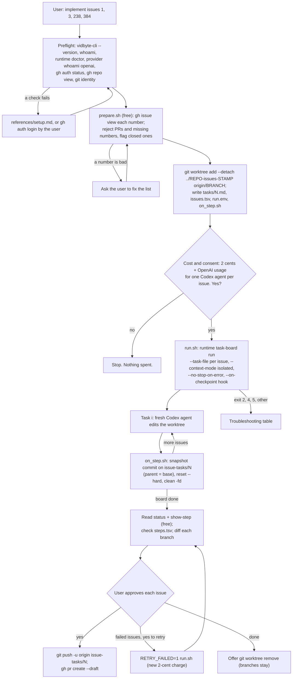

# github-issue-tasks

## Summary

Add the public agent skill `skills/github-issue-tasks/`. A user names the GitHub issues they want
built, for example "implement issues 1, 3, 238, and 384", and the skill turns them into one Vidbyte
Task Board (`vidbyte-cli runtime task-board run`, 2 cents per board plus the user's own OpenAI
usage). Each issue becomes one board task, so each issue gets its own fresh Codex agent with an
empty context window that sees only that issue. The board runs in a separate git worktree, and a
small hook saves each issue's changes on its own branch, `issue-tasks/<number>`, then resets the
tree before the next agent starts. The user ends up with one reviewable branch per issue, and a
draft pull request for each issue they approve. This is the backlog's planned `burn-down-issues`
idea, named the way the user asked for it.

The same PR copies the `write-agent-skill` writing contract from the Vidbyte repository into
`docs/agent-skills/write-agent-skill/`, so the contract lives next to the skills it governs. The
copy is the contract as updated in cerredz/Vidbyte#678, after review on PR #1 changed the public
skill format, and review on PR #5 asked for the same format here.

## Flow chart



## Usage example

```bash
npx skills add cerredz/vidbyte-cli --skill github-issue-tasks
```

Then, in the coding agent, inside a clone of the repository:

```text
> /github-issue-tasks implement issues 1, 3, 238, 384
```

The agent runs the preflight, then `ISSUES="1 3 238 384" bash <skill>/scripts/prepare.sh`, and
asks: "This runs one Vidbyte Task Board over 4 issues. It costs 2 cents from your Vidbyte balance
plus OpenAI usage on your own account for 4 Codex agents, one per issue. The agents edit files only
in ../myrepo-issues-20261011-181500; each issue's changes land on a local branch issue-tasks/<n>.
Nothing is pushed until you approve each issue. Run it?" After a yes, `run.sh` calls:

```bash
vidbyte-cli --json --no-input runtime task-board run \
  --task-file .vidbyte/issue-tasks/tasks/1.md \
  --task-file .vidbyte/issue-tasks/tasks/3.md \
  --task-file .vidbyte/issue-tasks/tasks/238.md \
  --task-file .vidbyte/issue-tasks/tasks/384.md \
  --context-mode isolated --no-stop-on-error --retries-per-task 0 --turn-timeout 7200 \
  --checkpoint-root .vidbyte/issue-tasks/boards --checkpoint-id issues-20261011-181500 \
  --report-file .vidbyte/issue-tasks/report.md \
  --on-checkpoint "bash ../../on_step.sh" \
  --idempotency-key "github-issue-tasks:20261011:18150012345" > .vidbyte/issue-tasks/result.json
```

## How it works

- **Section order.** `SKILL.md` has no "When to use" or "When not to use" section; the frontmatter
  `description` already holds the triggers. It opens with "The problem" and "How vidbyte-cli
  solves it", and has "Steps" and "CLI commands" after "Gather inputs". The limits the removed
  sections held now sit where the agent acts on them: a lone issue, issues that need another
  issue's code, and possible security vulnerabilities in Gather inputs step 1 (security also in
  Guardrails), and a non-GitHub or fork clone in Preflight.
- **One board, one agent per issue.** The Task Board runs its tasks one at a time and throws each
  Codex agent away when its task ends. `--context-mode isolated` sends no earlier summary to any
  agent, so every issue starts with a fresh context window. Each task is a whole Markdown file
  passed with `--task-file`, never a `--task-list` `.md` file, because a task list splits on level-two
  headings and issue bodies often contain `## Steps to reproduce`.
- **A clean tree per issue.** Tasks share one working directory. The `--on-checkpoint` hook runs
  synchronously after every step, before the next agent starts (`TaskBoardCheckpointer.run_hook`:
  `subprocess.run(shell=True)`, 60-second timeout, working directory = the board directory). It
  stages everything, writes one commit with git plumbing (`write-tree`, `commit-tree -p BASE`,
  `update-ref refs/heads/issue-tasks/N`), then runs `reset --hard BASE` and `clean -fd`. So each
  branch is the base plus exactly one issue's changes, and the next agent sees a pristine tree.
  Plumbing never runs the repository's commit hooks, so a slow pre-commit hook cannot hit the
  60-second limit and leave a dirty tree. The project's checks run later, before anything is pushed.
- **A dedicated worktree.** `prepare.sh` creates a detached worktree beside the repository, so the
  user's own checkout and uncommitted work are never touched, and `reset`/`clean` only ever run
  there. The hook refuses to act unless its top level equals the recorded worktree and is a linked
  worktree, never a main checkout. State lives in `<worktree>/.vidbyte/issue-tasks/`, added to
  `info/exclude`, so `git add -A` never stages it and `git clean -fd` never deletes it.
- **Task text.** `prepare.sh` builds each task with `gh issue view --jq`: title, URL, labels, the
  body cut to 10,000 characters, and the last three comments cut to 1,500 each, which keeps every
  task under the 20,000-character limit. The text frames the issue as data written by others, tells
  the agent to read the project's conventions, run its checks, change only what the issue needs, run
  no `git` writes, and end with a short `STATUS / FILES / CHECKS / NOTES` report. The step summary
  is cut to 1,200 characters, so the report comes first; the full text is free to read through
  `show-step`.
- **Validation.** `gh issue view` also answers for pull request numbers, so `prepare.sh` rejects any
  number whose `url` contains `/pull/`, stops on a missing number, and stops on closed issues
  unless `ALLOW_CLOSED=1`. It also requires `origin` to be the repository the issues belong to.
- **Retry and resume.** The CLI's own `resume_command` has no `--on-checkpoint`, so pasting it would
  let issues pile into one tree. `run.sh` is the only entry point: `RETRY_FAILED=1` adds
  `--retry-failed-only`, and `FROM=<n>` adds `--from n`. Both reuse the board's stored task list and
  repeat the same settings, which the manifest check requires. `run.sh` refuses to start on a dirty
  worktree or one not at the base commit.
- **Deliver.** The agent reads `runtime task-board status` and `show-step` (both free), checks that
  `steps.tsv` has a row for every step (a missing row means the hook failed and the next branch may
  hold two issues), shows a table and each branch's diff, and opens a draft PR with
  `gh pr create --draft` only for issues the user approves, after running the project's checks.

## Files

| File | Change |
|---|---|
| `skills/github-issue-tasks/SKILL.md` | New. The skill, in the section order of the updated `write-agent-skill` contract. |
| `skills/github-issue-tasks/scripts/prepare.sh` | New. Free: validates issues, creates the worktree, writes task files and state. |
| `skills/github-issue-tasks/scripts/run.sh` | New. The one paid step, plus the retry and resume modes. |
| `skills/github-issue-tasks/scripts/on_step.sh` | New. The `--on-checkpoint` hook that gives each issue its own branch. |
| `skills/github-issue-tasks/references/setup.md` | New. Byte-for-byte copy of the canonical file. |
| `skills/github-issue-tasks/references/troubleshooting.md` | New. Byte-for-byte copy of the canonical file. |
| `docs/agent-skills/write-agent-skill/` | New. Byte-for-byte copy of Vidbyte `skills/agent-skills/write-agent-skill/` (`SKILL.md` and `references/`) at cerredz/Vidbyte#678's head, `ee4c3ab95`. |
| `.gitattributes` | New. `*.sh text eol=lf`, so a Windows clone with `core.autocrlf=true` (Git for Windows' default) still checks the scripts out with LF endings that bash can run. |
| `docs/design/github-issue-tasks.md` | New. This document. |

`docs/` is outside every folder the skills CLI scans (`skills/`, `.claude/skills/`, `.agents/skills/`,
and others), so the copied contract is readable by contributors but never installed into a user's
agent. A local test confirmed `npx skills add <dir> --list` skips `docs/agent-skills/`.

No `AGENTS.md` exists in this repository and no CI workflow runs on it, so the gate is local.

## CLI surface and min-cli-version

Every `runtime task-board run` option the skill passes, and `status`, `show-step`, `whoami`,
`runtime doctor`, and `provider whoami`, are in `contracts/cli-commands.json` on
`cerredz/vidbyte-cli-internal` `main` and in the `v0.2.0` tag. The `run` option declarations are
identical between the two; the only differences are the recorded-runs ledger and a printed recovery
key when no `--idempotency-key` is given, and the skill always passes one. So `min-cli-version` is
`0.2.0`. The price, 2 cents flat per board, comes from the backend catalog entry
`runtime.task-board@1` (`admission_floor_cents=2`, `PREPAID_WALLET_FLAT`).

## Risks and open questions

- **Sequential, not parallel.** The Task Board runs one agent at a time. Each agent has a fresh
  context window, but 40 issues take 40 agent turns end to end. Parallel lanes would need one board
  per worktree (2 cents each); out of scope here.
- **Slug.** The user asked for `/github-issue-tasks`; the backlog called this idea `burn-down-issues`,
  and the unmerged `triage-issue-backlog` skill points to that name. If both ship, that pointer
  should be renamed.
- **No network for task agents.** Codex's workspace-write sandbox has no network, so the skill asks
  the agent to install dependencies in the worktree before the run.
- **Hook failure.** If the hook fails, the board continues and the next agent starts on a dirty
  tree. Deliver detects the missing `steps.tsv` row and warns that the next branch may hold two
  issues. `hook.log` keeps the hook's stderr, which the CLI otherwise discards.
- **Windows.** The hook runs through `cmd.exe`. `run.sh` must be started from Git Bash, so `bash`
  resolves to Git's bash before the WSL launcher (checked on this machine).
- **Forks.** `origin` must be the issues' repository; a fork-and-upstream setup is refused in v1.
- No paid end-to-end run was made, because it spends real money.

## Verification

1. Contract and tag check: every `vidbyte-cli` invocation in `SKILL.md` and `run.sh` parsed against
   `contracts/cli-commands.json` on `main`, and `run.sh`'s exact arguments parsed by the installed
   0.2.0 Click command (`make_context`, no invocation).
2. Hook test: a scratch repository and worktree, with the hook started by the real 0.2.0
   `TaskBoardCheckpointer.run_hook` over three steps (changed, failed with partial changes, no
   changes). Each branch must hold only its issue's changes on top of the base, the tree must be
   clean after every step, and the state folder must survive `git clean`.
3. `prepare.sh` against a scratch clone of `octocat/Hello-World`: read-only `gh` calls, a PR number
   and a missing number rejected, task files under 20,000 characters.
4. `bash -n` on every script; `npx skills add <worktree> --list` lists `github-issue-tasks` and not
   `write-agent-skill`.
5. `git hash-object` of every copied file equals its Vidbyte blob: the contract's `SKILL.md` and
   `references/skill-template.md` at cerredz/Vidbyte#678's head (`ee4c3ab95`), and
   `references/setup.md` and `references/troubleshooting.md` on `origin/main`, which #678 leaves
   unchanged.
