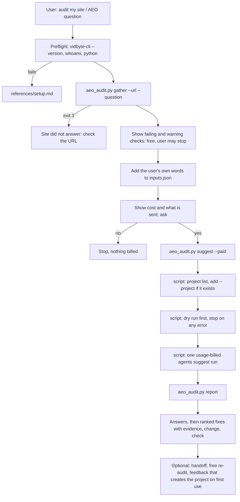

# improve-my-aeo v2: a minimal skill file, SEO foundations, and every bot

## Summary

Three changes to the unmerged `improve-my-aeo` skill (draft PR #32):

1. **A minimal `SKILL.md`.** The first version was 36 KB, the size of its siblings, and most of
   it taught the agent mechanics the script can do itself: the free dry run, finding the learning
   project, building the command line. The script now does those, and `SKILL.md` keeps only what
   an agent must decide or say: which site and questions, what to show before asking for money,
   the consent question, and how to present the fixes. Every section the public skill contract
   requires stays, in order, cut to the minimum. Target: under 10 KB.
2. **SEO foundations in the checklist.** The checklist covered how machines read a site, but
   not the search method that decides which pages exist and which queries they target. A new
   `SEO` family (SEO-01 to SEO-22) adds every item from the eight public SKILL.md files of a
   WordPress SEO agent studied on 2026-10-25 (project setup, keyword research, clustering,
   competitive landscape, competitor analysis, link prospecting, keyword page rewrites, coaching)
   and from its 8-item pre-publish checklist. Google's own guide says AEO for Google is SEO, so
   the family belongs here.
3. **Every bot, not 11.** The audit adopts the 66-entry, source-checked bot registry from
   vidbyte.pro (vidbyte PR #829): search, training, user, agent, preview, ads, other, infra, and
   catch-all bots. It fetches the home page as every fetchable bot and evaluates robots.txt for
   every token. Two new checks, ACC-17 (robots.txt lets every bot type in) and ACC-18 (the
   firewall lets every bot type in), and ACC-04 now treats a training block as a finding: the
   owner wants every type of bot allowed.

## Flow chart



## Usage example

```bash
python3 "<skill>/scripts/aeo_audit.py" gather --url https://acme.com --question "Why does ChatGPT quote our old price?"
# read <out_dir>/audit.md, show the failing checks, add the user's words to inputs.json, ask for a yes
python3 "<skill>/scripts/aeo_audit.py" suggest --out "<out_dir>" --paid
python3 "<skill>/scripts/aeo_audit.py" report --out "<out_dir>"
python3 "<skill>/scripts/aeo_audit.py" feedback --out "<out_dir>" --idea idea-002 --accept
```

## How it works

**Script takes over mechanics.**
- `suggest --paid` first runs `vidbyte-cli --json agents suggest project list`, and adds
  `--project improve-my-aeo` when that project exists and `inputs.json` does not name one.
- It then runs the same command with `--dry-run`, which is free, and stops before any charge if
  that fails.
- `suggest --dry-run` stays for a free check on its own.
- `feedback` creates the `improve-my-aeo` project with `agents suggest project create` when none
  exists, because an explicit accept or reject is the user asking to be remembered.

**Bot registry.**
- `scripts/aeokit/bots.json` is a copy of vidbyte's `next-app/seo/bot-registry.js`, exported at
  commit 2b89510e9. It carries name, operator, category, robots token, UA token, user agent, the
  robots-only flag, the ignores-wildcard flag, the IP ranges URL, sources, and the checked date.
- `probe.py` sends one home-page GET per fetchable bot, which replaces the 11 hard-coded probes.
  Bots without a documented user agent send `Mozilla/5.0 (compatible; <token>)`, as vidbyte's
  checker does.
- The robots.txt tokens come from the registry.
- Checks:
  - ACC-05 stays the severity-3 check on the AI and search core (GPTBot, OAI-SearchBot,
    ChatGPT-User, ClaudeBot, Claude-SearchBot, Claude-User, PerplexityBot, Perplexity-User,
    Bingbot, Googlebot, Applebot).
  - ACC-18 reports every other bot by category.
  - ACC-17 evaluates robots.txt for the categories ACC-02 to ACC-04 do not cover. Bots that obey
    only a group naming them (AdsBot-Google and similar) count as allowed unless a group names
    them.
  - Severity by category: search, user, and agent blocks fail; preview, ads, other, training, and
    catch-all blocks warn; infra bots are information unless the site is behind Cloudflare.

**Checklist and rubric.**
- `aeo-checklist.md` gains:
  - ACC-17 and ACC-18;
  - a rewritten ACC-04;
  - the `SEO` family;
  - a bot registry table (name, operator, category, robots token).
- `aeo-rubric.md` gains one explanation line per new id and the rule to label each claim's data
  source (the user's Search Console, third-party SEO data, the audit, or judgment). It stays under
  the CLI's 20,000-byte instructions limit.

### Conqueror coverage map

Every item from the eight files and the pre-publish checklist, and where it lands.

| Source item | Checklist id |
|---|---|
| Project setup: working folder, site scope (domains, markets, stage, CMS) | SEO-01 |
| Project setup: goals with metrics and timeframe | SEO-02 |
| Project setup: positioning (audience, pain, why chosen, substitutes, fit, no-go topics) | SEO-03 |
| Project setup: Search Console connected or 3- and 16-month exports, query+page | SEO-04 |
| Project setup: asset inventory, linkable assets | SEO-05 |
| Project setup and coach: recommend one next workflow | rubric (one next step) |
| Keyword research: striking-distance queries (average position 5-20) first | SEO-06 |
| Keyword research: volume, difficulty, intent, CPC, trend; unknown stays unknown; business fit over volume; drop off-intent and branded-only | SEO-07 |
| Keyword research: SERP check when intent is ambiguous | SEO-08 |
| Keyword research, landscape, competitor, links: local pack, Maps, Business Profile questions | SEO-09 |
| Keyword research and clustering: save with tags only after confirmation | SEO-01 (project file), rubric |
| Clustering: by SERP overlap and intent, not wording; existing, new, or do-not-target | SEO-10 |
| Clustering: page brief (type, problem, sections, internal links) | SEO-11 |
| Clustering: cannibalization from Search Console query+page | SEO-12 |
| Landscape: mixed-intent query set; recurring domains by type; SEO vs business competitors; formats and SERP features | SEO-13 |
| Landscape and competitor: domain footprint and backlink strength | SEO-14 |
| Competitor analysis: keyword themes, head-to-head SERPs, vulnerabilities, do not copy | SEO-15 |
| Link prospecting: a linkable asset and the reason to cite it | SEO-16 |
| Link prospecting: query patterns, prospect filters, outreach angles, flag paid placements | SEO-17 |
| Link prospecting: real, sourced contacts; no invented emails; no mass outreach | SEO-18 |
| Keyword rewrite: best-matching page; title, description, headings, gaps for the keyword | SEO-19 |
| Keyword rewrite: keep voice, links, images, CMS blocks and shortcodes; invent nothing | SEO-20 |
| Keyword rewrite and blog: proposals reviewed as a diff, rollback, autonomy level | SEO-22 |
| Pre-publish: facts verified, reachable keyword, no same-intent page, answer first, original, copy-quality title, real internal links, worth publishing | SEO-21 |
| Coach: label live SEO data, first-party data, web evidence, local files, judgment | rubric (data sources) |

The public files never name the source product: the skill contract forbids comparisons with
other products. This map is the only place it is named.

## Files

- `skills/improve-my-aeo/SKILL.md`: rewritten. The description changes its counts, so the
  vidbyte listing (PR #831) copies it again.
- `skills/improve-my-aeo/scripts/aeo_audit.py`: suggest runs the project lookup and the dry run;
  feedback creates the project.
- `skills/improve-my-aeo/scripts/aeokit/bots.json`: new.
- `skills/improve-my-aeo/scripts/aeokit/probe.py`, `checks.py`, `digest.py`: the registry sweep,
  ACC-04, ACC-17, and ACC-18.
- `skills/improve-my-aeo/references/aeo-checklist.md`, `aeo-rubric.md`: new items and lines.
- `scripts/test-improve-my-aeo.py`: tests for the above.
- `docs/design/improve-my-aeo-v2.md`: this file.

## Risks and open questions

- **Longer audit.** About 63 extra home-page requests at 0.25 s apart add 20 to 40 seconds.
- **Larger checklist.** Every model call reads the checklist; most of it is cached after the
  first call. The cost cap does not change.
- **Training blocks are now warnings.** A site owner who blocks training on purpose sees a
  warning; their `--constraint` keeps the run from recommending a change.
- **Registry ages.** It was checked on 2026-10-21 and 2026-10-25. Re-check it quarterly, the
  same as vidbyte's copy.

## Verification

- `python scripts/test-improve-my-aeo.py` passes 100% on Python 3.8 and 3.13, with new tests for:
  - the registry sweep;
  - ACC-04, ACC-17, and ACC-18 on fixtures that block and allow;
  - the auto project lookup, the dry run before the paid run, and project creation on first
    feedback, all through the fake CLI;
  - every checklist id having a rubric line;
  - SEO-01 to SEO-22 existing.
- `ruff check` is clean.
- `SKILL.md` is under 10 KB and has every contract section in order.
- A live `gather` against vidbyte.pro (every bot answered 200 on 2026-10-25) and
  conquerorapp.com (Applebot 403).
- A free dry run through the real CLI.
