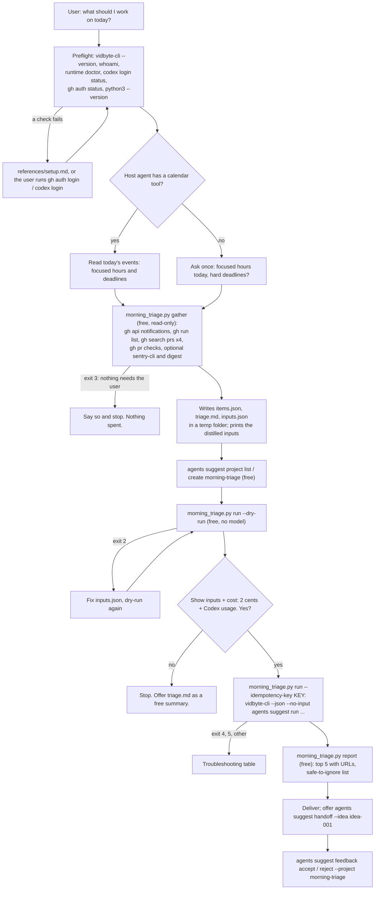

# morning-triage

## Summary

Add the public agent skill `skills/morning-triage/`. A developer or founder starts the day with
unread GitHub notifications, red CI on the default branch, pull requests waiting for their review,
their own pull requests with failing checks or requested changes, maybe new production errors, and
a day cut up by meetings. They spend the first hour deciding what to do. The skill turns that
first hour into a few minutes: a free, bundled Python script collects the signals with the GitHub
CLI (`gh`), and optionally `sentry-cli` and a session digest, distills them into the Suggestion
Agent's typed inputs, and, after the user's yes, one `vidbyte-cli agents suggest run` (2 cents
plus the user's own Codex usage) returns today's top five in order. The skill delivers each item
with its first action and the URL it came from, then a short "safe to ignore today" list, and
records the user's accepts and rejects in a suggestion project so tomorrow's ranking learns from
today.

The slug is `morning-triage`, the user's own name for it. It names the situation the user is in
("my morning triage") rather than the agent, which is what contract section 2 asks. `plan-my-day`
was considered; it is broader than what the skill does (it does not schedule the day, it ranks
the incoming work), so `morning-triage` is the more exact problem name. No skill on any branch of
cerredz/vidbyte-cli uses it.

## Flow chart



## Usage example

```bash
npx skills add cerredz/vidbyte-cli --skill morning-triage
```

Then, in the coding agent, from inside the repository the user works in most:

```text
> what should I work on today?
```

The agent runs the preflight, asks "How many focused hours do you have today, and are there any
hard deadlines?", and, on "about 4 hours, the release notes are due at 3pm", runs:

```bash
python3 <skill>/scripts/morning_triage.py gather --focus-hours 4 --deadline "Release notes due at 3pm"
```

The script prints the counts, every distilled value, and `OUT_DIR=<temp folder>`. The agent makes
sure the `morning-triage` suggestion project exists, dry-runs the exact command for free, shows
the inputs, and asks for a yes for 2 cents plus Codex usage. After the yes:

```bash
python3 <skill>/scripts/morning_triage.py run --out-dir "<OUT_DIR>" --idempotency-key "morning-triage:20261012:7f3a9c"
python3 <skill>/scripts/morning_triage.py report --out-dir "<OUT_DIR>"
```

`run` executes, with every value passed as its own argument (no shell quoting):

```bash
vidbyte-cli --json --no-input agents suggest run \
  --goal "Pick the five things this developer should work on today, in order, ..." \
  --project morning-triage \
  --horizon now \
  --category prioritization --category immediate_next_steps \
  --category quick_wins --category stop_or_defer \
  --count 5 \
  --blockers "[R1] CI is red on main in acme/api: ..." \
  --blockers "[V1] acme/web#311 Add rate limit headers by @dana has waited 2 days for your review ..." \
  --in-progress "[P1] Your PR acme/api#298 Retry webhook delivery: checks failing (lint) ..." \
  --constraint "4 focused hours today. Hard deadlines: Release notes due at 3pm." \
  --context "Snapshot of the last 16 hours: 23 unread notifications ..." \
  --files "<OUT_DIR>/triage.md" \
  --idempotency-key "morning-triage:20261012:7f3a9c" > "<OUT_DIR>/result.json"
```

## How it works

- **One Python script, three subcommands.** `scripts/morning_triage.py` uses only the Python
  standard library and calls `gh`, `sentry-cli`, and `vidbyte-cli` through `subprocess` with
  argument lists, never a shell. Python is used instead of bash because `vidbyte-cli` already
  needs Python 3.11+, so Python is present wherever the skill runs, and because the values carry
  PR titles with quotes, `$`, and backticks that break bash, PowerShell, and `cmd.exe` quoting in
  different ways. Passing argv directly removes every quoting problem on every OS. The contract
  does not require `.sh` scripts; github-issue-tasks used bash because the Task Board starts its
  hook through a shell. The script runs on Python 3.8+ so an older system Python also works.
  - `gather` (free, read-only on GitHub) collects, classifies, redacts, and writes
    `items.json`, `triage.md`, and `inputs.json` into a new temp folder outside the repository,
    then prints the distilled inputs and `OUT_DIR=<path>`.
  - `run` reads `inputs.json` and runs the one `vidbyte-cli agents suggest run` command, either
    with `--dry-run` (writes `dry-run.json`) or with `--idempotency-key` (writes `result.json`).
    The agent can edit `inputs.json` between the two if the user wants an item dropped or added.
  - `report` (free, offline) maps each returned idea back to the items it cites and prints the
    top five with URLs and the "safe to ignore today" list.
- **Gather.** Every call is a read; none marks a notification read or writes to GitHub. The
  script first checks the login with `gh api user --jq .login`, which works on every `gh` version
  (newer `gh auth status` exits 1 when any stored account is broken), and never prints the login.
  - Notifications: `gh api --method GET notifications -f since=<cutoff> -f per_page=50 -f page=N`,
    pages 1 to 4 (at most 200). `since` is GitHub's ISO 8601 "last updated after" parameter; with
    the default `all=false` only unread threads come back. The cutoff defaults to 16 hours
    (`--since-hours`; 64 covers a weekend). Each `reason` maps to a priority: `mention`,
    `team_mention`, `assign`, `review_requested`, `security_alert`, `approval_requested` are high;
    `subscribed`, `state_change` (the user's own action), `security_advisory_credit`, and
    `member_feature_requested` are low ("safe to ignore"); the rest are normal. A CheckSuite
    notification is normal only when its title says the run failed. Notifications for a PR already
    listed as a review request or as the user's own PR are folded into that item.
  - CI: for each `--repo` (default: the current repository from `gh repo view`), read the default
    branch with `gh repo view <repo> --json defaultBranchRef`, then
    `gh run list --repo <repo> --branch <default> --limit 100 --json ...`. A workflow is red when
    its newest completed run concluded `failure`, `timed_out`, or `startup_failure`. This differs
    from the literal `--status failure` filter on purpose: that filter also returns failures a
    later green run already fixed, which would rank stale noise as a blocker.
  - Review queue: `gh search prs --review-requested=@me --state=open --archived=false`.
  - The user's own PRs: `gh search prs --author=@me --state=open --archived=false`, plus the same
    search with `--checks=failure`, `--review=changes_requested`, and `--review=approved` to label
    each PR. For up to five failing PRs, `gh pr checks <url> --json name,bucket,link` names the
    failing checks, so the first action can be concrete ("fix the lint job"). A PR nobody updated
    for 30 days is marked low priority and left out of the flags, even with red checks: it is not
    today's work, and users with dozens of open PRs would otherwise drown the ranking.
  - Optional sources: Sentry, when `sentry-cli` is on `PATH` and an org and a project are known
    (from `--sentry-org`/`--sentry-project` or `sentry-cli info --config-status-json`):
    `sentry-cli issues list --org <org> --project <project> --query "is:unresolved firstSeen:-<N>h" --max-rows 20`,
    parsed from its table output. The calendar comes from the host agent's own calendar tool or
    MCP server, if it has one; otherwise the skill asks one question. A digest file from the
    sibling session-digest skill, or any text file the user names, is passed with `--digest`.
- **Distill.** The mapping follows the `agents suggest run` help text for each flag:
  - `--blockers`: red CI on the default branch, then PRs waiting for the user's review (other
    people are blocked on the user). At most 10 values.
  - `--in-progress`: the user's own open PRs and their state (failing checks, changes requested,
    approved, waiting), failing and changes-requested first. At most 8 values.
  - `--constraint`: `<N> focused hours today. Hard deadlines: <...>.`
  - `--context`: one snapshot value with the counts, then the high-priority notifications and new
    Sentry issues. At most 8 values.
  - `--files <OUT_DIR>/triage.md`: the full list, grouped, with every URL. `--files` and not
    `--attach`: a `--files` file becomes a citable `ctx-NNN` evidence item, and the run's evidence
    gate withholds ideas that cite anything else; `--attach` only adds the file to the agent's
    turn, so an idea grounded in it cannot cite it. The digest is copied into `OUT_DIR` as a
    redacted `.md` file because `--files` accepts only `.txt`, `.md`, and `.json`.
  - Every value starts with a tag (`[R1]`, `[V2]`, `[P1]`, `[N3]`, `[E1]`) and ends with its URL,
    so `report` can map an idea's `handoff.evidence` back to items. Values are one line, at most
    400 characters, and the total argv stays far below the Windows limit of 32,767 characters.
    The CLI's own limits are generous (goal 4,096 characters; context 5,000,000 characters in
    total, per item and for files; `--attach` 50 files, 1 MB each, 8 MB in total), so the
    practical limit is model tokens: `triage.md` is capped at 60,000 characters and each digest at
    100,000.
  - Redaction: GitHub, Vidbyte, OpenAI, Slack, AWS, and Sentry token shapes, JWTs, private key
    blocks, `password=`/`token=`/`secret=` values, and email addresses are replaced with
    `[redacted]` in every value, in `triage.md`, and in the digest copy.
- **Run.** `--horizon now` keeps only ideas for today; `--category prioritization` (make the trade
  explicit and name what falls below the line), `immediate_next_steps` (a move startable from the
  current state), `quick_wins` (approve, merge, rerun: small, concrete payoffs), and
  `stop_or_defer` (what can wait, with a restart trigger); `--count 5`, one 2-cent block;
  `--project morning-triage` loads yesterday's accepts and rejects. `bottleneck` was left out:
  prioritization already weighs what blocks others, and the blockers are named explicitly.
- **Deliver.** `report` lists the top five with `first_action` and source URLs, and the "safe to
  ignore today" list from low-priority items plus anything a `stop_or_defer` idea defers. The
  skill offers `agents suggest handoff --idea idea-001` for the first item and records explicit
  accepts and rejects with `agents suggest feedback accept|reject --project morning-triage`.

## Files

| File | Change |
|---|---|
| `skills/morning-triage/SKILL.md` | New. The skill, in contract section 4's order. |
| `skills/morning-triage/scripts/morning_triage.py` | New. `gather`, `run`, and `report`; stdlib only. |
| `skills/morning-triage/references/setup.md` | New. Byte-for-byte copy of the canonical file. |
| `skills/morning-triage/references/troubleshooting.md` | New. Byte-for-byte copy of the canonical file. |
| `docs/design/morning-triage.md` | New. This document. |

No other file changes. There is no `AGENTS.md` and no CI workflow in this repository, so the gate
is local.

## CLI surface and min-cli-version

Every command and option the skill uses is in `contracts/cli-commands.json` on the internal
repository's `main`: `agents suggest run` (`--goal`, `--project`, `--horizon`, `--category`,
`--count`, `--blockers`, `--in-progress`, `--constraint`, `--context`, `--files`, `--dry-run`,
`--idempotency-key`), `agents suggest handoff` (`--input`, `--idea`), `agents suggest feedback
accept|reject` (`--project`, `--suggestion`, `--reason`), `agents suggest project list`,
`agents suggest project create` (`--key`, `--title`, `--description`), `whoami`, and
`runtime doctor`. The four category ids exist in `services/suggestions/categories.py`.

PyPI's newest release is 0.2.0. Its `agents suggest run` has every option above except
`--idempotency-key`, and it predates the paid admission. Contract rule 5 requires one idempotency
key per priced run, and on `main` the run is priced, so `min-cli-version` is `0.3.0`, the next
release, and the skill is not published until 0.3.0 is on PyPI. The price, 2 cents per block of up
to ten requested suggestions, is the backend catalog entry `runtime.suggestion@1` and the CLI's
`--count` help.

## Risks and open questions

- **Unreleased CLI.** The skill needs 0.3.0 for `--idempotency-key`; it must wait for that release.
- **Horizon filter.** `--horizon now` drops ideas the generator labels `next` or `later`, so a run
  can return fewer than five. That is the intended trade: today's list must be about today.
- **Search lag and limits.** `gh search prs` reads GitHub's search index, which can lag a few
  minutes, and returns at most 50 PRs per query. The notifications API accepts classic tokens only;
  a fine-grained token gets a 403, and the script reports that source as unavailable and continues.
- **Sentry parsing.** `sentry-cli issues list` prints a table, not JSON. The parser reads the
  `| ... |` rows of sentry-cli's fixed six-column table and falls back to the raw text. It was
  tested on a synthetic table, not a live Sentry account.
- **Calendar.** Depends on the host agent's own tool; there is no portable calendar CLI.
- **Sibling skill.** The digest comes from a sibling skill built in parallel; this skill accepts
  any text file and does not depend on its format.
- No paid end-to-end run was made, because it spends real money.

## Verification

1. Every `vidbyte-cli` command path and option in `SKILL.md` and the script checked against
   `contracts/cli-commands.json` on the internal `main`, and against the 0.2.0 wheel from PyPI
   (all present except `--idempotency-key`).
2. `gather` run against a real GitHub account (read-only calls only); output kept out of the repo.
3. `run --dry-run` fed with that real output, executed by a `vidbyte-cli` built from the internal
   `main` with its state folders pointed at a scratch directory: exit 0, `stop_reason` `dry_run`,
   every manifest entry `included`, `admission` null.
4. `report` checked against a synthetic `result.json`; the Sentry parser checked against a
   synthetic table.
5. `cmp` of both `references/` files against the canonical copies; `git diff` checked for leaked
   names, URLs, paths, or tokens before every commit.
