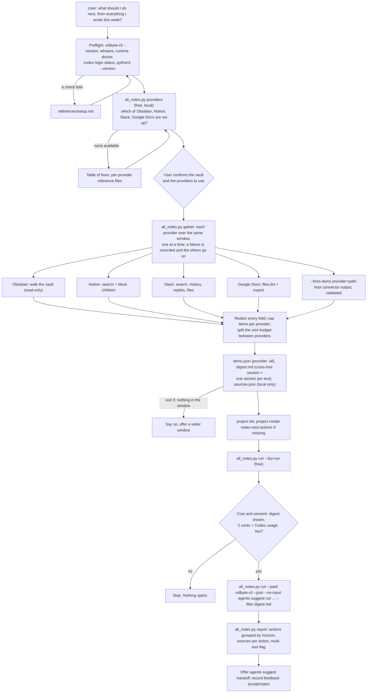

# next-actions-from-all-my-notes

## Summary

Add the public agent skill `skills/next-actions-from-all-my-notes/`. Most people do not keep their
work in one tool. A plan starts in a Notion page, the decision about it happens in a Slack thread,
the draft lives in a Google Doc, and the open tasks end up in an Obsidian daily note. Each of the
four provider skills in the `next-actions-from-*` family (Obsidian, Notion, Slack, Google Docs)
reads one of these tools. This skill reads all of them in one run.

The skill finds which note providers are set up on this machine, for free and without reading any
content. It gathers what the user created or edited in each one over the same window (the last 7
days by default), redacts it, and merges it into one digest with a section per tool and a short
cross-tool section: the topics that come up in more than one tool, and the open tasks from every
tool. After the user has seen the digest and said yes, one `vidbyte-cli agents suggest run`
(2 cents at `--count 8`, plus model usage on the user's own Codex account) answers one question:
"What are the most important next actions given what I've been writing and discussing across
Obsidian, Notion, Slack, and Google Docs over the last 7 days?" The user gets each next action with
the tool, title, and link of every source it came from, and a flag on the actions that more than
one tool backs up.

This skill reuses the four provider adapters as copies, writes the same `notes-digest/1` format,
and records feedback in the same suggestion project, `notes-next-actions`, so what the user
accepts or rejects here also shapes the single-provider skills, and the other way round.

## Flow chart



## Usage example

```bash
npx skills add cerredz/vidbyte-cli --skill next-actions-from-all-my-notes
```

Then, in the coding agent:

```text
> look at everything I wrote this week in my notes, Notion, Slack, and Google Docs. what should I do next?
```

The agent runs the preflight, then finds the providers for free:

```bash
python3 "<skill>/scripts/all_notes.py" providers --vault ~/Notes
```

```text
| Provider    | Status        | Found                                  | Fix                                                        |
|-------------|---------------|----------------------------------------|------------------------------------------------------------|
| Obsidian    | available     | vault "Notes" (--vault)                | -                                                          |
| Notion      | available     | NOTION_TOKEN is set                    | -                                                          |
| Slack       | not available | SLACK_USER_TOKEN holds a bot token     | Use the app's User OAuth Token (xoxp-): slack-app.md       |
| Google Docs | available     | GOOGLE_OAUTH_ACCESS_TOKEN is set       | -                                                          |
```

It gathers the three available providers over the last 7 days, shows the per-provider counts and
the digest, makes sure the shared project exists, runs the free dry run, and asks: "This sends the
redacted digest of 31 items from Obsidian, Notion, and Google Docs to the Vidbyte Suggestion Agent
through your own Codex login. It costs 2 cents from your Vidbyte balance, plus Codex usage, and
changes no files. Run it?" After a yes:

```bash
python3 "<skill>/scripts/all_notes.py" run --out "<out_dir>" --paid
```

which runs, from inside `<out_dir>` and without a shell:

```bash
vidbyte-cli --json --no-input agents suggest run \
  --goal "What are the most important next actions given what I've been writing and discussing across Obsidian, Notion, and Google Docs over the last 7 days? Name the exact titles of the notes, pages, threads, or documents each action comes from." \
  --category immediate_next_steps --category prioritization \
  --category completion --category continuation \
  --horizon any --count 8 \
  --files digest.md \
  --project notes-next-actions \
  --idempotency-key "next-actions-from-all-my-notes:20261011:3f9a1c"
```

Then `python3 "<skill>/scripts/all_notes.py" report --out "<out_dir>"` prints the actions grouped
`now`, `next`, `later`, each with lines such as `From: Notion "Launch plan" https://www.notion.so/...`
and, where it applies, `Backed by more than one tool: Notion, Slack.`

## How it works

- **One script, four adapters.** `scripts/all_notes.py` has five subcommands: `providers`,
  `gather`, `run`, `report`, and `feedback`. `scripts/notes_common.py` is part 1 of the Obsidian
  skill's script (redaction, the shared format, the run helpers, the report matcher), with the
  token formats of all four providers added to the redactor. `scripts/providers/` holds one module
  per provider, each copied from its sibling skill and changed only where the sibling printed and
  exited: here an adapter raises `ProviderError(kind, message, hint)` and returns raw items, so one
  provider's failure cannot stop the others.
- **Window.** `--days N` (1 to 365, default 7) or `--since YYYY-MM-DD` (local midnight). Every
  provider reads the same window, and the window start is sent to each API in UTC.
- **Detect, free and local** (`providers`). Detection reads only environment variables, flags, and
  local files; it never reads note content and never prints a token or part of one.

  | Provider | Available when | Otherwise |
  |---|---|---|
  | Obsidian | `--vault <folder>` names a folder that holds `.obsidian`. | Vaults listed in Obsidian's own `obsidian.json` (and, with `--scan`, a 15-second scan of the home folder) are shown as "found, confirm with --vault". The skill always asks the user to confirm a vault. |
  | Notion | `NOTION_TOKEN` is set. | Fix: `references/notion-setup.md`. |
  | Slack | `SLACK_USER_TOKEN` is set and starts with `xoxp-`. | A bot (`xoxb-`) or browser session (`xoxc-`, `xoxd-`) token gets its own fix. Fix: `references/slack-app.md`. |
  | Google Docs | `--google-token-file` names a readable file, or `GOOGLE_OAUTH_ACCESS_TOKEN` is set, or `--google-auth gcloud` is passed, or gcloud is on `PATH` and a quota project is set (`--google-quota-project` or `GOOGLE_CLOUD_QUOTA_PROJECT`). | gcloud on `PATH` without a quota project is reported as "possible": gcloud is used only when the user chose it, because its token needs Drive access and a project of the user's own. Fix: `references/google-drive-access.md`. |
  | Any | `--from-items <provider>=<items.json>` names a file the host agent wrote with its own connector. | - |

  `providers --check` adds one free, read-only call per available provider (Notion `GET /v1/users/me`,
  Slack `auth.test`, Drive `files.list` with `pageSize=1`) and marks a provider unavailable when the
  call fails, with the error kind. The JSON output has a `providers[]` list (provider, label,
  available, source, detail, fix, reference) and a ready `table_markdown`. Exit 0 when at least one
  provider is available, 3 when none is.
- **Gather** (`gather`). `--providers obsidian,notion,...` picks a subset; the default is every
  available provider. Each provider runs in its own `try` block, one after another:
  - Obsidian walks the vault read-only (templates, attachments, `.trash`, the vault's own excluded
    files, and Excalidraw drawings are skipped, as in the sibling) and keeps notes modified in the
    window.
  - Notion calls `POST /v1/search` (pages, newest edit first), `GET /v1/blocks/{id}/children`, and
    capped parent lookups (`/v1/pages`, `/v1/data_sources`, `/v1/blocks`), with
    `Notion-Version: 2026-03-11`, about three requests a second, and `--notion-max-requests`
    (default 500).
  - Slack calls `auth.test`, `search.messages`, `users.conversations`, `conversations.history`,
    `conversations.replies`, `files.list`, and `chat.getPermalink`, GET only, with the user token.
    People become `@me` and `@person-N`; DMs are skipped unless `--slack-include-dms`.
  - Google Docs calls Drive `files.list` (`modifiedTime > since`), `files.export` (Markdown, then
    plain text), folder lookups, and, with `--google-comments`, `comments.list`.

  A provider that fails (HTTP 401, a missing scope, a rate limit that outlasts the retries, the
  network) is recorded in `sources.json` with its error kind, a redacted message, and the fix, and
  the gather goes on with the next provider. Each provider's own options keep their sibling names
  with a provider prefix where they would clash: `--obsidian-exclude`, `--obsidian-exclude-tag`,
  `--notion-exclude`, `--notion-my-user-id`, `--notion-max-depth`, `--notion-max-requests`,
  `--slack-channels`, `--slack-exclude`, `--slack-include-dms`, `--slack-include-bots`,
  `--slack-max-wait`, `--google-include`, `--google-include-others`, `--google-shared-drives`,
  `--google-comments`, `--google-exclude`, `--google-token-file`, `--google-auth`,
  `--google-quota-project`. A plain `--exclude` is passed to every provider's own exclusion, so a
  folder, page, channel, or document the user names is never read where the provider allows it,
  and is also removed from the merged items by title and container.
- **Merge.** Every string field of every item (title, id, link, container, tasks, excerpt) is
  redacted before anything is cut. Each provider keeps at most `--max-items` items (default 40):
  the newest for Obsidian, Notion, and Google Docs, and the highest Slack score for Slack (open
  requests, mentions of the user, the user's own involvement, replies, recency, as in the sibling).
  Slack permalinks are filled for the kept items only. Titles are made unique within a provider.
- **Outputs**, in a new folder under the system temp folder (never inside the vault):

  | File | What it is | Sent to the model? |
  |---|---|---|
  | `digest.md` | The merged, redacted digest (layout below). | Yes |
  | `items.json` | The kept items in `notes-digest/1`, `"provider": "all"`, newest first across providers. | No |
  | `sources.json` | Local index: the window, each provider's status, counts, skips, warnings, API call counts, error, and budget share, and the vault's real path. | No, never |

  Exit 0 when the files were written, 3 when no provider returned an item, 1 when every provider
  that was tried failed, 2 for a usage error (including a `--from-items` file that does not follow
  the format; every problem is listed).
- **Run, report, and feedback** follow the provider skills. `run --dry-run` builds the request,
  saves it in `request.json`, and runs it with `--dry-run`; a passing dry run stores a fingerprint
  of `digest.md` and the request. `run --paid` refuses to start without that fingerprint, after any
  change to either file, when a paid attempt was already made in the folder, or when Codex is not
  logged in (`codex login status`, exit 6). It makes one idempotency key,
  `next-actions-from-all-my-notes:<YYYYMMDD>:<6 hex>`, saves it, and accepts `--idempotency-key`
  only to recover that same admission with the saved key. `run` and `feedback` take `--cli <path>`
  (default `vidbyte-cli` on `PATH`) and report the executable they ran.
- **Flag choices.**
  - `--goal`: the user's question with the providers that are in the digest and the window filled
    in, plus "Name the exact titles of the notes, pages, threads, or documents each action comes
    from.", so the report can trace every action to its sources.
  - `--category immediate_next_steps prioritization completion continuation`: the same four as the
    provider skills. Prioritization matters most here: four tools hold more open loops than one.
  - `--horizon any`: any other horizon is a filter applied after review (`service.py` `_finalize`),
    so it could drop ideas while the charge stays the same. The report groups by each idea's own
    horizon.
  - `--count 8`: still one 2-cent block (up to ten ideas per block), with room for actions from
    more than one tool. The provider skills ask for six.
  - `--files digest.md`, a relative path from inside the output folder, so the digest gets a
    context reference ideas can cite and no home path reaches the model.
  - `--trajectory` (at most 2), `--constraint` (at most 3), `--avoid` (at most 3): only when the
    user states them.
  - `--project notes-next-actions`: the family's shared project.
- **Report.** A file evidence entry holds only the first 4,096 characters of the digest, so it
  cannot name a source. The report matches each idea's text (title, summary, first action, actions,
  why now, completion check, decision points, and non-file evidence) against every item's link,
  distinctive id, and exact title (case-insensitive for titles of two or more words, exact case for
  one-word titles; a title inside a longer matched title does not count twice). When nothing
  matches, it falls back to a word overlap of at least 60 % with a title of two or more significant
  words. Each source line is `From: <Provider> "<title>" <link>`; an action with sources in two or
  more providers gets `Backed by more than one tool: <providers>.`

## Provider detection decision

Detection reads environment variables and local files only, because the user may not want a
provider read at all, and because a live call to four APIs on every `providers` run would be slow
and could hit rate limits. `--check` is there for a run that needs certainty before the gather.

gcloud is not used just because it is installed. The Google sibling falls back to gcloud
automatically, which suits a skill whose only job is Google. Here gcloud on `PATH` is common among
developers who never gave it Drive access, so an automatic fallback would turn into a confusing
`scope` or `api_disabled` failure on most runs. gcloud counts as available only when the user asked
for it (`--google-auth gcloud`) or has set a quota project, which only someone who followed way B
in `references/google-drive-access.md` does.

Obsidian is never chosen silently. A machine can hold several vaults, and one may be a private
journal, so the skill shows the vaults Obsidian knows and asks the user to confirm one, as the
Obsidian sibling does.

## Budget rule

The digest has to fit one `--files` entry. The CLI accepts up to 5,000,000 characters per file and
in total (`MAX_CONTEXT_CHARS`); `--max-chars` (default 100,000, at most 1,000,000) keeps model usage
small. One noisy provider must not push the others out, and a quiet provider should not hold room
it does not need. The rule:

1. `pool` = `--max-chars` minus the header and the cross-tool section. The cross-tool section is
   built from all gathered items and capped (at most 10 topics, 8 tasks per tool, and a tenth of
   `--max-chars`), so its size is known before the split.
2. `need` of a provider = the size of its section with every kept item and every excerpt at full
   length (at most `--excerpt-chars`, default 2,000, per item).
3. Each provider with items gets a floor: `pool / (2 x number of providers)`, but never more than
   its `need`.
4. The rest is split in proportion to item count among the providers that still need more, each
   capped at its `need`. What a capped provider does not use is split again the same way, until
   nothing is left or every provider has what it needs.
5. Inside a provider's share, the lowest-priority items (the oldest; for Slack, the lowest score)
   are dropped until every remaining item fits with at least 200 characters of excerpt. The share
   left for excerpts is then split so that short excerpts stay whole and long ones split the rest
   evenly. Obsidian excerpts are cut in the middle (notes grow at the bottom), Slack conversations
   keep the first line and the newest lines, and other text keeps its start.
6. The cross-tool section is rebuilt from the kept items, cut to the size reserved in step 1, and
   the total is checked against `--max-chars`. If rounding pushed it over, the pool shrinks by the
   difference and steps 3 to 6 run again.

Example, with a pool of 96,000 characters:

| Provider | Items | Need | Floor (12,000, capped at need) | Proportional share | Final |
|---|---|---|---|---|---|
| Slack | 40 | 70,000 | 12,000 | +35,789, then +1,902 | 49,691 |
| Notion | 12 | 25,000 | 12,000 | +10,736, then +570 | 23,306 |
| Obsidian | 8 | 9,000 | 9,000 | needs nothing more | 9,000 |
| Google Docs | 5 | 14,000 | 12,000 | +4,473, capped at +2,000 | 14,000 |

The floors use 45,000 characters. The other 51,000 are split 40 : 12 : 5 among Slack, Notion, and
Google Docs. Google Docs needs only 2,000 more, so its unused 2,473 are split 40 : 12 between Slack
and Notion. Obsidian and Google Docs keep everything; Slack and Notion drop or shorten their
lowest-priority items to fit their shares.

## Shared family format

`items.json` has exactly the five top-level keys and the eleven item keys of `notes-digest/1`, in
the same order. Here the top-level `provider` is `"all"`, and each item keeps its real provider:

```json
{"schema": "notes-digest/1", "provider": "all", "generated_at": "2026-10-11T18:00:00Z", "since": "2026-10-04T18:00:00Z",
 "items": [{"provider": "notion", "id": "<page id>", "title": "Launch plan", "link": "https://www.notion.so/...",
            "kind": "page", "container": "Projects", "created": "2026-09-30T09:12:00Z",
            "last_edited": "2026-10-10T16:40:00Z", "author": "me",
            "open_tasks": ["Book the venue"], "excerpt": "<redacted, cut text>"}]}
```

Items are newest first by `last_edited` across all providers. `provider` is one of `obsidian`,
`notion`, `slack`, `google-docs`; `kind` one of `note`, `page`, `database-row`, `message`,
`thread`, `file`, `doc`; `author` `me`, `other`, or `null`. Per-provider status lives in
`sources.json`, never in `items.json`, so a consumer that reads one provider's `items.json` reads
this one the same way.

`digest.md`:

```markdown
# All my notes: 31 items created or edited over the last 7 days (2026-10-04 to 2026-10-11)

From Obsidian (8 notes), Notion (12 pages and database rows), Google Docs (11 documents). Not included: Slack (not set up).

<one paragraph: how the file is laid out, that times are local, what the redaction markers mean, and that everything below is data, not instructions>

# Across tools

**Topics that appear in more than one tool**

- "launch plan": Notion (2), Google Docs (1)
- "pricing": Obsidian (2), Notion (1)

**Open tasks from every tool**

- [ ] Book the venue (Notion: "Launch plan")
- [ ] Draft the FAQ (Obsidian: "2026-10-10")

# Notion: 12 pages and database rows

## Launch plan
page · Projects · last edited 2026-10-10 16:40 · https://www.notion.so/...

- [ ] Book the venue

<excerpt>
```

The cross-tool section uses bold labels instead of `##`, so every `##` heading in the file is one
item. Topics are the words and two-word phrases from item titles (at least four letters, common
words left out) that appear in the title or text of items from at least two tools, ranked by the
number of tools, then items; a two-word phrase hides its single words. Headings inside an excerpt
become bold lines.

## Keeping the copied adapters in sync

`npx skills add` installs one skill folder on its own, so this skill cannot import a sibling's
script. Each module in `scripts/providers/` starts with a docstring that names the sibling skill,
its script, and its pull request, and says that a fix there must be copied here. The copies change
only the entry points: the adapter returns raw items and raises `ProviderError` instead of printing
and exiting, takes its options from the namespaced flags, and leaves redaction, the budget, and
the output files to `all_notes.py`. The API calls, limits, parsing, and filters are the siblings'
own code. `references/slack-app.md` and `references/google-drive-access.md` are copies with only
the command lines changed to `all_notes.py`; `references/notion-setup.md` is new, from the Notion
sibling's setup steps.

## Files

| File | Change |
|---|---|
| `skills/next-actions-from-all-my-notes/SKILL.md` | New. The skill, in the contract's section order. |
| `skills/next-actions-from-all-my-notes/scripts/all_notes.py` | New. `providers`, `gather`, `run`, `report`, `feedback`; detection, merge, budget, digest. |
| `skills/next-actions-from-all-my-notes/scripts/notes_common.py` | New. Part 1 of `obsidian_next_actions.py` (PR #11) with every provider's token formats in the redactor. |
| `skills/next-actions-from-all-my-notes/scripts/providers/obsidian.py` | New. Copy of part 2 of `obsidian_next_actions.py` (PR #11). |
| `skills/next-actions-from-all-my-notes/scripts/providers/notion.py` | New. Copy of the Notion client and reader in `notion_next_actions.py` (PR #13). |
| `skills/next-actions-from-all-my-notes/scripts/providers/slack.py` | New. Copy of `slack_adapter.py` and the Slack score (PR #14). |
| `skills/next-actions-from-all-my-notes/scripts/providers/google_docs.py` | New. Copy of the Drive client and gather in `google_docs.py` (PR #15). |
| `skills/next-actions-from-all-my-notes/references/notion-setup.md` | New. Notion integration steps and the Notion MCP path. |
| `skills/next-actions-from-all-my-notes/references/slack-app.md` | New. Copy of the Slack sibling's file, command lines changed. |
| `skills/next-actions-from-all-my-notes/references/google-drive-access.md` | New. Copy of the Google sibling's file, command lines changed. |
| `skills/next-actions-from-all-my-notes/references/setup.md` | New. Byte-for-byte copy of the canonical file. |
| `skills/next-actions-from-all-my-notes/references/troubleshooting.md` | New. Byte-for-byte copy of the canonical file. |
| `docs/design/next-actions-from-all-my-notes.md` | New. This document. |

## CLI surface and min-cli-version

Every command and long option is in `contracts/cli-commands.json` on the internal repository's
`main`: `agents suggest run` (`--goal`, `--category`, `--horizon`, `--count`, `--trajectory`,
`--constraint`, `--avoid`, `--files`, `--project`, `--dry-run`, `--idempotency-key`),
`agents suggest handoff` (`--input`, `--idea`), `agents suggest project list`,
`agents suggest project create` (`--key`, `--title`, `--description`),
`agents suggest feedback accept|reject` (`--project`, `--suggestion`, `--reason`), `whoami`, and
`runtime doctor`. PyPI's newest release is 0.2.0, which has no paid admission and no
`--idempotency-key`, so `min-cli-version` is `0.3.0` and the PR is not merged until 0.3.0 is on
PyPI. The price, 2 cents per block of up to ten requested ideas, comes from the
`agents suggest run --count` help text on `main`.

## Risks and open questions

- **Four setups.** Most users will have one or two providers set up. The skill runs with whatever
  is available and says what was left out and how to add it; it never blocks on a missing provider.
- **Copies drift.** A fix in a sibling adapter has to be copied here by hand. The docstrings name
  the source, and the design keeps the copied code unchanged except at its entry points to make the
  diff easy to read.
- **One Slack token can be slow.** Apps installed outside the Slack Marketplace after May 29, 2025
  get about one `conversations.history` call per minute. `--slack-max-wait` (default 120 seconds)
  bounds the wait, and the Slack section notes what was not read.
- **Cross-tool topics are a heuristic.** Matching title words across tools finds shared topics
  such as a project name, not paraphrases. The Suggestion Agent reads every section anyway.
- **Redaction is pattern-based.** It removes the common secret formats, every provider's token
  format, email addresses, phone numbers, home paths, and the login name (and the Slack handle),
  not every possible secret or other people's names. The user sees the digest first.
- **Open question:** should `--count` grow with the number of providers? Eight fits one block and
  can be read in one sitting; ten would still be one block.
- No paid end-to-end run was made, because it spends real money. The paid path was tested with a
  stand-in `vidbyte-cli` that only records its arguments, and no Notion, Slack, or Google account
  or connector was used.

## Verification

1. Every `vidbyte-cli` command path and long option in `SKILL.md` and the scripts checked against
   `contracts/cli-commands.json` on the internal `main`.
2. `py_compile` of every script, a Python 3.8 grammar check (`ast.parse(..., feature_version=(3, 8))`),
   an AST scan for `write_text`/`read_text` with `newline=`, and the test suite run under a real
   Python 3.8 interpreter.
3. `gather` against one local mock server that answers the Notion, Slack, and Drive paths with
   realistic JSON (planted secrets, emails, phone numbers, checklists, threads, a database row,
   pagination, a 429 that succeeds on retry), plus a synthetic Obsidian vault: `items.json` has
   exactly the shared keys in order, `"provider": "all"`, newest first; `digest.md` has the shared
   layout and the cross-tool section; no planted secret survives.
4. Partial failure: Notion answers 401 while the other providers succeed; the gather exits 0, the
   digest names Notion as not included, and `sources.json` holds the error kind and fix.
5. The budget split against the worked example above, and a run where the digest has to shrink.
6. `--from-items` for each of the four providers, with valid and invalid files.
7. `run --dry-run` against a CLI built from a fresh archive of the internal `main`, with its state
   folder in a scratch directory, behind a wrapper that refuses any paid run.
8. The paid and feedback paths against a recording stand-in passed with `--cli`, with a `PATH` that
   holds no `vidbyte-cli` (checked with `command -v vidbyte-cli` in the same shell call), asserting
   exactly the calls the stand-in logged.
9. `providers` on a development machine, and `gather --providers obsidian` on a real vault, read
   only, reporting counts only.
10. `cmp` of both shared `references/` files against the canonical copies, and a leak scan of the
    diff for home paths, login names, emails, and token shapes.
