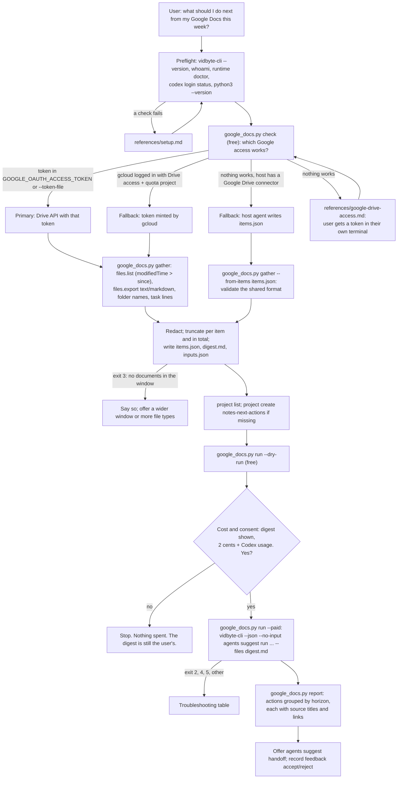

# next-actions-from-google-docs

## Summary

Add the public agent skill `skills/next-actions-from-google-docs/`. People write plans, meeting
notes, and to-do lists in Google Docs, then move on. A week later the open tasks and the half-made
decisions sit in a dozen documents that nobody rereads. The skill reads the Google Docs the user
created or edited in a time window (the last 7 days by default; Sheets, Slides, and Markdown or
text files in Drive on request), pulls out each document's text and the lines that look like open
tasks, redacts secrets, email addresses, phone numbers, home paths, and the login name, and writes a
short digest. After the user has seen the digest and said yes, one `vidbyte-cli agents suggest run`
(2 cents at `--count 6`, plus model usage on the user's own Codex account) answers the user's own
question: "What are the most important next actions given what I've been writing and discussing in
Google Docs over the last 7 days?" The user gets each next action with the titles and links of the
documents it came from.

This is one of four provider skills in the `next-actions-from-*` family (Obsidian, Notion, Slack,
Google Docs). All four write the same `items.json` and `digest.md` format and use the same
suggestion project, `notes-next-actions`, so a later combined skill, `next-actions-from-all-my-notes`,
can reuse this skill's adapter as is.

## Flow chart



## Usage example

```bash
npx skills add cerredz/vidbyte-cli --skill next-actions-from-google-docs
```

Then, in the coding agent:

```text
> what are my next actions from the google docs I worked on this week?
```

The agent runs the preflight and checks Google access for free:

```bash
python3 "<skill>/scripts/google_docs.py" check
python3 "<skill>/scripts/google_docs.py" gather --days 7
```

It shows the user the document table and the digest, makes sure the shared suggestion project
exists, runs the free dry run, and asks: "This sends the redacted digest of 9 Google Docs to the
Vidbyte Suggestion Agent through your own Codex login. It costs 2 cents from your Vidbyte balance,
plus Codex usage, and changes no files. Run it?" After a yes:

```bash
python3 "<skill>/scripts/google_docs.py" run --out "<out_dir>" --paid
```

which runs, from inside `<out_dir>` and without a shell:

```bash
vidbyte-cli --json --no-input agents suggest run \
  --goal "What are the most important next actions given what I've been writing and discussing in Google Docs over the last 7 days? Tie each action to the documents it comes from by their exact titles." \
  --category immediate_next_steps --category prioritization \
  --category completion --category continuation \
  --horizon any --count 6 \
  --files digest.md \
  --project notes-next-actions \
  --idempotency-key "next-actions-from-google-docs:20261011:3f9a1c"
```

Then `python3 "<skill>/scripts/google_docs.py" report --out "<out_dir>"` prints the actions,
grouped `now`, `next`, `later`, each with the titles and links of its source documents.

## How it works

- **Window.** `--days N` (default 7) or `--since YYYY-MM-DD` (local midnight). The window start is
  sent to Drive in UTC RFC 3339.
- **Gather through the Drive API v3** (`https://www.googleapis.com/drive/v3`), with `urllib` only:
  1. `GET /files` with `q = modifiedTime > '<since>' and trashed = false and (mimeType = 'application/vnd.google-apps.document' ...)`,
     `orderBy = modifiedTime desc`, `pageSize = 100`, `corpora = user` (or `allDrives` with
     `--shared-drives`), `includeItemsFromAllDrives = true`, `supportsAllDrives = true`, and
     `fields = nextPageToken,incompleteSearch,files(id,name,mimeType,webViewLink,createdTime,modifiedTime,modifiedByMeTime,ownedByMe,lastModifyingUser(me),parents,size)`.
     It follows `nextPageToken` for at most 10 pages. `incompleteSearch: true` becomes a warning.
  2. Keep a file when the user edited it in the window (`modifiedByMeTime >= since`) or created it
     there (`ownedByMe` and `createdTime >= since`). `modifiedByMeTime` is not a search term, so this
     filter runs locally. `--include-others` also keeps documents only other people edited.
  3. `GET /files/{id}/export?mimeType=text/markdown` for each Doc (Markdown keeps headings and
     checklists; `text/plain` is the fallback if Markdown export fails). Sheets export as
     `text/csv` (first sheet only) and Slides as `text/plain`. Markdown and text files uploaded to
     Drive are read with `GET /files/{id}?alt=media`, at most 2 MB each. Export is limited to 10 MB
     by Google; a file over it (`exportSizeLimitExceeded`) is skipped with a warning.
  4. `GET /files/{folderId}?fields=id,name,parents` walks each document's parent folders (cached,
     at most 150 lookups) to build the `container` path, such as `My Drive/Projects`. A document with
     no visible parent is in `Shared with me`.
  5. With `--comments`, `GET /files/{id}/comments?fields=comments(content,resolved,deleted)` adds
     up to five unresolved comments per document as open tasks. The Drive API has no field for
     "assigned to me", so the skill does not claim to find assignments.
- **Open tasks.** Plain-text export has no checkboxes, so task lines are found by shape: `- [ ]` and
  `[ ]` (also the escaped `\[ \]` that Markdown export can produce), `☐`, and lines that start with
  `TODO:`, `To do:`, `Action item:`, `Action:`, `Next step:`, or `Follow up:`. Checked items (`[x]`,
  `☑`, `☒`) are not tasks.
- **Redact, then truncate.** The redactor is copied from `sessions.py` in
  `pick-up-where-my-sessions-left-off` (private keys, JWTs, `sk-`, `ghp_`, `github_pat_`, Slack,
  AWS, `AIza`, `vb_live_`, `0x` keys, Bearer and Authorization values, credentials in URLs, `.env`
  lines, secret-named assignments, emails to `[email]`, home paths to `~`, the login name to
  `[user]`) and extended with Google OAuth tokens (`ya29.`, `1//`) and phone numbers (`[phone]`, 9 to
  15 digits with separators, never dates). Markdown image data URIs are dropped. Each excerpt is cut
  to `--max-item-chars` (default 3,000), and the whole digest to `--max-chars` (default 60,000): when
  it does not fit, excerpts shrink first and the oldest documents are dropped last, with a warning.
  The CLI accepts up to 5,000,000 characters per `--files` file and in total
  (`MAX_CONTEXT_CHARS` in `types/suggestions.py`); 60,000 keeps Codex usage small.
- **`--exclude`.** A folder name or document title, matched case-insensitively against the title
  and every folder in the path, with `*` and `?` wildcards. Excluded documents are never exported,
  so their text is never read.
- **Outputs**, in a new folder under the system temp folder: `items.json` and `digest.md` (the
  shared family format below), and `inputs.json` (goal, project, and the optional `trajectory`,
  `constraint`, and `avoid` values the agent may fill from what the user said).
- **Run.** `google_docs.py run` checks `inputs.json`, builds the argv, and runs `vidbyte-cli`
  without a shell, from inside the output folder, so `--files digest.md` is a relative path and no
  home path reaches the model. `--dry-run` is free. `--paid` refuses to start unless a dry run passed
  on the exact same request (a fingerprint of the argv and `digest.md`), makes one idempotency key,
  saves it in `idempotency-key.txt`, and refuses a folder that already holds a paid attempt unless
  the caller recovers it with that same saved key and no result was saved yet. `run` and
  `feedback` take `--cli <path>` (default: `vidbyte-cli` on `PATH`) and print the executable they
  ran, so a test can pass a recording stand-in explicitly instead of trusting `PATH` order.
- **Flag choices.**
  - `--goal`: the user's own question with the window filled in, plus one sentence asking the agent
    to tie each action to the documents' exact titles, so the report can link each action back.
  - `--category immediate_next_steps prioritization completion continuation`: act from where the
    documents leave off, rank what matters most, close the open loops the documents list, and take
    the next step of plans already written. All four ids are in the registry
    (`services/suggestions/prompts/categories/`).
  - `--horizon any`: the CLI applies any other horizon after review, as a silent filter on each
    idea's own label (`service.py` `_finalize`), so a narrower horizon could return fewer ideas and
    still be charged. The report groups ideas by their own `horizon` instead.
  - `--count 6`: one 2-cent block; six actions can be read and decided on in one sitting.
  - `--files digest.md`, not `--attach`: a `--files` entry gets a context ref that ideas can cite
    and that passes the evidence gate; attached text has no ref.
  - `--trajectory` (at most 2) and `--constraint` (at most 3) only when the user states a current
    focus or the time they have; `--avoid` only when the user names directions they do not want.
    `--success` is not used for targets; targets belong in the goal.
  - `--project notes-next-actions`: the family's shared project, created if missing, so feedback
    recorded from any provider shapes the next run from every provider.
- **Report.** `google_docs.py report` reads `result.json` and `items.json`. A file evidence entry
  holds only the first 4,096 characters of the digest, so it cannot name the source document.
  Instead the report matches each idea's text (title, summary, first action, actions, why now,
  completion check, and non-file evidence) against each document's link and exact title. An idea
  that names no document is shown as "from the digest as a whole".
- **Feedback.** `google_docs.py feedback` copies the idea's exact title from `result.json` into
  `vidbyte-cli --json agents suggest feedback accept|reject --project notes-next-actions`, because
  rejection works by exact text.

## Authentication decision

Every Drive API call needs an OAuth access token with a Drive scope, and Google bills the call to a
Google Cloud project that has the Drive API enabled. Three paths were evaluated.

| Path | What it needs | Verdict |
|---|---|---|
| (b) Access token in `GOOGLE_OAUTH_ACCESS_TOKEN` or a token file | A token with `drive.readonly`. The [OAuth 2.0 Playground](https://developers.google.com/oauthplayground/) issues one with no Google Cloud project: Google's own Playground client owns the quota. The token lasts about an hour, and the Playground revokes its refresh tokens after 24 hours (stated on the Playground page). | **Primary.** Works in every coding agent and on every OS, needs no project and no install, is read-only, and expires on its own. The script's behavior is fully deterministic and was tested end to end against a mock Drive. |
| (a) `gcloud auth login --enable-gdrive-access`, then `gcloud auth print-access-token` | The flag exists ([gcloud auth login](https://docs.cloud.google.com/sdk/gcloud/reference/auth/login): "Enable Google Drive access."). In Cloud SDK 512.0.0, `lib/surface/auth/login.py` adds `GOOGLE_DRIVE_SCOPE = 'https://www.googleapis.com/auth/drive'`, which is full read and write Drive access. The token belongs to gcloud's own OAuth client, project 32555940559, and [gcloud auth print-access-token](https://docs.cloud.google.com/sdk/gcloud/reference/auth/print-access-token) warns that curl calls with it can fail with "API has not been used in project 32555940559 before or it is disabled", fixed by an `X-Goog-User-Project` header naming a project where the caller has `serviceusage.services.use` ([system parameters](https://docs.cloud.google.com/apis/docs/system-parameters)). So this path needs gcloud, a project, and `gcloud services enable drive.googleapis.com --project <id>`. | **Fallback for repeat use.** Once set up, nobody copies a token: the script runs `gcloud auth print-access-token` as an argv list on every run and sends `X-Goog-User-Project` from `--quota-project`. |
| (c) The host agent's own Google Drive connector or MCP server | A connector the host already has and the user already authorized. | **Fallback with no Google setup.** The host agent searches for recently edited Docs, reads their text, and writes `items.json` in the shared format; `gather --from-items items.json` validates it strictly, applies the window and `--exclude`, redacts, and builds the digest. Connector tools differ by host and could not be tested here (no connector was used against a real account), so this path is second to the deterministic one. |

Rules for every path: the script reads a token only from the environment, a file the user wrote, or
gcloud's stdout; it never prints, logs, or saves a token, and never puts one on a command line. The
skill never asks for a token in the chat. HTTP 401 stops with "get a new token", 403
`accessNotConfigured` or `SERVICE_DISABLED` explains the quota project, 403 insufficient scopes
explains the scope, 403 `domainPolicy` names the admin block, and 403 `userRateLimitExceeded` or
`rateLimitExceeded`, 429, and 5xx are retried with exponential backoff (1, 2, 4, 8, 16 seconds plus
jitter, or `Retry-After`), as the [error guide](https://developers.google.com/workspace/drive/api/guides/handle-errors)
and the [usage limits](https://developers.google.com/workspace/drive/api/guides/limits) recommend.

A test-only override, `GOOGLE_DOCS_SKILL_TEST_API_BASE`, points the script at a local mock server.
It accepts only `http://127.0.0.1:<port>` or `http://localhost:<port>`, so a token can never be sent
to another host through it. `SKILL.md` does not mention it.

## Shared family format

`items.json` has exactly these fields and no others:

```json
{"schema": "notes-digest/1", "provider": "google-docs", "generated_at": "2026-10-11T18:00:00Z", "since": "2026-10-04T18:00:00Z",
 "items": [{"provider": "google-docs", "id": "<Drive file id>", "title": "Launch plan",
            "link": "https://docs.google.com/document/d/<id>/edit", "kind": "doc",
            "container": "My Drive/Projects", "created": "2026-09-30T09:12:00Z",
            "last_edited": "2026-10-10T16:40:00Z", "author": "me",
            "open_tasks": ["Send the pricing draft to [email]"], "excerpt": "<redacted, truncated text>"}]}
```

- `kind` is `doc` for Google Docs, Sheets, and Slides, and `file` for uploaded Markdown or text.
- `last_edited` is `modifiedTime` (the last edit by anyone); `author` is `me` when
  `lastModifyingUser.me` is true, `other` when it is false, and `null` when Drive does not say.
- Items are newest first by `last_edited`.

`digest.md` is a header line with the provider, window, and item count, then one `## <title>`
section per item, newest first: a metadata line `kind · container · last edited <date> · <link>`,
the open tasks as `- [ ]` lines, then the excerpt. Headings inside an excerpt are turned into bold
lines so they cannot start a new section.

```markdown
# Google Docs · last 7 days (2026-10-04 to 2026-10-11) · 9 items

## Launch plan
doc · My Drive/Projects · last edited 2026-10-10 · https://docs.google.com/document/d/<id>/edit

- [ ] Send the pricing draft to [email]

<excerpt>
```

## Files

| File | Change |
|---|---|
| `skills/next-actions-from-google-docs/SKILL.md` | New. The skill, in the contract's section order. |
| `skills/next-actions-from-google-docs/scripts/google_docs.py` | New. `check`, `gather` (Drive API or `--from-items`), `run` (dry run or paid), `report`, `feedback`. Standard library only, Python 3.8+. |
| `skills/next-actions-from-google-docs/references/google-drive-access.md` | New. Step-by-step instructions for the three ways to give the script Google access. Loaded only when `check` fails. |
| `skills/next-actions-from-google-docs/references/setup.md` | New. Byte-for-byte copy of the canonical file. |
| `skills/next-actions-from-google-docs/references/troubleshooting.md` | New. Byte-for-byte copy of the canonical file. |
| `docs/design/next-actions-from-google-docs.md` | New. This document. |

## CLI surface and min-cli-version

Every command and long option is in `contracts/cli-commands.json` on the internal repository's
`main`: `agents suggest run` (`--goal`, `--category`, `--horizon`, `--count`, `--trajectory`,
`--constraint`, `--avoid`, `--files`, `--project`, `--dry-run`, `--idempotency-key`),
`agents suggest handoff` (`--input`, `--idea`), `agents suggest project list`,
`agents suggest project create` (`--key`, `--title`, `--description`),
`agents suggest feedback accept|reject` (`--project`, `--suggestion`, `--reason`), `whoami`, and
`runtime doctor`. PyPI's newest release is 0.2.0, which has no paid admission and no
`--idempotency-key` on `agents suggest run`, so `min-cli-version` is `0.3.0` and the PR is not
merged until 0.3.0 is on PyPI. The price, 2 cents per block of up to ten requested ideas, comes from
`SuggestionAdmissionLimit` and the `agents suggest run --count` help text on `main`.

## Risks and open questions

- **Getting a token is the hardest step.** The Playground flow is several clicks, and the token
  lasts about an hour, so a weekly user repeats it weekly. gcloud removes the repetition but needs a
  project. A Google Workspace admin can block either. The connector path avoids both where a host has
  one.
- **gcloud grants full Drive access.** `--enable-gdrive-access` requests `auth/drive` (read and
  write). The script only reads, and `references/google-drive-access.md` says so.
- **Task detection is a heuristic.** Lines that look like tasks are tasks; a task written as a plain
  sentence is found only by the Suggestion Agent reading the excerpt.
- **Shared drives.** Shared-drive documents are searched only with `--shared-drives`
  (`corpora=allDrives`), which Google may answer with `incompleteSearch`.
- **Family consistency.** The four provider skills are built in parallel. All of them create the
  shared project with the same `project create` line, character for character, so whichever runs
  first sets the same title ("Next actions from my notes") and description.
- **Redaction is pattern-based.** It removes the common secret formats and contact details, not
  every possible secret. The user sees the digest before anything is sent.
- No paid end-to-end run was made, because it spends real money. The paid path was tested with a
  stand-in `vidbyte-cli` that only records its arguments, and no Google credentials or connectors
  were used.

## Verification

1. Every `vidbyte-cli` command path and long option in `SKILL.md` and `google_docs.py` checked
   against `contracts/cli-commands.json` on the internal `main`.
2. `gather` against a local mock Drive server with realistic JSON: two pages of `files.list`, a
   429 that succeeds on retry, Markdown and plain-text export bodies with planted secrets, emails,
   phone numbers, a data-URI image, and checklist lines, an `exportSizeLimitExceeded` file, folder
   lookups, comments, `--exclude`, and `--include-others`. `items.json` checked for exactly the
   shared fields; `digest.md` checked for the shared layout; no planted secret survives.
3. Error paths against the mock: 401, 403 `SERVICE_DISABLED`, 403 insufficient scopes, and
   repeated 429, each giving its own message and exit code without printing the token.
4. `--auth gcloud` with a stand-in `gcloud` that prints a fake token, checking the
   `X-Goog-User-Project` header; `--from-items` with valid and invalid files.
5. `run --dry-run` with a synthetic digest against a CLI built from the internal `main`, in an
   isolated state folder, behind a wrapper that refuses any `agents suggest run` without
   `--dry-run`: exit 0, `stop_reason: dry_run`, every manifest entry `included`, no charge.
6. The paid-run guards tested with a recording stand-in `vidbyte-cli`, passed with `--cli` on every
   call, with a `PATH` that holds no other `vidbyte-cli` (checked before each call) and a bogus
   `VIDBYTE_API_KEY`. Each test asserts how many calls the stand-in logged and that the report names
   the stand-in: no dry run, a changed digest, changed inputs, an earlier key file, a failed
   admission followed by recovery with the saved key, a recovery key that does not match, and one
   clean paid run that then refuses a second one.
7. `report` and `feedback` against a synthetic, schema-valid `result.json`; `agents suggest handoff`
   on it with the isolated CLI.
8. `cmp` of both shared `references/` files against the canonical copies, and a leak scan of the
   diff for home paths, the login name, emails, and token shapes.

## Update: usage-billed Suggestion Agent (2026-10-11)

- `agents suggest run` in vidbyte-cli 0.3.0 no longer buys a 2-cent Vidbyte admission or runs on
  the user's Codex. Each generator, critic, and revision step is one model call through Vidbyte's
  model gateway, billed to the Vidbyte balance at the model's per-token rate plus 2%. The skill
  keeps the defaults, so both roles run on gpt-6-sol at high reasoning effort ($2 input, $0.20
  cached input, $10 output per million tokens).
- The idempotency key, `idempotency-key.txt`, and the admission-recovery path are gone.
  `google_docs.py run` passes `--max-total-tokens 400000` on both the dry and the paid run, so the
  dry-run fingerprint covers the exact paid command. It writes `paid-run.txt` just before the paid
  run and refuses a second paid run in a folder that holds that marker or a `result.json`.
- A run makes about five model calls (one draft, then a critique and a revision in each of two
  rounds). The cap plus one in-flight call bounds a run at 540,000 tokens; with up to seven
  32,000-token replies (two for repair retries) the worst case is about $2.93, which SKILL.md
  states as "under about $4".
- `run` reports `models`, `usage` (`model_calls`, `input_tokens`, `cached_input_tokens`,
  `output_tokens`), and `estimated_cost_usd` (gpt-6-sol rates plus 2%) instead of `charged_cents`
  and `idempotency_key`; `report` ends with that usage and estimate instead of the cents charged.
- Preflight drops `vidbyte-cli --json runtime doctor` and `codex login status`. The Vidbyte key
  needs the `models:invoke` permission instead; without it the run stops with exit 4 at the first
  model call, before anything is billed. `references/setup.md` and `references/troubleshooting.md`
  are the new canonical copies.
- cerredz/vidbyte-cli#22 (`pick-up-where-my-sessions-left-off`) is the reference implementation.
