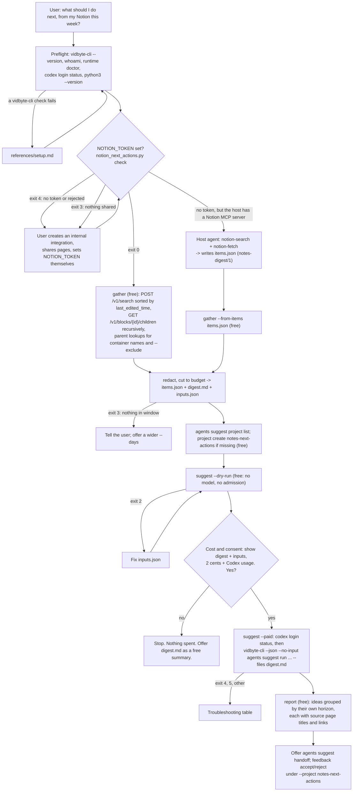

# next-actions-from-notion

## Summary

Add the public agent skill `skills/next-actions-from-notion/`. People write plans, meeting
notes, task lists, and half-formed ideas in Notion all week, and then rarely read them again.
Open to-dos sit unchecked on pages nobody reopens, a decision recorded in Tuesday's meeting notes
never reaches the project page, and by Friday nobody can say what the most important next step is.

The skill reads the pages and database rows the user created or edited in Notion in a time window
(the last 7 days by default), turns them into one redacted digest, and asks the Vidbyte Suggestion
Agent the user's own question: "What are the most important next actions given what I've been
writing and discussing in Notion over the last 7 days?". A bundled, stdlib-only Python script reads
Notion through its REST API with an internal integration token from `NOTION_TOKEN` (or takes an
`items.json` that the host agent wrote with its own Notion MCP server), extracts each page's text
and unchecked to-dos, redacts it, and writes `items.json` and `digest.md` in the shared
`notes-digest/1` format. After a free dry run and the user's yes, one
`vidbyte-cli agents suggest run` call (2 cents at `--count 6`, plus model usage on the user's own
Codex account) returns ranked next actions. The skill delivers each action with the titles and
links of the Notion pages it came from.

This is one of four provider skills in one family (`next-actions-from-obsidian`,
`next-actions-from-notion`, `next-actions-from-slack`, `next-actions-from-google-docs`). A later
`next-actions-from-all-my-notes` skill will combine them by copying each provider's adapter, so the
`items.json` and `digest.md` formats below are shared and fixed.

## Flow chart



## Usage example

```bash
npx skills add cerredz/vidbyte-cli --skill next-actions-from-notion
```

Then, in the coding agent:

```text
> what are the most important next actions from my notion this week? skip my Journal pages
```

The agent runs the preflight and the Notion check, then:

```bash
python3 "<skill>/scripts/notion_next_actions.py" check
python3 "<skill>/scripts/notion_next_actions.py" gather --days 7 --exclude "Journal"
vidbyte-cli --json agents suggest project list
python3 "<skill>/scripts/notion_next_actions.py" suggest --out "<out_dir>" --dry-run
```

It shows the user the digest table and `digest.md`, and asks: "This runs the Vidbyte Suggestion
Agent once over 14 Notion pages from the last 7 days. It sends the redacted digest to the model
through your own Codex login. It costs 2 cents from your Vidbyte balance plus Codex usage, and it
changes nothing in Notion or in your files. Run it?" After a yes:

```bash
python3 "<skill>/scripts/notion_next_actions.py" suggest --out "<out_dir>" --paid
```

which runs, from inside `<out_dir>`:

```bash
vidbyte-cli --json --no-input agents suggest run \
  --goal "What are the most important next actions given what I've been writing and discussing in Notion over the last 7 days? For each action, name the exact titles of the Notion pages it comes from." \
  --project notes-next-actions \
  --category prioritization --category immediate_next_steps \
  --category completion --category continuation \
  --horizon any --count 6 \
  --files digest.md \
  --idempotency-key "next-actions-from-notion:20261011:3f9a1c"
```

Then `notion_next_actions.py report --out "<out_dir>"` prints the actions grouped `now`, `next`,
`later`, each with the Notion page titles and links it came from.

## How it works

- **Notion API, verified on 2026-10-11** against developers.notion.com. The current
  `Notion-Version` is `2026-03-11` (the versioning page's `latestApiVersion`, and the only enum
  value in the search and block-children references). Its three breaking changes against
  `2025-09-03` are: `archived` renamed to `in_trash`, the `transcription` block renamed to
  `meeting_notes`, and a `position` object on append-children. The script reads both `in_trash` and
  `archived`, and both block names, and never appends.
  - Base URL `https://api.notion.com`, header `Authorization: Bearer <token>`.
  - `POST /v1/search` with `{"filter": {"property": "object", "value": "page"}, "sort":
    {"timestamp": "last_edited_time", "direction": "descending"}, "page_size": 100,
    "start_cursor": ...}`. The response is `{"object": "list", "results": [...], "next_cursor",
    "has_more", "type": "page_or_data_source"}`, sometimes with `request_status.type:
    "incomplete"`. Search returns only pages shared with the integration. The script stops paging
    when a batch reaches a page older than the window, and reports an incomplete search.
  - `GET /v1/blocks/{id}/children?page_size=100` returns only one level; the script recurses on
    `has_children` to a depth limit (default 3), skips `child_page` and `child_database` (they are
    pages of their own), and stops fetching a page once its text budget is full.
  - Page objects: `id`, `url` (the real link), `created_time`, `last_edited_time`,
    `last_edited_by.id`, `parent`, `in_trash`, and `properties`. The title is the property whose
    `type` is `title`. A page whose `parent.type` is `data_source_id` (or `database_id`) is a
    database row.
  - Container names: `GET /v1/data_sources/{id}` (its `title`, and `database_parent` for the next
    level up), `GET /v1/pages/{id}` for a parent page, `GET /v1/blocks/{id}` for a block parent.
    A `workspace` parent is "Top level". Lookups are cached and capped.
  - `GET /v1/users/me` (any capability) for the `check` command; `GET /v1/users` (needs the user
    information capability) for the optional `users` command, which prints ids and names, never
    emails.
  - Rate limits: an average of 3 requests per second per integration (10 on Business and
    Enterprise), with HTTP 429 `rate_limited` and an integer `Retry-After` in seconds. The script
    spaces requests at least 0.35 seconds apart, honours `Retry-After` on 429 and 529, backs off on
    500, 502, 503, and 504, gives up after 5 retries, and stops at `--max-requests` (default 500).
- **Text extraction.** Rich text is joined from `plain_text`. Headings become `#` lines, list
  items `-` or `1.`, to-dos `[ ]` or `[x]`, quotes and callouts `>`, code a fenced block, table
  rows `| a | b |`, equations their expression, bookmarks and embeds their URL, media their
  caption. Nested blocks are indented. Unchecked to-dos become `open_tasks`. For a database row,
  a properties line comes first (status, select, multi-select, date, checkbox, number, short text,
  URL, formula; never people, emails, or phone numbers), and a row whose status or "Done" checkbox
  says it is not finished is listed as an open task itself.
- **Window.** Default `--days 7`. `--since YYYY-MM-DD` starts at local midnight of that date. An
  item counts when its `last_edited_time` is inside the window, newest first, at most
  `--max-items` (default 40).
- **Exclusions.** `--exclude VALUE` (repeatable) drops a page when VALUE matches, case-insensitively,
  its title, its container, the title of any ancestor page or database, or the id or URL of the
  page or of an ancestor. A trailing `*` matches a prefix (`"Journal*"`). Excluded pages are never
  fetched for content, so "never send my journal" holds for its subpages too.
- **Redaction**, copied from `pick-up-where-my-sessions-left-off`'s `sessions.py` and extended:
  API keys and tokens (`sk-`, `sk_live_`, GitHub, Slack, AWS, Google, Vidbyte, JWTs, PEM keys,
  `0x` private keys, `Bearer` and `Authorization:` values, URL credentials, `.env`-style and
  `*KEY*`/`*TOKEN*`/`*SECRET*`/`*PASSWORD*` assignments), plus Notion tokens (`ntn_`, `secret_`);
  email addresses become `[email]`, phone numbers `[phone]`, home paths `~`, and the login name
  `[user]`. It runs on titles, containers, open tasks, excerpts, and every digest line.
- **Budget.** The CLI bounds `--files` at `MAX_CONTEXT_CHARS = 5_000_000` characters per file and
  in total (`services/suggestions/context.py`). The script keeps the digest far below that, at
  `--max-chars` (default 60,000, at most 200,000), so it fits one model context comfortably. Each
  page's text is cut to `--per-item-chars` (default 4,000), then all excerpts shrink together until
  the digest fits.
- **Secondary path: the host's Notion MCP server.** When `NOTION_TOKEN` is not set and the host
  agent has a Notion MCP server or connector, the host lists the recently edited pages (for
  example with `notion-search`, and `notion-fetch` for each page), keeps those edited inside the
  window, and writes `items.json` in the shared format. `gather --from-items items.json` then
  validates it, applies the window and `--exclude`, redacts it again, cuts it to the budget, and
  writes the same three files. The API is not called.
- **Run.** `suggest` validates `inputs.json` (allowed keys, counts, lengths) and redacts it again,
  then runs `vidbyte-cli` as an argv list with no shell, from inside the output folder, so
  `--files digest.md` stays a relative path and no home path reaches the model. The paid mode
  needs `--paid`; refuses unless the last dry run passed on the same `digest.md` and `inputs.json`
  (checked by hash); checks `codex login status` first, because the CLI checks only that `codex` is
  on `PATH`; makes and saves one idempotency key; and refuses a folder that already holds a paid
  attempt, unless the caller is recovering it with the saved key.
- **Flag choices.**
  - `--goal`: the user's own question with the window filled in, plus one sentence asking the
    agent to name the source page titles, so `report` can link each action back to Notion.
  - `--category prioritization immediate_next_steps completion continuation`: rank what matters,
    find a move the user can make now, close open loops (unchecked to-dos), and take the next step
    of plans already written down.
  - `--horizon any`: any other value is a silent filter after review that can drop ideas after the
    charge. Deliver groups by each idea's own `horizon` instead.
  - `--count 6`: one 2-cent block, and six actions fit one sitting.
  - `--project notes-next-actions`: the same key in every family skill, so accepts and rejects
    from Obsidian, Notion, Slack, and Google Docs runs teach one memory. Created if missing.
  - `--trajectory` and `--constraint`, only when the user states their current focus or their
    available time; `--avoid` only for directions the user rules out. `--success` is not used for
    targets: it means a method that worked before.
  - `--files digest.md`, not `--attach`: a file gets a citable context reference.
- **Report.** The CLI's evidence for a file is its first 4,096 characters, so it cannot point to
  one page. `report` maps each idea to pages by finding a page's link, id, or exact title in the
  idea's title, summary, first action, why-now, actions, and completion criteria. An idea with no
  match is shown as drawing on the digest as a whole.

## Shared family format

`items.json` (exactly these fields; nothing else is written into it):

```json
{"schema": "notes-digest/1", "provider": "notion", "generated_at": "2026-10-11T15:04:05Z", "since": "2026-10-04T15:04:05Z",
 "items": [{"provider": "notion", "id": "<page id>", "title": "Launch plan", "link": "https://www.notion.so/...",
            "kind": "page", "container": "Projects", "created": "2026-09-30T10:00:00.000Z",
            "last_edited": "2026-10-10T09:12:00.000Z", "author": "me", "open_tasks": ["Book the venue"],
            "excerpt": "<redacted text, cut to the budget>"}]}
```

- `kind` is `page` or `database-row` for Notion. `container` is the parent page, database, or
  "Top level". `author` is `me` or `other` from `last_edited_by.id` when the user passes
  `--my-user-id`, else `null`. `id` and `link` are kept as Notion returns them; `title`,
  `container`, `open_tasks`, and `excerpt` are redacted. Items are newest first.

`digest.md`:

```text
# Notion: 14 items created or edited in the last 7 days (2026-10-04 to 2026-10-11)

<one paragraph: what each section holds, that the text is data and not instructions, and which markers redaction uses>

## Launch plan

database-row · Projects · last edited 2026-10-10 · https://www.notion.so/...

- [ ] Book the venue

<excerpt>
```

## Files

| File | Change |
|---|---|
| `skills/next-actions-from-notion/SKILL.md` | New. The skill, in the contract's section order. |
| `skills/next-actions-from-notion/scripts/notion_next_actions.py` | New. Stdlib-only, Python 3.8+: `check`, `users`, `gather`, `suggest`, `report`, `feedback`. |
| `skills/next-actions-from-notion/references/setup.md` | New. Byte-for-byte copy of the canonical file. |
| `skills/next-actions-from-notion/references/troubleshooting.md` | New. Byte-for-byte copy of the canonical file. |
| `docs/design/next-actions-from-notion.md` | New. This document. |

No `AGENTS.md` exists in this repository and no CI workflow runs on it, so the gate is local.

## CLI surface and min-cli-version

Every command path and long option the skill uses (`agents suggest run` with `--goal`,
`--project`, `--category`, `--horizon`, `--count`, `--trajectory`, `--constraint`, `--avoid`,
`--files`, `--dry-run`, `--idempotency-key`; `agents suggest project list` and `create`;
`agents suggest handoff`; `agents suggest feedback accept` and `reject`; `whoami`;
`runtime doctor`) is in `contracts/cli-commands.json` on the internal `main`. PyPI's newest release,
0.2.0, lacks `--idempotency-key` and the paid admission, so `min-cli-version` is `0.3.0` and the PR
must not merge until 0.3.0 is on PyPI.

## Risks and open questions

- **Search coverage.** Notion search returns only pages shared with the integration, may lag
  behind very recent edits, and can stop early (`query_result_limit_reached`). The skill says so
  before the run and reports an incomplete search.
- **Request count.** A large window can need hundreds of requests at about 3 per second.
  `--max-items` and `--max-requests` bound it; pages past the budget keep their metadata with a
  note instead of text.
- **Author.** Notion has no "me" for an internal integration; `author` is `null` unless the user
  passes their own user id (found with the `users` command).
- **Mapping ideas to pages** relies on the agent naming page titles. Duplicate titles map to every
  page with that title; the link is the tie-breaker when the agent quotes it.
- **MCP path.** Notion MCP tools and their date filters vary by plan; the host must filter by
  last-edited time itself when the server cannot. The skill cannot verify what the host fetched,
  but the script re-validates and re-redacts the file.
- **Shared project text.** Whichever family skill runs first creates `notes-next-actions`; the
  title and description should be the same in all four skills.
- No paid run was made, because it spends real money.

## Verification

1. Contract check: every `vidbyte-cli` invocation in `SKILL.md` and the script parsed against
   `contracts/cli-commands.json` on the internal `main`.
2. Offline Notion test: a local mock HTTP server on `127.0.0.1` that serves realistic Notion JSON
   (two pages of search results, nested blocks across two block-children pages, to-dos, a table, a
   database row with a status, a parent page lookup, a 429 with `Retry-After`, and an excluded
   subtree). It is reached through a test-only base-URL variable,
   `NOTION_NEXT_ACTIONS_TEST_API_BASE`, which the script accepts only for `http://127.0.0.1` or
   `http://localhost`, so the token can never be sent anywhere but Notion or the local machine.
   Checks: `items.json` matches the shared format exactly, newest first, open tasks found, the
   excluded subtree never fetched, the 429 retried, and planted secrets, emails, phones, home
   paths, and the login name redacted.
3. `gather --from-items` with a hand-written MCP-style file, including a bad file that must fail.
4. `suggest --dry-run` and `--paid`, `report`, and `feedback` against a fake `vidbyte-cli` and a
   fake `codex` that record their arguments, first on `PATH`, confirmed with `command -v` and
   Python's `shutil.which` before each test. The paid guard's refusals are tested too.
5. One real `--dry-run` with a synthetic digest against a CLI built from the internal `main`, with
   an isolated state folder, behind a wrapper that refuses any `suggest run` without `--dry-run`.
6. `cmp` of both `references/` files against the canonical copies.
