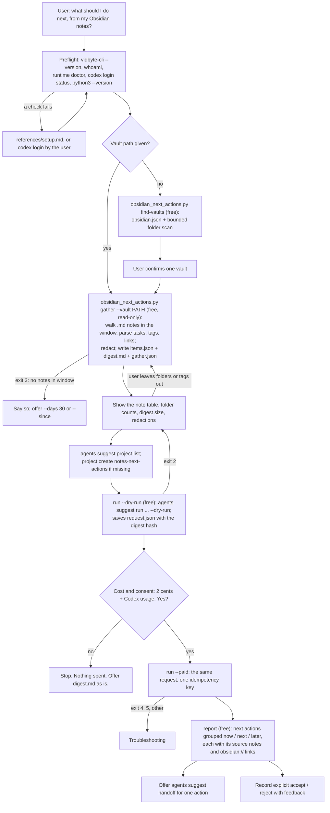

# next-actions-from-obsidian

## Summary

Add the public agent skill `skills/next-actions-from-obsidian/`. People keep ideas, plans, meeting
notes, and task lists in an Obsidian vault, then rarely read them again. Open `- [ ]` tasks stay
open, `#idea` notes go stale, and links to notes "to write later" stay red. The user asked for a
skill that reads what they recently wrote in a note provider and asks the Vidbyte Suggestion Agent
"what are the most important next actions given this context". This is the Obsidian member of a
family of four (Obsidian, Notion, Slack, Google Docs) plus a later combined skill,
`next-actions-from-all-my-notes`, which will copy this skill's adapter and data format.

A stdlib-only Python script finds the vault, reads the Markdown notes created or edited in a
window (the last 7 days by default), extracts each note's open tasks, tags, and links to notes that
do not exist yet, redacts secrets, emails, phone numbers, home paths, and the login name, and
writes `items.json` and `digest.md` in the family's shared format. The user sees the digest and
can leave folders out. A free dry run checks the exact request. After the user's yes, one
`vidbyte-cli agents suggest run` (2 cents at `--count 6`, plus model usage on the user's own Codex
account) returns ranked next actions, and the script ties each one back to the notes it came from.

## Flow chart



## Usage example

```bash
npx skills add cerredz/vidbyte-cli --skill next-actions-from-obsidian
```

Then, in the coding agent:

```text
> look at what I wrote in my Obsidian vault this week and tell me what I should do next
```

The agent runs the preflight, then:

```bash
python3 "<skill>/scripts/obsidian_next_actions.py" find-vaults
python3 "<skill>/scripts/obsidian_next_actions.py" gather --vault "~/Documents/Notes" --days 7
python3 "<skill>/scripts/obsidian_next_actions.py" gather --vault "~/Documents/Notes" --days 7 --exclude Journal
vidbyte-cli --json agents suggest project list
vidbyte-cli --json agents suggest project create --key notes-next-actions --title "Next actions from my notes" --description "..."
python3 "<skill>/scripts/obsidian_next_actions.py" run --out "<out_dir>" --dry-run
```

It shows the note table and the digest, and asks: "This runs the Vidbyte Suggestion Agent once
over 12 notes from your vault. It sends the redacted digest to the model through your own Codex
login. It costs 2 cents from your Vidbyte balance, plus model usage on your Codex account, and it
changes no files. Run it?" After a yes:

```bash
python3 "<skill>/scripts/obsidian_next_actions.py" run --out "<out_dir>" --paid
python3 "<skill>/scripts/obsidian_next_actions.py" report --out "<out_dir>"
```

The paid step runs, from inside `<out_dir>` and without a shell:

```bash
vidbyte-cli --json --no-input agents suggest run \
  --goal "What are the most important next actions given what I've been writing and discussing in Obsidian over the last 7 days? Name the notes each action comes from." \
  --category immediate_next_steps --category prioritization \
  --category completion --category continuation \
  --horizon any --count 6 \
  --files digest.md \
  --project notes-next-actions \
  --idempotency-key "next-actions-from-obsidian:20261011:3f9a1c"
```

## How it works

- **Finding the vault.** A vault is a folder with a `.obsidian/` folder in it. `--vault` names it.
  Without one, `find-vaults` reads Obsidian's own vault list, `obsidian.json` in the app's
  settings folder: `%APPDATA%\obsidian` on Windows, `~/Library/Application Support/obsidian` on
  macOS, `$XDG_CONFIG_HOME/obsidian` or `~/.config/obsidian` on Linux (the folders Obsidian's help
  page "How Obsidian stores data" names), plus the Flatpak and Snap copies of that folder when they
  exist. The file is undocumented. On this machine it is
  `{"vaults": {"<16-hex id>": {"path": "<absolute path>", "ts": <epoch ms>, "open": true}}}`, and
  Obsidian drops vaults whose folder is gone. So the script uses it as a hint: it keeps only paths
  that still hold `.obsidian/`, adds a bounded scan of common folders (the home folder to depth 4,
  the iCloud Obsidian folder), and the agent always asks the user to confirm one vault.
- **Gathering.** `gather` walks the vault once without following symlinks. It skips dot-folders
  (`.obsidian`, `.trash`, `.git`), the templates folder named in `.obsidian/templates.json` or the
  Templater plugin's settings, the attachment folder named in `.obsidian/app.json`, the user's own
  "Excluded files" (`userIgnoreFilters` in the same file), and `*.excalidraw.md` drawings. A note
  is in the window when its modified time, or its creation time (birth time on Windows and macOS,
  or a `created`/`date` frontmatter value), is on or after the window start. `--exclude` (a
  folder, a file, or a glob) and `--exclude-tag` remove notes before anything is written; excluded
  notes appear only as counts.
- **Parsing.** For each note: a small YAML frontmatter reader (`tags`, `created`, `date`,
  `source`), inline `#tags` outside code, unchecked tasks (`- [ ]`, and `- [/]` in progress),
  wikilinks and Markdown links whose target is no file in the vault ("notes not written yet"), and
  a cleaned body: frontmatter, comments, Dataview and Tasks query blocks, embeds, open task lines,
  and empty template headings removed; headings turned into bold lines so they cannot be mistaken
  for a new note in the digest. A note with no text and no open task left is skipped as empty, so a
  daily note created from a template and never filled in costs nothing.
- **Daily notes.** A note in the daily-notes folder (`.obsidian/daily-notes.json`, or the Periodic
  Notes plugin's settings) or named like a date (`2026-10-09`) is a daily note. It stays a `note`
  with its date as title; its excerpt starts with "Daily note." and keeps the start and the end of
  the text, because daily notes grow at the bottom. The agent asks whether a journal folder should
  be left out.
- **Budget.** The CLI accepts up to 5,000,000 characters per `--files` file and in total
  (`MAX_CONTEXT_CHARS` in `types/suggestions.py`; a longer file is truncated with a warning). The
  digest defaults to 60,000 characters (`--max-chars`, at most 200,000) so it fits the model's
  context with room to spare and keeps usage small. Each excerpt starts at 1,500 characters
  (`--excerpt-chars`); when the digest is too long, excerpts shrink, and at 200 characters the
  oldest notes are dropped and counted. At most 60 notes (`--max-items`), newest first.
- **Redaction.** Copied from `sessions.py` in `pick-up-where-my-sessions-left-off`: private keys,
  JWTs, OpenAI, Stripe, GitHub, Slack, AWS, Google, Vidbyte keys, bearer and basic credentials,
  `password=`-style assignments, URL credentials, and `.env` lines become `[REDACTED]`; emails
  become `[email]`; home-folder paths become `~`; the login name becomes `[user]`. Added here:
  phone numbers become `[phone]` (a leading `+` and digit groups, or a 3-3-4 number with
  separators, so dates, times, and version numbers are kept). Redaction runs on the whole cleaned
  text before truncation, so a cut never leaves half a secret, and on every field written:
  title, folder, path, link, tasks, and excerpt.
- **The run.** `run --dry-run` builds the request, saves it in `request.json` with the SHA-256 of
  `digest.md`, and runs it with `--dry-run`. `run --paid` takes no content flags: it replays
  `request.json` only after a passed dry run, only if `digest.md` is unchanged, and only in a folder
  with no earlier paid attempt. It makes one idempotency key, saves it in `idempotency-key.txt`,
  and accepts `--idempotency-key` only to recover an attempt whose admission was never verified.
  Paths reach the model, so `--files digest.md` is relative and the command runs from inside the
  output folder.
- **Settings.** `--goal` is the user's question for the window, plus "Name the notes each action
  comes from." so ideas can be traced. `--category immediate_next_steps`, `prioritization`,
  `completion`, `continuation`: act from the notes' current state, choose among more open loops
  than there is time for, close nearly finished work, and take the next step of plans already
  written down. `--horizon any`, because any other value drops ideas after review while the charge
  stays the same; the report groups ideas by each idea's own horizon instead. `--count 6` is one
  2-cent block. `--trajectory`, `--constraint`, and `--avoid` are added only when the user states a
  current focus, a time limit, or a direction they do not want. `--project notes-next-actions`
  loads the user's earlier accepts and rejects; the key is the same in every family skill, so
  feedback carries across providers. `--files` and not `--attach`, because a `--files` file gets a
  citable context reference.
- **Report and feedback.** `report` reads `result.json` and `items.json`, finds the notes each idea
  names (by path, then by title), groups ideas by `now`, `next`, and `later`, and prints each with
  its source notes' titles, paths, and `obsidian://open?vault=<name>&file=<path>` links (format
  from Obsidian's "Obsidian URI" help page; both values URL-encoded). `feedback` copies an idea's
  exact title into `agents suggest feedback accept|reject`, because rejection matches text word
  for word.

## The shared family format

Every family skill writes these two files. The combined skill reads `items.json` from each
provider and renders one digest with the same layout.

`items.json`, with exactly these fields:

```json
{"schema": "notes-digest/1", "provider": "obsidian", "generated_at": "2026-10-11T18:15:00Z", "since": "2026-10-04T18:15:00Z",
 "items": [{"provider": "obsidian", "id": "Projects/Pricing page.md", "title": "Pricing page",
            "link": "obsidian://open?vault=Notes&file=Projects%2FPricing%20page.md",
            "kind": "note", "container": "Projects", "created": "2026-10-02T09:12:00Z",
            "last_edited": "2026-10-10T16:40:00Z", "author": "me",
            "open_tasks": ["Draft the annual plan row", "Ask about student discounts"],
            "excerpt": "Tags: #pricing\n\n**Plans**\nThree tiers ..."}]}
```

For Obsidian: `id` is the vault-relative path with forward slashes, `title` is the file name
without `.md` (the name Obsidian shows and links by), `link` is the `obsidian://` URI, `kind` is
always `note`, `container` is the folder (`(vault root)` at the top), and `author` is `me`, or
`other` for a web clipping (a frontmatter `source` that is an `http(s)` URL). Every text field is
already redacted, so `items.json` is safe to render and send. Local-only facts (the absolute vault
path, the window phrase, counts) go in a third file, `gather.json`, which is never sent.

`digest.md`: a header line with the provider, window, and item count; one short paragraph that
says the notes are newest first and what the redaction markers mean (and, for Obsidian, the tags
used in more than one note and the most-linked notes not written yet); then one `## <title>`
section per item, newest first, each with a metadata line
(`note · Projects · last edited 2026-10-10 16:40 · obsidian://open?...`), the open tasks as
`- [ ]` lines, and the excerpt.

## Files

| File | Change |
|---|---|
| `skills/next-actions-from-obsidian/SKILL.md` | New. The skill, in the contract's section order. |
| `skills/next-actions-from-obsidian/scripts/obsidian_next_actions.py` | New. Stdlib-only, Python 3.8+: `find-vaults`, `gather`, `run`, `report`, `feedback`. Runs external commands as argv lists, never through a shell. |
| `skills/next-actions-from-obsidian/references/setup.md` | New. Byte-for-byte copy of the canonical file. |
| `skills/next-actions-from-obsidian/references/troubleshooting.md` | New. Byte-for-byte copy of the canonical file. |
| `docs/design/next-actions-from-obsidian.md` | New. This document. |

No `AGENTS.md` exists in this repository and no CI workflow runs on it, so the gate is local. The
`write-agent-skill` contract in `docs/agent-skills/` stands in for it.

## CLI surface and min-cli-version

Every command path and long option the skill uses is in `contracts/cli-commands.json` on the
internal `main`: `agents suggest run` with `--goal`, `--category`, `--horizon`, `--count`,
`--trajectory`, `--constraint`, `--avoid`, `--files`, `--project`, `--dry-run`, and
`--idempotency-key`; `agents suggest project list` and `project create` (`--key`, `--title`,
`--description`); `agents suggest handoff` (`--input`, `--idea`); and `agents suggest feedback
accept|reject` (`--project`, `--suggestion`, `--reason`). PyPI's newest release, 0.2.0, has no
`--idempotency-key` and no paid admission on `agents suggest run`, so `min-cli-version` is `0.3.0`
and the PR waits for that release, like PRs #7 and #8.

## Risks and open questions

- **Modified time is not always an edit.** A sync client, a `git pull`, or a fresh clone can touch
  many notes at once. When more than 100 notes, or more than half the vault, fall in the window,
  `gather` warns, and the agent offers a shorter window or exclusions before anything is sent.
- **Creation time.** Linux has no birth time in `os.stat`, so there `created` comes only from
  frontmatter and is often `null`. The window still uses the modified time.
- **Tracing ideas to notes.** The CLI's handoff evidence for a file is the file's first 4,096
  characters, not the passage an idea relies on. The goal asks the model to name its notes, and
  `report` matches paths and titles in the idea text; an idea that names none is shown as drawing
  on the digest as a whole.
- **Redaction is pattern-based.** It removes common secret formats, not every possible secret, and
  it keeps other people's names. The user sees the digest before anything is sent.
- **Shared project key.** One `notes-next-actions` project for every provider means feedback from
  Slack shapes ideas from Obsidian. That is the family's intent; the description says so.
- No paid end-to-end run was made, because it spends real money.

## Verification

1. Every `vidbyte-cli` command path and long option in `SKILL.md` and the script checked against
   `contracts/cli-commands.json` on the internal `main`.
2. `gather` run read-only against a real vault on this machine (7 and 30 days); output kept outside
   the repository and scanned for home paths, the login name, emails, and token patterns. Only
   counts are reported; nothing from it is committed.
3. `gather` run against a synthetic vault built by the test (daily notes, a template folder, a
   `.trash` note, an attachment folder, an excluded folder, a private tag, planted secrets, emails,
   and phone numbers, unresolved links, an old note outside the window); `items.json` checked
   field by field against the shared format.
4. `run --dry-run` with the real-vault digest against a CLI built from the internal `main`, with an
   isolated state folder: exit 0, `stop_reason: dry_run`, `charged_cents: null`, the digest
   `included` in the manifest.
5. The paid path tested only with a stand-in `vidbyte-cli` first on `PATH`, confirmed with
   `command -v` and `shutil.which` before each test: no dry run, a changed digest, an earlier key
   file, and an earlier result all refuse; a clean folder runs once with the recorded argv, then
   refuses; a recovery key runs only while no result is saved. `report` and `feedback` checked
   against a synthetic `result.json`.
6. `cmp` of both `references/` files against the canonical copies; `python -m py_compile`.
