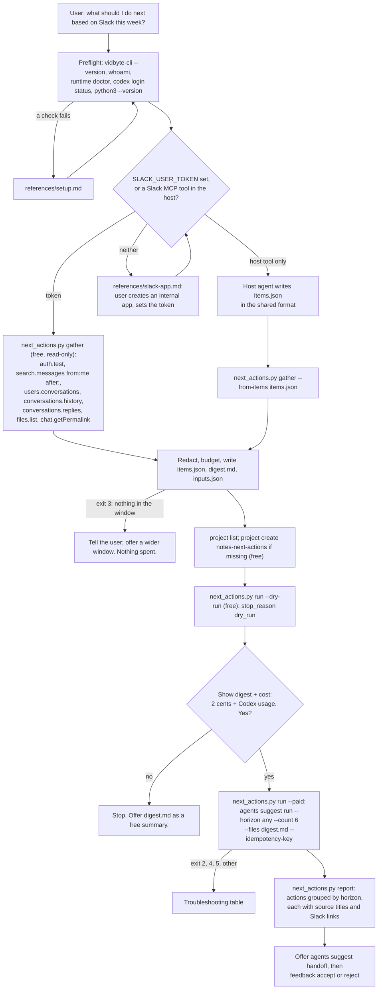

# next-actions-from-slack

## Summary

Add the public agent skill `skills/next-actions-from-slack/`. A user asks "what should I do next
based on Slack this week?", and the skill turns their recent Slack activity into a short list of
next actions, each tied to the thread, message, or file it came from.

A free, bundled Python script reads the last 7 days of Slack with the user's own Slack user token
(`SLACK_USER_TOKEN`): the threads they wrote in, the conversations in channels they belong to, the
requests aimed at them, and the files they uploaded or that were shared with them. It groups
messages into one item per thread, finds open requests ("can you...", "follow up", unchecked
boxes), redacts secrets, emails, phone numbers, home paths, and names, and writes `items.json` and
`digest.md` in the shared `notes-digest/1` format. After the user has seen the digest, a free dry
run, and the cost, one `vidbyte-cli agents suggest run` call (2 cents plus the user's own Codex
usage) asks the Suggestion Agent: "What are the most important next actions given what I've been
writing and discussing in Slack over the last 7 days?" The user gets the actions grouped by
horizon, each with its source titles and Slack links, plus a handoff prompt and feedback that
teaches later runs.

This is one of four provider members of the "next actions from your notes" family (Obsidian,
Notion, Slack, Google Docs). All four write the same `items.json` and `digest.md` format and use
the same suggestion project, `notes-next-actions`, so a later `next-actions-from-all-my-notes`
skill can copy each adapter and feedback carries across providers.

## Flow chart



## Usage example

```bash
npx skills add cerredz/vidbyte-cli --skill next-actions-from-slack
```

The user creates their own Slack app once (`references/slack-app.md`), sets `SLACK_USER_TOKEN` in
their terminal, and starts their coding agent from it. Then:

```text
> what are my most important next actions from Slack this week? I'm focused on the billing launch.
```

The agent runs the preflight, then:

```bash
python3 "<skill>/scripts/next_actions.py" gather --days 7 --exclude random --focus "Shipping the billing launch"
python3 "<skill>/scripts/next_actions.py" run --out "<out_dir>" --dry-run
```

It shows the item table and `digest.md`, and asks: "This sends the redacted digest of 23 Slack
items to the Vidbyte Suggestion Agent through your own Codex login. It costs 2 cents from your
Vidbyte balance plus Codex usage, and it changes nothing in Slack or in your files. Run it?" After a
yes, `run --paid` executes, from inside `<out_dir>` and without a shell:

```bash
vidbyte-cli --json --no-input agents suggest run \
  --goal "What are the most important next actions given what I've been writing and discussing in Slack over the last 7 days? Name the Slack thread, message, or file each action comes from." \
  --project notes-next-actions \
  --category immediate_next_steps --category prioritization \
  --category completion --category continuation \
  --horizon any --count 6 \
  --trajectory "Shipping the billing launch" \
  --files digest.md \
  --idempotency-key "next-actions-from-slack:20261011:3f9a1c"
```

`report` then prints the actions grouped by `now`, `next`, and `later`, each with its source
threads and Slack permalinks.

## How it works

### Gather, Slack Web API path (primary)

`scripts/next_actions.py gather` reads `SLACK_USER_TOKEN` from the environment, never from the
command line or the chat, and refuses anything that is not a user token (`xoxp-`). A bot token
cannot call `search.messages`, and a browser session token (`xoxc-`, `xoxd-`) is not something the
user should hand to a script. `scripts/slack_adapter.py` then makes only read calls, in this order:

| Step | Method | User token scope | What it is for |
|---|---|---|---|
| 1 | `auth.test` | none | The user's own id ("me"), the workspace URL, and the user's handle (redacted to `[user]`). |
| 2 | `search.messages`, query `from:<@ME> after:<day before the window>`, `sort=timestamp`, `count=100`, at most 5 pages | `search:read` | Every message the user wrote in the window, in any channel, including replies in threads whose parent is older than the window. The permalink's `thread_ts` names the thread. |
| 3 | `users.conversations`, `types=public_channel,private_channel` (plus `im,mpim` with `--include-dms`), `exclude_archived=true`, `limit=200`, cursor pages | `channels:read`, `groups:read` (`im:read`, `mpim:read`) | The channels the user belongs to. `conversations.list` is not used: it lists every public channel in the workspace, and `users.conversations` returns only the user's own. |
| 4 | `conversations.history`, `oldest=<window start>`, `limit=200`, cursor pages, at most 300 messages per channel and 100 channels | `channels:history`, `groups:history` (`im:history`, `mpim:history`) | Top-level messages in the window, thread parents with `reply_count`, and mentions of the user. Channels where the user wrote are read first. |
| 5 | `conversations.replies`, `limit=200`, one page, at most 60 threads | same as step 4 | The replies of each active thread, so a thread becomes one item. Threads the user wrote in or was mentioned in come first. |
| 6 | `files.list`, `ts_from=<window start>`, `count=100`, at most 3 pages | `files:read` | Files the user uploaded or that were shared into a channel the skill reads. Small text files (at most 256 KB) are downloaded from `url_private` for their text. Canvases are listed by title and link only, because Slack documents no method that reads a canvas's text. |
| 7 | `chat.getPermalink` | none | A real permalink for every kept item that has none from search yet. |

How messages become items:

- **Thread**, `kind: "thread"`: the parent and its replies. `id` is `<channel id>:<thread ts>`,
  `created` is the parent's time, `last_edited` the newest reply, `author` is `me` when the user
  started the thread.
- **Message**, `kind: "message"`: a run of top-level messages in one channel with no gap longer than
  30 minutes, so an unthreaded conversation stays together. A single message is a run of one.
- **File**, `kind: "file"`: one uploaded or shared file, with its text when it is a small text file.
- Join, leave, topic, and other system messages are dropped. Bot messages are dropped unless
  `--include-bots`, because CI and integration bots flood channels.
- People other than the user become stable pseudonyms (`@person-1`, `@person-2`) and the user
  becomes `@me`, so no names or user ids reach the model and no `users:read` scope is needed.
  Group DM names, which list handles, become "group DM".
- `open_tasks` holds requests aimed at the user that the user has not answered: a message from
  someone else that mentions the user (or any message in a DM, with `--include-dms`) and asks
  something ("can you", "could you", "please", "follow up", "todo", "let me know", a question
  mark), with no later message from the user in the same thread or run and no check-mark reaction
  from the user. It also holds the user's own unfulfilled commitments ("I'll", "will do", "on it",
  "remind me") and unchecked boxes (`- [ ]`, `☐`). At most 5 per item.

Rate limits: every call goes through one client that, on HTTP 429 or `error: ratelimited`, waits
the `Retry-After` seconds and retries, up to a total wait budget (`--max-wait`, default 120
seconds). When the budget is spent, the phase stops, what was read so far is kept, and the summary
says what was skipped. If `conversations.history` or `conversations.replies` answers with a wait
of 30 seconds or more, the summary names the likely cause (the 2025 Tier 1 limit below) and points
to `references/slack-app.md`.

The token is sent only to `https://slack.com/api/` and, for file downloads, to
`https://files.slack.com/`, with `add_unredirected_header` and a redirect handler that refuses
every redirect, so it is never forwarded to another host. One test-only variable,
`NEXT_ACTIONS_SLACK_TEST_BASE_URL`, points the client at a local mock server; it accepts only
`http://127.0.0.1:<port>` or `http://localhost:<port>`, so it cannot send the token anywhere
else.

### Slack facts that shape the design

- `search.messages` needs a user token with `search:read` (Tier 2, 20+ per minute) and is marked
  "a legacy method"; Slack recommends the Real-time Search API (`assistant.search.context`, user
  limit 10 requests per minute, 20 results per call) for new AI apps.
  <https://docs.slack.dev/reference/methods/search.messages>,
  <https://docs.slack.dev/reference/methods/assistant.search.context>
- `conversations.history` and `conversations.replies` are Tier 3 (50+ per minute, `limit` up to
  999 and 1000) for Marketplace apps and internal customer-built apps. Since May 29, 2025, new apps
  and new installations that are commercially distributed outside the Slack Marketplace get Tier 1:
  1 request per minute, with the `limit` maximum and default cut to 15. "Internal
  customer-built applications are not impacted by these changes." That is why the skill tells the
  user to create their own app in their own workspace instead of using someone else's
  distributed app.
  <https://docs.slack.dev/changelog/2025/05/29/rate-limit-changes-for-non-marketplace-apps>,
  <https://docs.slack.dev/reference/methods/conversations.history>,
  <https://docs.slack.dev/reference/methods/conversations.replies>
- A 429 response carries `Retry-After` in seconds. <https://docs.slack.dev/apis/web-api/rate-limits>
- `users.conversations` (Tier 3, `channels:read`, `groups:read`, `im:read`, `mpim:read`) lists
  the conversations the user is a member of.
  <https://docs.slack.dev/reference/methods/users.conversations>
- `files.list` (Tier 3, `files:read`) filters by `ts_from`, pages with `count` and `page`, and does
  not list canvases as a `types` value. <https://docs.slack.dev/reference/methods/files.list>
- `auth.test` and `chat.getPermalink` need no scope ("Special" limits, hundreds per minute). A
  thread reply's permalink carries `thread_ts` and `cid`.
  <https://docs.slack.dev/reference/methods/auth.test>,
  <https://docs.slack.dev/reference/methods/chat.getPermalink>

### Gather, host connector path (secondary)

When the host agent has a Slack MCP server or connector and no token is set, the agent pulls the
same data itself (its own searches for the user's messages and mentions in the window, each
thread's replies, recent files) and writes `items.json` in the shared format, following a mapping
table in `SKILL.md`. `gather --from-items items.json` then checks the schema and every field,
applies the window, `--channels`, and `--exclude` to `container`, redacts every text field again,
truncates, and writes the same `digest.md`. No token is needed and no Slack call is made.

### The shared family format

`items.json`, exactly these fields, the same in all four provider skills:

```json
{"schema": "notes-digest/1", "provider": "slack", "generated_at": "<ISO 8601 UTC>", "since": "<ISO 8601>",
 "items": [{"provider": "slack", "id": "<channel id>:<ts> or <file id>", "title": "...", "link": "<permalink>",
            "kind": "thread|message|file", "container": "#channel / private channel / DM / group DM / file",
            "created": "<ISO or null>", "last_edited": "<ISO>", "author": "me|other|null",
            "open_tasks": ["..."], "excerpt": "<redacted text, truncated>"}]}
```

`digest.md`: a header line with the provider, window, and item count; then one `## <title>`
section per item, newest first, with a metadata line (`kind · container · last edited <date> ·
<link>`), any open tasks as `- [ ]` lines, then the excerpt. Only `digest.md` is sent to the model.

Budget: the CLI accepts up to 5,000,000 characters per `--files` file and in total
(`MAX_CONTEXT_CHARS`, used as both `_MAX_FILE_CHARS` and `_MAX_TOTAL_CHARS` in
`services/suggestions/context.py`). The digest is kept far smaller, 60,000 characters by default
(`--max-chars`, at most 200,000), because it goes into one model context window. Each excerpt gets
an equal share, at most 1,500 characters; a long thread keeps its first message and its newest
replies. At most 40 items are kept (`--max-items`), chosen by open tasks, mentions, the user's own
involvement, replies, and recency, then ordered newest first.

Redaction, applied to every title, container, open task, and excerpt: the token patterns from
`sessions.py` in pick-up-where-my-sessions-left-off (private keys, JWTs, OpenAI, Stripe, GitHub,
Slack, AWS, Google, Vidbyte keys, bearer and basic auth, credentials in URLs, `.env` lines, and
secret-named assignments) to `[REDACTED]`; email addresses to `[email]`; phone numbers to
`[phone]`; home-folder paths to `~`; the OS login name and the Slack handle to `[user]`.
`--exclude` (repeatable) names channels that are never read or sent, such as a private journal
channel; `--channels` limits the run to the named channels. DMs and group DMs are skipped unless
`--include-dms`.

### The run

`run --dry-run` and `run --paid` read `inputs.json` (goal, project, and optional `trajectory`,
`constraint`, `avoid` values from `--focus`, `--time-available`, and `--avoid`) and run the
command above from inside the output folder, so `--files digest.md` is a relative path and the
home folder never reaches the model. Settings: the user's own framing as `--goal`;
`--horizon any`, because any other value is a silent filter after review that can return fewer
ideas and still charge; `--count 6`, one 2-cent block; categories `immediate_next_steps`,
`prioritization`, `completion`, `continuation` (all four are ids in
`services/suggestions/categories.py`); `--project notes-next-actions`, created if missing. `--success`
is not used, because it means a method that worked before, not a target. The paid-run guard is the
one from pick-up-where-my-sessions-left-off: `--paid` must be given explicitly, a folder with an
earlier key file or result refuses a second paid run, and `--idempotency-key` only recovers that
same admission.

### Report and deliver

`report` reads `result.json` and `items.json`, matches every idea to its source items (by link,
exact title, then title-word overlap in the idea text and its evidence), and prints the ideas
grouped by `horizon` with title, first action, effort, readiness, and each source's title and link.
`feedback` copies an idea's exact title into `agents suggest feedback accept|reject`, because
rejection works by exact text.

## Files

| File | Change |
|---|---|
| `skills/next-actions-from-slack/SKILL.md` | New. The skill, in the contract's section order. |
| `skills/next-actions-from-slack/scripts/next_actions.py` | New. `gather`, `run`, `report`, `feedback`; the shared format, redaction, budget, and paid-run guard. Standard library only, Python 3.8+. |
| `skills/next-actions-from-slack/scripts/slack_adapter.py` | New. The Slack Web API adapter (`urllib`), rate-limit handling, threads, open tasks. The combined skill copies this file. |
| `skills/next-actions-from-slack/references/slack-app.md` | New. Creating the user's own Slack app from a manifest with the minimum user scopes, and setting `SLACK_USER_TOKEN` without pasting it in the chat, on macOS, Linux, and Windows. Loaded only when the token is missing or rejected. |
| `skills/next-actions-from-slack/references/setup.md` | New. Byte-identical copy of the canonical file. |
| `skills/next-actions-from-slack/references/troubleshooting.md` | New. Byte-identical copy of the canonical file. |
| `docs/design/next-actions-from-slack.md` | New. This document. |

No `AGENTS.md` and no CI workflow exist in this repository, so the gate is local.

## CLI surface and min-cli-version

Commands: `--version`, `whoami`, `runtime doctor`, `agents suggest project list`,
`agents suggest project create` (`--key --title --description`), `agents suggest run`
(`--goal --project --category --horizon --count --trajectory --constraint --avoid --files
--dry-run --idempotency-key`), `agents suggest handoff` (`--input --idea`), and
`agents suggest feedback accept|reject` (`--project --suggestion --reason`). Every path and
option is in `contracts/cli-commands.json` on the internal `main`. PyPI's newest release, 0.2.0,
lacks `agents suggest run --idempotency-key` and the paid admission, so `min-cli-version` is
`0.3.0` and the PR must not merge before 0.3.0 is on PyPI.

## Risks and open questions

- **`search.messages` is legacy.** Slack recommends the Real-time Search API for new AI apps. It
  still works with a user token and `search:read`; if Slack retires it, step 2 moves to
  `assistant.search.context` (10 calls per minute per user).
- **Mentions in old threads.** A mention in a thread whose parent is older than the window, in a
  thread the user did not write in, is not found: Slack's search has no documented "mentions me"
  modifier, and history only returns parents inside the window.
- **Installing an app may need an admin.** Many workspaces require approval for new apps. The
  skill says so and offers the host-connector path.
- **Pseudonyms lose names.** "Reply to @person-2" is less direct than a name, but the Slack link
  opens the thread. A `--names` option (with `users:read`) is left for later.
- **Canvases are titles only** until Slack documents a read method.
- **Heuristic open tasks.** Request detection is pattern-based in English; the excerpt still
  carries the text, so the agent can judge what the patterns miss.
- **Workspace name in links.** Permalinks include the workspace subdomain, and they reach the model
  in the digest. The consent question says so.
- No paid end-to-end run was made, because it spends real money; no real Slack workspace was used.

## Verification

1. Every `vidbyte-cli` command path and long option in `SKILL.md` and the script checked against
   `contracts/cli-commands.json` on the internal `main`.
2. `gather` against a local mock Slack server with realistic JSON: cursor pagination on
   `users.conversations` and `conversations.history`, a thread with replies, a reply in an old
   thread found by search, a mention with a request, a text file and a canvas, a DM (skipped by
   default), an excluded channel, and one 429 with `Retry-After`. Check `items.json` against the
   shared format field by field, the digest layout, the redaction of planted secrets, emails,
   phone numbers, home paths, and the login name, and that no request goes to a non-local host.
3. `gather --from-items` with a host-written `items.json`, including invalid ones (wrong schema,
   missing field, bad kind), which must fail with exit 2.
4. `run --dry-run` with the synthetic digest, executed by a `vidbyte-cli` built from the internal
   `main` with its state folders pointed at a scratch directory: exit 0, `stop_reason: dry_run`,
   every manifest entry `included`, `charged_cents` null.
5. `run --paid`, `report`, and `feedback` only against a fake `vidbyte-cli` placed first on
   `PATH` (checked with `command -v vidbyte-cli` before each test) that records its arguments and
   returns a schema-shaped result: the guard refuses a second paid run, accepts a recovery key only
   while no result is saved, and passes `--files digest.md` as a relative path.
6. `cmp` of both shared `references/` files against the canonical copies; `py_compile` under the
   oldest available Python; the diff grepped for real names, paths, emails, and tokens before every
   commit.
