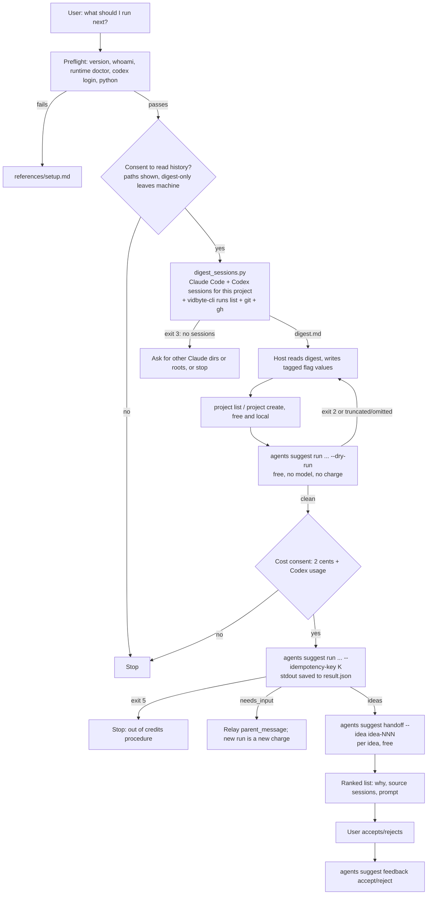

# Design: `next-from-my-sessions` agent skill

## Summary

A developer who has run many Claude Code and Codex sessions in one project often loses track of
what is finished, what was left halfway, and what keeps failing. This PR adds a public agent skill,
`skills/next-from-my-sessions/`, that turns the newest sessions for the current project (up to 100)
into a ranked list of next sessions, each with a ready-to-paste prompt. A small stdlib-only script
reads the local session files and writes a redacted digest. The host agent maps the digest onto the
Vidbyte Suggestion Agent's typed context flags. One paid run (2 cents at `--count 8`, plus model
usage on the user's own Codex login) produces the slate. Free `handoff` calls produce the prompts,
and `feedback` records what the user accepts or rejects, so the next run learns from it.

The skill is a distribution page as well as a tool. It is named after the problem ("what next,
from my sessions"), not after the agent. The backlog's `whats-next` reads repository state. This
skill reads the user's own session history, which is different evidence.

## Flow chart



## Usage example

The user types, in a project where they have been working for two weeks:

```text
look at what I've been doing in this repo and tell me what to run next
```

The agent loads the skill, passes preflight, asks to read history, and after a yes runs:

```bash
python3 "<skill-dir>/scripts/digest_sessions.py" --root "$(git rev-parse --show-toplevel)" --limit 100
# -> {"digest_path": ".../next-from-my-sessions/myapp-1a2b3c/digest.md", "sessions": {"claude": 41, "codex": 9}, ...}

vidbyte-cli --json --no-input agents suggest run \
  --goal "Choose the next coding-agent sessions to run in myapp, based on what the last 50 sessions finished, left unfinished, or kept failing at." \
  --project sessions-myapp-1a2b3c \
  --category completion --category continuation --category bottleneck --category immediate_next_steps \
  --count 8 \
  --trajectory "[S01 S50] Two weeks moving the upload pipeline from polling to webhooks." \
  --in-progress "[S04 S09] Webhook retry handler half written; signature check and tests not started." \
  --mistakes "[S02 S05 S11] pytest tests/test_upload.py timed out three times; cause: real S3 calls in tests." \
  --files ".../digest.md" \
  --idempotency-key "next-from-my-sessions:20261011:7f3a9c"
```

Then it prints, for each idea, the title, why it matters now, the sessions it came from, and the
prompt from `agents suggest handoff --input result.json --idea idea-001`.

## How it works

1. **Preflight.** Run `vidbyte-cli --version` (0.3.0 or newer), `vidbyte-cli --json whoami`, and
   `vidbyte-cli --json runtime doctor` (Codex host available). Then run `codex login status`,
   because the suggestion agent runs in the user's Codex, and a Python check for the script.
2. **Consent to read history.** Name the paths. Say that raw transcripts stay local, that only a
   redacted digest goes to the suggestion agent (in the user's Codex, on their own login), and
   that Vidbyte's admission request carries only the host and the unit count. The CLI's
   `suggest.py` states this in its comment on the launch plan and the admission request.
3. **Gather and distill (free, local):** `scripts/digest_sessions.py`, stdlib only, Python 3.8+.
   - Claude Code: every `<config dir>/projects/*/` folder whose sessions record a `cwd` inside one
     of the `--root` paths. The config dir is `$CLAUDE_CONFIG_DIR`, else `~/.claude`, plus any
     `--claude-dir`. The folder name is the launch `cwd` with every character outside
     `[A-Za-z0-9]` replaced by `-`. That rule matched all 12 sampled folders on the author's
     machine. The script still matches on the recorded `cwd`, so a different encoding (for
     example, a truncated long path) cannot hide a project. Only top-level `*.jsonl` files are
     sessions. `<session-id>/subagents/` files are skipped.
   - Codex: `$CODEX_HOME` (else `~/.codex`) `/sessions/**/rollout-*.jsonl`. The first record is
     `session_meta`, and its `payload.cwd` filters by project. Sessions whose `source` is a
     subagent object are skipped. So are sessions whose `originator` is `codex_python_sdk`: those
     are programmatic runs (including vidbyte-cli's own agents, which the runs ledger already
     covers). `archived_sessions/` is skipped.
   - Codex prompts come from `event_msg` `user_message` records. Newer Codex TUI sessions have
     none, so the script falls back to `response_item` user messages and skips injected
     instructions (text that starts with `<` or carries the AGENTS.md preamble).
   - Per session: first and last human prompt, prompt count, title (`ai-title`), final assistant
     message, interruptions, files edited, tool errors, failed commands, PR links, branch. Edited
     files with an absolute path outside every root (for example, agent memory files) are dropped.
     The digest lists only files edited in two or more sessions.
   - Vidbyte runs ledger: `vidbyte-cli --json runs list --all --limit 200` (the binary can be
     named with `--vidbyte-cli`), filtered to runs whose
     `request.working_directory` is inside a root. Git: `git log --oneline -30`, current branch,
     count of uncommitted files. GitHub: `gh pr list --state open --limit 10 --json
     number,title,headRefName`, only when `gh` is installed.
   - Redaction before writing: API keys and tokens (`sk-`, `vb_live_`, GitHub, Slack, AWS, Google,
     JWT, Bearer, PEM private keys, EVM private keys, long mixed-case tokens), `NAME=value` and
     `.env`-style assignments, `key: value` secrets, URL credentials, emails, home-directory paths
     (the real home plus generic `C:\Users\x`, `/Users/x`, `/home/x`), and the login name when it
     has at least four characters and is not a generic name. Project paths become repo-relative.
   - Output: `digest.md` in `<tempdir>/next-from-my-sessions/<repo>-<hash>/`, capped by
     `--max-chars` (default 80,000). The script prints a JSON summary to stdout: paths, counts,
     the redaction count, and a suggested project key.
4. **Map onto typed flags.** The host reads the digest and writes `--trajectory`, `--completed`,
   `--in-progress`, `--mistakes`, `--blockers`, `--outcomes`, and `--context` values, at most 40
   in all. Each value starts with session tags like `[S03 S07]` and is one fact of at most 300
   characters. The full digest goes in `--files`. The tags do two jobs:
   - The handoff's `evidence[].content` quotes the cited values. So the tags tell the user which
     sessions an idea came from.
   - `SuggestionService._rejected_terms` uses every `completed`, `in_progress`, `avoid`, `mistakes`,
     and `forbidden` value as a verbatim suppression needle (`selection.suppress_rejected`). An
     idea whose title, summary, or actions contain a value is dropped. A short untagged value such
     as "auth refactor" would therefore remove every continuation of that work. A tagged
     full-sentence value is very unlikely to be echoed verbatim.
5. **Settings chosen.**
   - `--category completion continuation bottleneck immediate_next_steps`. These cover unfinished
     obligations, the next step of an accepted plan, the repeated failures that limit progress,
     and anything startable now.
   - `--count 8`. One admission unit buys up to 10, so this still costs 2 cents. It is short
     enough to review in one sitting.
   - No `--horizon`. `_finalize` drops every idea whose horizon differs from a non-`any` filter,
     and a plan of next sessions needs both `now` and `next` ideas.
   - `--project sessions-<repo>-<hash>`, created with `agents suggest project create` if
     `project list` lacks it, so accepted and rejected ideas carry over between runs.
   - Default rounds.
6. **Dry run first.** `--dry-run` never loads the SDK, never buys an admission, and never calls a
   model (`suggest.py` returns before `IdempotencyKey.create`; `service.run` returns before
   `SuggestionSdk.load`). It validates every flag, the digest file, and the project, and shows the
   `context_manifest` statuses. The paid run happens only after cost consent, with one
   idempotency key `next-from-my-sessions:<YYYYMMDD>:<6 hex>`.
7. **Deliver.** Save stdout to `result.json` as UTF-8. Windows PowerShell 5.1's `>` writes UTF-16,
   and `handoff` reads `utf-8-sig`. For each idea, run `agents suggest handoff --input result.json
   --idea <id>` (free, local) and show `data.execution_prompt`. Map evidence tags to session dates
   and titles from the digest. Ask for accept or reject, and record only explicit answers with
   `agents suggest feedback accept|reject --project <key> --suggestion "<idea title>" --reason
   "<user's words>"`. The verbatim title becomes a suppression needle for future runs.

## Files

| File | Change |
|---|---|
| `skills/next-from-my-sessions/SKILL.md` | New. The skill, in the write-agent-skill section order. |
| `skills/next-from-my-sessions/scripts/digest_sessions.py` | New. Stdlib-only digest builder (find, parse, redact, cap). |
| `skills/next-from-my-sessions/references/setup.md` | Byte-for-byte copy of the canonical file in the write-agent-skill skill (`skills/agent-skills/write-agent-skill/references/`). |
| `skills/next-from-my-sessions/references/troubleshooting.md` | Byte-for-byte copy of the canonical file. |
| `docs/design/next-from-my-sessions.md` | This document. |

## Commands and versions

Every command path and long option below is in the CLI's `contracts/cli-commands.json` on
`main` (contract commit `9703b53`) and in the command tree of the 0.3.0 release candidate
(`d242790`). The help text and validation come from `src/vidbyte_cli/` on `main` (`7e589d7`). The
`--version`, `--help`, `agents suggest categories`, `agents suggest project list`, `runs list`,
and `runtime doctor` commands, plus the dry run, `project create`, `handoff`, and `feedback`, were
run from a throwaway install of that candidate, with an isolated state directory.

| Command | Used for | Price |
|---|---|---|
| `vidbyte-cli --version`, `--json whoami`, `--json runtime doctor` | Preflight | Free |
| `vidbyte-cli --json runs list --all --limit 200` | Runs ledger (`--limit` 1-200) | Free, offline |
| `vidbyte-cli --json agents suggest project list` / `project create --key --title --description` | Memory scope | Free, local |
| `vidbyte-cli --json --no-input agents suggest run ... --dry-run` | Validation | Free, no model |
| `vidbyte-cli --json --no-input agents suggest run ... --idempotency-key` | The run | 2 cents per block of up to 10 requested suggestions (`runtime.suggestion@1` = 2 in `gate.py`; `SUGGESTIONS_PER_UNIT = 10`) + Codex model usage |
| `vidbyte-cli --json agents suggest handoff --input --idea` | Prompts | Free, local |
| `vidbyte-cli --json agents suggest feedback accept/reject --project --suggestion --reason` | Memory | Free, local |

`min-cli-version` is `0.3.0`. In `v0.2.0`, `runs` does not exist, `agents suggest run` has no
`--idempotency-key`, there is no paid admission (so the cost statement would be wrong), and
`--count` is capped at 15. 0.3.0 is not on PyPI yet, so this PR must not merge until it is.

## Risks and open questions

- **No end-to-end run.** The author was not allowed to spend money, so the paid run and
  `handoff` on a real model result were not executed. The dry run was executed against the 0.3.0
  candidate with a digest built from real history. `handoff` was run on a synthetic result, and
  `project create` and `feedback accept`/`reject` were run in an isolated state directory.
- **Claude Code formats are undocumented.** The record shapes (`type`, `isMeta`, `isSidechain`,
  `isCompactSummary`, `turnOrigin`, `ai-title`, `pr-link`, `tool_use`/`tool_result`) and the
  folder encoding were read from one machine's files (Windows, recent Claude Code). Long-path
  truncation and macOS/Linux folder names were not observed. The script matches on the recorded
  `cwd` to tolerate this.
- **Codex SDK sessions are excluded.** This includes Vidbyte's own runs. If a user drives Codex
  mainly through the SDK, they may see few sessions. Open question: add an opt-in flag later?
- **Redaction is pattern-based.** It removes the listed shapes, but it cannot promise that no
  sensitive prose remains. The consent message says this, and the skill offers to show the
  digest before the paid run.
- **Run duration.** It is unknown and may exceed a host shell tool's timeout. The skill tells the
  agent to run it in the background, because a killed run is already charged and cannot resume.
  Open question: should the skill pass `--timeout-seconds`?
- **Open question.** Should `stop_or_defer` be added, so that threads abandoned several times
  produce an explicit "drop this" idea? It was left out because the user asked for sessions to
  run.
- **Open question.** Worktree sessions are included through `git worktree list`. Sessions from an
  older clone of the same repository at another path are not. Should the skill match on the
  remote URL too?

## Verification

- `npx -y skills add <worktree> --list` lists `next-from-my-sessions`. A scratch install copies
  `scripts/` and `references/`.
- `git hash-object` of both references equals `git rev-parse origin/main:<path>` in the Vidbyte
  repository.
- A script parses every `vidbyte-cli` invocation in `SKILL.md` (joining continued lines) and
  checks its command path and long options against `contracts/cli-commands.json` and against the
  live command tree of the installed 0.3.0 candidate.
- The digest script runs against this machine's real history, with output outside the repository.
  A scan of the output finds no home path, login name, email, or key pattern. The output is not
  copied anywhere. The script also runs on Python 3.8.
- The dry run of the exact command shape succeeds on the 0.3.0 candidate (`stop_reason:
  dry_run`, every manifest entry `included`).
- The write-agent-skill review checklist is walked item by item in the PR body.
