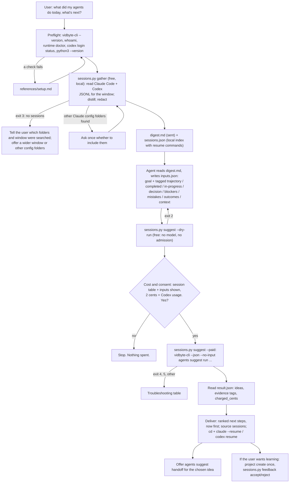

# pick-up-where-my-sessions-left-off

## Summary

Add the public agent skill `skills/pick-up-where-my-sessions-left-off/`. A developer runs several
Claude Code and Codex sessions a day, often in parallel and across repositories. By the evening or
the next morning nobody remembers what each session finished, what it left half done, which errors
it hit, or what to do next. The transcripts hold all of it, but they are large JSONL files nobody
reads.

The skill turns those transcripts into ranked next steps. A bundled, stdlib-only Python script
reads the sessions of a time window (default: the last 24 hours) from the local Claude Code and
Codex folders, distills each session (project, title, prompts, last agent message, recap, files
edited, failed commands, how it ended), redacts secrets, emails, and home paths, and writes one
Markdown digest. The coding agent maps the digest onto the Suggestion Agent's typed inputs, shows
the user what will be sent, and after a yes runs one `vidbyte-cli agents suggest run` (2 cents at
`--count 8`, plus model usage on the user's own Codex account). The user gets ranked next steps,
each tied to the sessions it came from and the exact command to resume them.

## Flow chart



## Usage example

```bash
npx skills add cerredz/vidbyte-cli --skill pick-up-where-my-sessions-left-off
```

Then, in the coding agent:

```text
> what did my claude and codex sessions get done today, and what should I pick up next?
```

The agent runs the preflight, then:

```bash
python3 "<skill>/scripts/sessions.py" gather --hours 24
```

It reads `digest.md`, writes `inputs.json` next to it, checks the request for free, shows the user
the session table and every value that will be sent, and asks: "This runs the Vidbyte Suggestion
Agent once. It costs 2 cents from your Vidbyte balance, plus model usage on your own Codex account.
It changes no files. Run it?" After a yes:

```bash
python3 "<skill>/scripts/sessions.py" suggest --out "<out_dir>" --paid
```

which runs, from inside `<out_dir>`:

```bash
vidbyte-cli --json --no-input agents suggest run \
  --goal "Choose what to do next with the work in progress from my coding-agent sessions of the last 24 hours ..." \
  --category completion --category continuation --category immediate_next_steps --category verification \
  --count 8 \
  --trajectory "[all] ..." --completed "[S2] ..." --in-progress "[S1] ..." --decision "[S4] ..." \
  --blockers "[S3] ..." --mistakes "[S1 S3] ..." --outcomes "[S2] ..." --context "[all] ..." \
  --files digest.md \
  --idempotency-key "pick-up-where-my-sessions-left-off:20261011:3f9a1c"
```

## How it works

- **Gather (free, local).** `sessions.py gather` reads:
  - Claude Code: `<config dir>/projects/*/<session-id>.jsonl`, where the config dir is
    `$CLAUDE_CONFIG_DIR` if set, else `~/.claude`, plus every `--claude-dir` the user names. It
    reports other `~/.claude*` folders that hold transcripts but never reads them unasked. Subagent
    transcripts (`<session>/subagents/*.jsonl`), sidechain records, and SDK sessions
    (`entrypoint` starting with `sdk`) are skipped.
  - Codex: `$CODEX_HOME` or `~/.codex`, `sessions/YYYY/MM/DD/rollout-*.jsonl`. The first line is
    `session_meta` with `id`, `cwd`, `originator`, `source`, and `thread_source`. SDK sessions,
    subagent threads, and desktop automations are skipped. Titles come from `session_index.jsonl`
    (`thread_name`) or `thread_name_updated` events.
  - A file is opened only if its modification time is inside the window, and only records with a
    timestamp inside the window count. `--project-dir` keeps sessions whose recorded `cwd` (any
    turn) is that folder or inside it, which also catches worktrees under it.
- **Formats confirmed on real files** (Claude Code 2.1.296, codex-cli 0.161.0, and older Codex
  rollouts back to January 2026):
  - Claude Code human prompts are `type: user` records whose `origin.kind` is `human`. Older
    records without `origin` are filtered by shape: no `isMeta`, no `isCompactSummary`, no
    `tool_result`, and not one of the injected texts (`<task-notification>`, `<local-command-...>`,
    `<system-reminder>`, `Stop hook feedback`, `[Request interrupted ...`, peer-session messages).
    Slash commands render as `/name args`. Tool calls are `tool_use` parts (`Bash`, `PowerShell`,
    `Edit`, `Write`, `MultiEdit`, `NotebookEdit`); results are `tool_result` parts with `is_error`
    and `Exit code N` text. Titles are `custom-title` (user-set, preferred) and `ai-title`. Recaps are
    `system/away_summary` and the "Pending Tasks" to "Optional Next Step" part of the
    `isCompactSummary` message. PRs are `pr-link` records. API failures are `isApiErrorMessage`.
  - Codex prompts are `event_msg/user_message` (older) or `item_completed` items of type
    `UserMessage` (newer). Commands are `exec_command_end` or `CommandExecution` items with
    `exit_code` and `status`; edits are `patch_apply_end` or `FileChange` items. Turn ends are
    `task_complete` (with `last_agent_message`), `turn_aborted`, and `error`. Newer compactions are
    encrypted, so a `compacted.message` is used only when it has text.
- **Distill.** Per session: tool, project (home-relative), title, active time, prompt count with
  the first and last prompts, last agent message, recap, files edited, failed commands with the last
  error lines (marked resolved when the same command later succeeded), tool calls the user
  rejected, permission denials, checks run (test, lint, build) with their last result, commits, and
  PRs. "How it ended" is mechanical: finished its last turn, ended with a question to the user,
  stopped mid-task, interrupted by the user, or stopped by an API error; activity in the last 15
  minutes is flagged "may still be running". Each section is capped and shrinks in steps so the
  whole digest stays under `--max-chars` (default 60,000).
- **Redact before writing.** Every string is passed through one redactor before it reaches
  `digest.md`: `sk-`/`sk_live_`-style keys, `ghp_`/`gho_`/`ghu_`/`ghs_`/`ghr_`, `github_pat_`,
  `xox?-` and `xapp-` Slack tokens, AWS `AKIA`/`ASIA` key ids, Google `AIza` keys, `vb_live_`/
  `vb_test_` Vidbyte keys, JWTs, PEM private-key blocks, `0x` + 64-hex private keys, `Bearer` and
  `Authorization:` values, credentials in URLs, `.env`-style assignments (`NAME=value` lines and any
  `*KEY*`/`*TOKEN*`/`*SECRET*`/`*PASSWORD*` assignment, including JSON-style), email addresses, and
  absolute home paths (`C:\Users\<name>`, `/Users/<name>`, `/home/<name>`, and this user's home in
  every spelling, including Claude Code's encoded project folder names) shown as `~`, and this
  user's login name as a whole word, shown as `[user]`. The digest header lists the counts, never
  the values. `sessions.json`
  keeps real paths and session ids for the resume commands and is never sent.
- **Typed inputs.** The coding agent writes `inputs.json` from the digest. Every value except
  `constraint` and `avoid` must start with session tags such as `[S2 S5]` or `[all]`. The tags tie
  each idea's evidence back to sessions, and they stop the CLI's verbatim suppression from deleting
  real follow-ups: `selection.suppress_rejected` drops any idea whose title, summary, or actions
  contain a `--completed`, `--in-progress`, `--mistakes`, `--avoid`, or `--forbidden` value word
  for word. The script re-runs the redactor over the values, checks the tags exist, and caps
  counts and lengths so the argv stays far below Windows' 32,767-character limit.
- **Run.** `sessions.py suggest` builds the argv and runs `vidbyte-cli` without a shell, so no
  quoting differs between bash, zsh, PowerShell, and cmd. It runs from inside the output folder and
  passes `--files digest.md` as a relative path, so the file's `source` string that reaches the model
  holds no home path, and no repository `AGENTS.md` is in Codex's working folder. stdout is saved
  as UTF-8 (`dry-run.json` or `result.json`); stderr is shown and saved (`*.stderr.txt`) because
  the CLI writes its `kind: "error"` document there. The paid mode needs `--paid`, makes and saves
  one idempotency key, and refuses to start in a folder that already holds a paid attempt
  (`idempotency-key.txt` or `result.json`, even an empty or unreadable one), unless the caller is
  recovering that attempt with `--idempotency-key` and no result was saved yet.
- **Flag choices.**
  - `--category completion continuation immediate_next_steps verification`: close the open loops,
    take the next step of plans already agreed, act from the current state, and check claims
    sessions made ("tests pass") before building on them. All four ids are in the registry
    (`agents suggest categories`). `prioritization` is left out because the slate is already
    ranked; `bottleneck` because one day rarely shows a repeated constraint.
  - `--count 8`: one admission unit covers 2 to 10 ideas (2 cents), the count is a maximum, not a
    quota, and eight covers a day of parallel sessions in one reading.
  - No `--horizon`. In the source the horizon is applied only after review, as a hard filter on
    each idea's own label, and the generator is never told it (`service.py` `_finalize`). `now`
    would silently drop every idea labelled `next` and could return an empty slate that was still
    charged. The goal names the next working session instead, and Deliver lists `now` ideas first.
  - `--files` for the digest, not `--attach`: a `--files` entry gets a manifest ref (`ctx-NNN`), so
    ideas can cite it and pass the evidence gate (`validate_evidence`); `--attach` text has no ref,
    so an idea citing it would be withheld.
  - `--project session-next-steps` only after the user opts into learning, so accepted and rejected
    ideas shape later runs; default `--rounds 2` and `--max-messages 2`.
- **Deliver.** Ideas are grouped `now`, `next`, `later`, in rank order. Each names its source
  sessions (tags from `handoff.evidence[].content`, else from the idea text) with title, tool, and
  project from `sessions.json`, plus the resume command: `cd "<cwd>"` then `claude --resume <id>`
  (with `CLAUDE_CONFIG_DIR` set when the session lives in another config folder) or
  `codex resume <id>` (with `CODEX_HOME` when not `~/.codex`). Both spellings were checked with each
  tool's `--help`. The agent offers `agents suggest handoff` for the chosen idea, `feedback
  accept/reject` through the script (which copies the exact title from `result.json`), and the
  sibling skill `morning-triage`, which can take this digest as one of its inputs.

## Why Python, not shell scripts

The contract does not require `.sh` scripts. `github-issue-tasks` uses bash because it drives
`git` and `gh` and its hook runs inside the Task Board. This skill parses large JSONL files,
redacts with regular expressions, and passes free text as arguments; in bash that means `jq` and
`sed` pipelines that break on Windows, and PowerShell 5.1 mangles embedded double quotes in native
arguments. `vidbyte-cli` needs Python 3.11+, so Python is present wherever the skill runs. The
script uses only the standard library and runs on Python 3.8+.

## Files

| File | Change |
|---|---|
| `skills/pick-up-where-my-sessions-left-off/SKILL.md` | New. The skill, in the contract's section order. |
| `skills/pick-up-where-my-sessions-left-off/scripts/sessions.py` | New. `gather` (read, distill, redact), `suggest` (dry run or paid run), `feedback` (accept or reject by idea id). Stdlib only. |
| `skills/pick-up-where-my-sessions-left-off/references/setup.md` | New. Byte-for-byte copy of the canonical file. |
| `skills/pick-up-where-my-sessions-left-off/references/troubleshooting.md` | New. Byte-for-byte copy of the canonical file. |
| `docs/design/pick-up-where-my-sessions-left-off.md` | New. This document. |

## CLI surface and min-cli-version

Every command and long option the skill uses is in `contracts/cli-commands.json` on the internal
repository's `main`: `agents suggest run` (`--goal`, `--category`, `--count`, `--trajectory`,
`--completed`, `--in-progress`, `--decision`, `--blockers`, `--mistakes`, `--outcomes`,
`--context`, `--constraint`, `--avoid`, `--files`, `--project`, `--dry-run`, `--idempotency-key`),
`agents suggest handoff` (`--input`, `--idea`), `agents suggest project list`, `agents suggest
project create` (`--key`, `--title`, `--description`), `agents suggest feedback accept|reject`
(`--project`, `--suggestion`, `--reason`), `whoami`, and `runtime doctor`. PyPI's newest release is
0.2.0. Its `agents suggest run` has no paid admission and no `--idempotency-key`, so the cost
statement and the contract's one-key-per-priced-run rule would both be wrong there. So
`min-cli-version` is `0.3.0`, and the skill is not published until 0.3.0 is on PyPI. The price, 2
cents per block of up to ten requested ideas, comes from `SuggestionAdmissionLimit` and the
`runtime.suggestion@1` admission on `main`.

## Risks and open questions

- **Undocumented formats.** Both transcript formats are internal and change between releases. The
  parser reads fields defensively, supports both Codex generations seen on disk, and counts what it
  could not parse. A format change degrades the digest; it does not crash it.
- **Redaction is pattern-based.** It cannot catch every secret. The user sees the session table and
  every typed value, and can open the digest before the paid run.
- **Mid-task is a heuristic.** It reads the last records only. A session whose agent wrote "done"
  but left work is caught by the agent reading the last message, not by the script.
- **Run length.** The paid run can take several minutes; the skill tells the agent to run it in the
  background or with a long timeout, because a run killed after admission is still charged.
- **Horizon filter.** The CLI applies `--horizon` silently after review. A warning, or telling the
  generator the horizon, would make the flag safe to use; reported as a CLI gap.
- No paid end-to-end run was completed, because it spends real money. The paid path was tested
  with a stand-in `vidbyte-cli` that only records its arguments.

## Verification

1. Every `vidbyte-cli` command path and long option in `SKILL.md` and `sessions.py` checked against
   `contracts/cli-commands.json` on the internal `main`.
2. `sessions.py gather` run against the real Claude Code and Codex folders on a Windows machine for
   24 hours, 72 hours, and with `--project-dir`; output kept outside the repository and scanned for
   home paths, the login name, emails, and token patterns. No real output is committed.
3. `sessions.py gather` run against small synthetic fixtures (both Claude Code and both Codex
   generations), including planted secrets, to check parsing, status detection, and redaction.
4. `sessions.py suggest --dry-run` run with the real digest and a written `inputs.json` against a
   CLI built from the internal `main`, with an isolated state folder: exit 0, `status:
   no_suggestions`, `stop_reason: dry_run`, every manifest entry `included`, no charge. Invalid
   inputs (missing tags, unknown tag, too many values, a missing project) fail with exit 2.
5. `cmp` of both `references/` files against the canonical copies.
6. The paid-run guards tested with a stand-in `vidbyte-cli` first on `PATH`: a folder with an
   earlier key file, an empty result, or an unreadable result refuses; a recovery key runs only
   while no result is saved; a clean folder runs once and then refuses.
7. `sessions.py feedback` (accept, reject with a redacted reason, unknown idea, bad project key) and
   `agents suggest handoff` run against a synthetic, schema-valid `result.json` with an isolated
   state folder; a dry run with `--project` then loads the recorded feedback.
