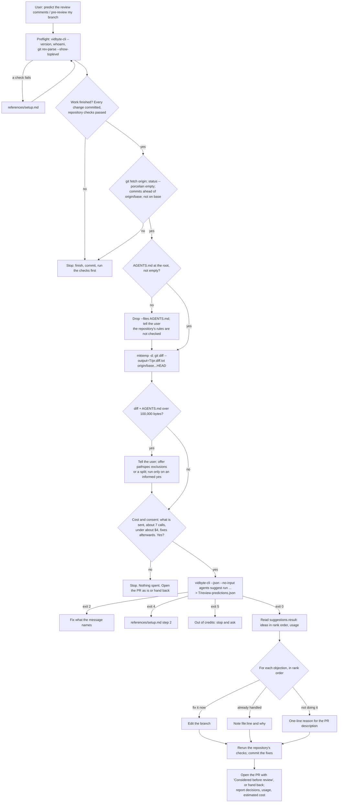

# predict-the-review

## Summary

Add the public agent skill `skills/predict-the-review/`. Before a pull request is opened, the
coding agent learns what human reviewers will object to, so the first round of review comments
never happens. The user asked for it in these words: "Before opening a PR, learn what reviewers
will object to so the first comment round never happens. It takes the branch diff and AGENTS.md
and returns objections ranked by severity, advice only, which fits the moment before a human
review." They also asked that the agent run the Suggestion Agent last, after it has created
everything in the pull request, and then use the output to decide what it still has to do.

The skill is command-only, like `vibe-coded-to-production`: no helper script. It checks that the
work is finished (every change committed, the repository's checks passed, an empty
`git status --porcelain`, commits ahead of `origin/<base>`), writes the three-dot diff into a temp
folder with `git diff --output`, gets one yes, and runs the user's `vidbyte-cli agents suggest run`
command once, with the changes the repository forces (below). The coding agent then decides for
each ranked objection: fix it now, already handled (`file:line`), or not doing it (a one-line
reason that goes into the pull request description). It commits the fixes, reruns the checks, and
opens the pull request or hands it back. It never reruns the prediction on its own.

## Flow chart



## Usage example

```bash
npx skills add cerredz/vidbyte-cli --skill predict-the-review
```

Then, in the coding agent, once the branch is done:

```text
> The rate-limit branch is finished. Predict the review comments, fix what's worth fixing, then open the PR.
```

The agent checks that the work is committed and writes the diff, all free and local:

```bash
git fetch origin
git status --porcelain                         # prints nothing
git rev-list --count origin/main..HEAD         # 3
mktemp -d                                      # /tmp/tmp.k3J9x2Lq
git diff --no-color --no-ext-diff --output="/tmp/tmp.k3J9x2Lq/pr.diff.txt" origin/main...HEAD
wc -c "/tmp/tmp.k3J9x2Lq/pr.diff.txt" AGENTS.md
```

After the user's yes, from the repository root:

```bash
vidbyte-cli --json --no-input agents suggest run \
  --goal "Find what reviewers will object to in this change before I open the PR" \
  --files "/tmp/tmp.k3J9x2Lq/pr.diff.txt" --files AGENTS.md \
  --avoid "Formatting and naming nits the linter already enforces" \
  --category verification --category risk_prevention --category simplification \
  --horizon now --count 8 --rounds 3 \
  --max-total-tokens 400000 > "/tmp/tmp.k3J9x2Lq/review-predictions.json"
```

The agent then decides each objection, commits the fixes, reruns the checks, and opens the pull
request with a "Considered before review" section that lists the skipped objections and why.

## How it works

- **Run last.** Gather inputs is the gate. The diff covers only committed work, so an earlier run
  reviews a stale or partial change, every edit after it goes unreviewed, and each run is a new
  charge. The rule appears in Goal and done-when, Gather inputs (as checks that stop the skill),
  Steps, Run, and Guardrails.
- **Calls.** On the usage-billing branch of internal PR #162, `services/suggestions/service.py`
  makes one generator draft, then one critic call and one revision per round: 1 + 2 x 3 = 7 turns
  with `--rounds 3` (5 with the default 2). `gateway.py` repeats a turn once when a message-tool
  call bounces (`_MESSAGE_ATTEMPTS = 2`).
- **Every call carries the diff.** `sdk.py` `agent_settings` renders each stage's
  `SuggestionAgentContext` into the agent's `instructions`, so all seven calls send the full diff
  and `AGENTS.md`; the generator also resends its growing history.
- **Cost ceiling.** `_check_limit` runs before each turn, so at most one turn starts after the
  400,000-token mark. Tokens before that turn stay under 400,000; with output capped at 32,000
  per call (`SuggestionOutputLimit.DEFAULT_TOKENS`) and a 100,000-byte context, they cost at most
  about $2.6 at gpt-6-sol's rates. The last turn (the third revision, two calls if its message
  bounces, each about 115,000 input tokens with the history) adds about $1.1. With 2%, about $3.8,
  stated to the user as "under about $4". This is an estimate from the code's limits, not a
  measured run.
- **Reading.** `SuggestionIdea` has no severity field. `selection.rank` numbers the final slate in
  the order the generator returned it, so the skill reads rank 1 as most severe. Cited evidence in
  a handoff is the first 4,096 characters of the input (`handoff.py`), not the cited lines, so the
  skill tells the agent to find the lines itself.
- **No dry run in the skill.** Considered and left out. `suggest.py` builds and validates the
  whole request (`SuggestionRequestBuilder().build`) before any model call in a paid run too, so
  every input error a dry run catches (file suffix, missing file, encoding, flag values) also stops
  the paid command before it bills anything. The one silent failure, a file `truncated` or
  `omitted` by the 5,000,000-character context budget (`context.py`), cannot happen under the
  100,000-byte rule.

## Files

| File | Change |
|---|---|
| `skills/predict-the-review/SKILL.md` | New. The skill, in the contract's section order. |
| `skills/predict-the-review/references/setup.md` | New. Byte-for-byte copy of the canonical file. |
| `skills/predict-the-review/references/troubleshooting.md` | New. Byte-for-byte copy of the canonical file. |
| `docs/design/predict-the-review.md` | New. This document. |

## Changes from the user's command

The user's command is kept word for word (goal, `--files AGENTS.md`, `--avoid`, the three
categories, `--horizon now`, `--count 8`, `--rounds 3`) except for these, each forced by the
repository or the CLI:

| # | Change | Evidence |
|---|---|---|
| F1 | The diff is `pr.diff.txt`, not `pr.diff`. | `_SUPPORTED_SUFFIXES = {".txt", ".md", ".json"}` in `services/suggestions/context.py`. Dry run with `pr.diff`: exit 2, `Could not read suggestion context: unsupported context file type: <path>.` |
| F2 | `--no-input` and `--max-total-tokens 400000` added. | Contract sections 4 and 6 (`vidbyte-cli --json --no-input ...`) and section 3 (`metadata.cost` names the cap); `max_total_tokens.md` and `_check_limit` in `service.py`. |
| F3 | The diff and `review-predictions.json` go in a new `mktemp -d` folder; the agent writes its literal path into later commands. | `/tmp` does not exist for Windows agents, a `review-predictions.json` in the repository root could be committed into the pull request it reviews, and agent hosts do not keep shell variables between tool calls. |
| F4 | `git diff --output=<file>` instead of `>`, and every block runs in bash or zsh. | `context.py` reads `utf-8-sig`. A UTF-16LE diff (what a Windows PowerShell 5.1 `>` writes): exit 2, `Could not read suggestion context: 'utf-8' codec can't decode byte 0xff in position 0: invalid start byte.` `--output` wrote byte-identical UTF-8 files from Git Bash and from PowerShell 5.1. |
| F5 | AGENTS.md is not copied; the command runs from the repository root with the temp path absolute. | The path does not reach the model: `SuggestionAgentContext.for_stage` in `types/suggestions.py` keeps only `ref`, `kind`, and `content` ("a stage cannot place a source path ... into a model window"), on internal `main` and on PR #162's branch. The path stays in local result fields only (`context_manifest[].source`, `handoff.evidence[].source`, `execution_prompt`). |
| F6 | `origin/<base>...HEAD` after `git fetch origin`; `main` stays the default base. | A stale local `main` makes the three-dot diff include commits already upstream. |
| F7 | No AGENTS.md: drop `--files AGENTS.md` and tell the user. | Dry run without the file: exit 2, `Could not read suggestion context: context file not found: AGENTS.md.` An empty file is omitted with a warning (`context.py`). |
| F8 | Over 100,000 bytes of diff plus AGENTS.md: stop and tell the user; offer pathspec exclusions or a split. | Every call carries the context (`sdk.py`), seven times; the gateway refuses any single request over 2,000,000 bytes (`ModelGatewayLimit.MAX_BODY_BYTES`, `SuggestionRequestTooLarge`), which a large diff plus the generator's growing history can reach mid-run, after earlier calls were billed. |

## Risks and open questions

- **Release.** `min-cli-version` is `0.3.0`, like every usage-billed sibling, and PyPI still serves
  0.2.0. Internal `main` is already at 0.3.1 (#159, #160) and still bills the Suggestion Agent with
  a 2-cent admission; usage billing (internal PR #162) is open. The first release with usage
  billing will be newer than 0.3.0, so this skill and its siblings need the same `min-cli-version`
  fix when it ships. Do not publish before that release.
- **Severity order.** The CLI has no severity score, and the user's goal text, kept word for word,
  does not ask for one. Open question: add "ranked by severity" to the goal, or keep the
  generator's own order.
- **Secrets in the diff.** The diff goes to Vidbyte and OpenAI as committed, with no redaction.
  The consent question names what is sent. Open question: a redaction step.
- **No AGENTS.md.** The skill does not fall back to `CLAUDE.md` or `CONTRIBUTING.md`. Open
  question: whether it should.
- **Not built, open questions only:** a learning project with `agents suggest feedback`, so
  accepted and rejected objections shape later runs; `agents suggest handoff` for one objection; a
  helper script; an automatic second run after the fixes (it would be a second charge); a hook
  that runs the skill before `gh pr create`.
- **Evidence is by content only.** The model sees each file as `## [ctx-002] file` with no name, so
  it tells the diff from `AGENTS.md` by their content.

## Verification

1. A script checked every `vidbyte-cli` command path, root option, and long option written as code
   in `SKILL.md`, plus `metadata.commands`, against `contracts/cli-commands.json` on internal
   `origin/main` (`8fdac4c`; the file records source commit `5c93cf6`) and on PR #162's branch:
   all pass.
2. Free dry runs of the exact Run command with `--dry-run` added, against a throwaway repository
   (one committed change on a branch, `AGENTS.md`, a local bare `origin`), using the CLI installed
   from the internal checkout. A wrapper forwarded only `--version` and `agents suggest run ...
   --dry-run`, pointed `VIDBYTE_API_URL` at a closed local port, set the keyring to the null
   backend, and redirected the CLI's folders with `WIN_PD_OVERRIDE_LOCAL_APPDATA` and
   `USERPROFILE`. Result: exit 0, `kind: suggestions.result`, `stop_reason: dry_run`, `usage: {}`,
   three manifest entries (`flag:avoid`, the diff, `AGENTS.md`) all `included`. The `.diff`, missing
   `AGENTS.md`, and UTF-16 runs gave the exit-2 messages quoted above. No paid run was made.
3. `cmp` and `git hash-object` of both `references/` files against the canonical copies: identical
   (`8fb4e3c`, `cb9656b`).
4. The diff was grepped for home folder names, emails, and token patterns before each commit.
5. Not done: an end-to-end paid run with a released CLI that has usage billing, because none is on
   PyPI yet.
