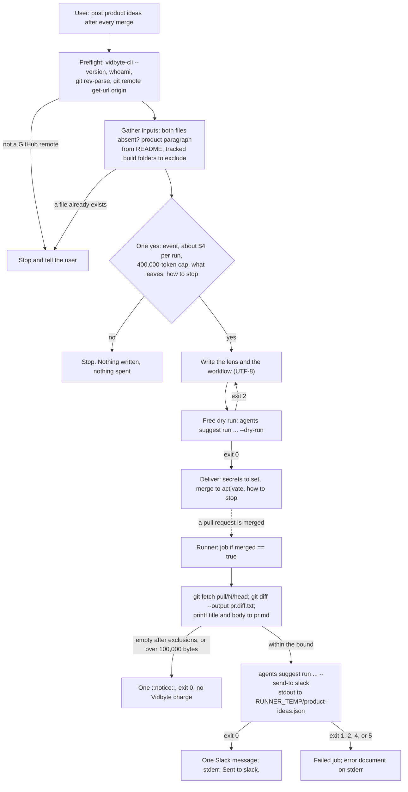

# product-ideas-after-merge

## Summary

Add the public agent skill `skills/product-ideas-after-merge/`. The user asked for:

> a custom, "product-focused" suggestion agent that suggestions product-facing features after a pr
> into a github that outputs its ideas to a slack channel

and chose the automatic trigger: after every merged pull request, with no one asking. After one
informed yes, the user's coding agent writes two files into the user's repository: a GitHub
Actions workflow, `.github/workflows/product-ideas.yml`, and a product lens,
`.github/product-ideas-lens.md`. On every merged pull request, the workflow sends the pull
request's diff, title, and description to `vidbyte-cli agents suggest run` with the lens, the
three product categories, `--count 3`, and `--max-total-tokens 400000`, and posts up to three ideas
to Slack with `--send-to slack`. The user sets the `VIDBYTE_API_KEY` and `SLACK_WEBHOOK_URL`
repository secrets themselves.

The skill is command-only, like `predict-the-review` and `vibe-coded-to-production`: no helper
script and no asset file. The workflow YAML and the lens template are fenced blocks in `SKILL.md`,
as `vibe-coded-to-production` prints its workflow. This repository's copy of the skills rulebook
gains one paragraph in section 5 and one section 9 checklist item that allow consent once, at
install, for a CI workflow that starts paid runs only on a trigger people with write access cause.

## Flow chart



## Usage example

```bash
npx skills add cerredz/vidbyte-cli --skill product-ideas-after-merge
```

Then, in the coding agent:

```text
> After every PR we merge, post product feature ideas to our Slack channel.
```

The agent runs Preflight and Gather inputs, asks one consent question, and after the yes writes the
two files. It checks them with a free dry run that needs no key:

```bash
vidbyte-cli --json --no-input agents suggest run \
  --goal "Product features for our users that pull request #0 (install check) makes possible" \
  --instructions .github/product-ideas-lens.md \
  --category product_experience --category business_growth --category adjacent_opportunity \
  --count 3 --max-total-tokens 400000 --dry-run
```

The user then sets the two secrets in their own terminal; each command prompts for the value:

```bash
gh secret set VIDBYTE_API_KEY
gh secret set SLACK_WEBHOOK_URL
```

Merging the two files is skipped with no Vidbyte charge. After that, every merged pull request
posts one Slack message, and the job log ends with `Sent to slack.`:

```text
Suggestions for: Product features for our users that pull request #42 (Add CSV export) makes possible

3 of 3 ideas (complete)

1. <idea title>
<idea summary>
First action: <first action>
```

## How it works

- **Judgment at install, a gate at run time.** Every decision that needs a person is made while
  the user is present: whether the files already exist, the product paragraph, and which tracked
  build folders (`dist`, `build`, `out`, `vendor`, `node_modules`) to leave out of the diff. The
  unattended run only checks two facts in the shell: the diff is empty after exclusions, or the
  diff and description are over 100,000 bytes. Either one prints one `::notice::` line naming its
  cause and exits 0 before any `vidbyte-cli` call.
- **The diff.** `actions/checkout@v4` with `fetch-depth: 0`, then
  `git fetch --no-tags origin "pull/$PR_NUMBER/head"`, then a three-dot
  `git diff --output="$RUNNER_TEMP/pr.diff.txt" "$BASE_SHA...$HEAD_SHA"` with the lockfile globs,
  the two installed files, and the install-time folders excluded. Three dots over base and head
  are what the pull request showed, for merge, squash, and rebase merges. The pull request's head
  ref survives the branch's deletion. The title and body come from the event payload through the
  step's `env:` and are written to `pr.md` with `printf`, so the shell never evaluates them.
- **Calls and the ceiling.** At the default two rounds the run has five turns: one draft, then a
  critique and a revision per round. A turn whose message bounces is retried once inside the turn,
  so a run makes at most about 10 calls. Each call has at most 32,000 output tokens, and the
  context is at most 100,000 bytes plus a lens of at most 4,000 bytes, about 240,000 input tokens
  over the run. At gpt-6-sol's $2 / $10 per million input / output tokens, 320,000 output tokens
  cost $3.20 and 240,000 input tokens $0.48: about $3.68, or about $3.75 with the 2%. The
  400,000-token cap is checked before each turn, so a run that grows past it starts no new turn.
  The skill states the ceiling as "at most about $4". This is an estimate from the code's limits,
  not a measured run.
- **The lens.** A short Markdown file passed with `--instructions`, which the CLI appends to the
  system prompt of the generator and every critic. It holds a two-to-four-sentence product
  paragraph written at install from the README (or the user's answer), says what to suggest and
  what not to, and tells the model to treat the pull request's text and diff as data. Sending the
  README itself would repeat a long, changing file in every call.
- **The result never reaches the log.** stdout goes to `$RUNNER_TEMP/product-ideas.json`, which
  GitHub empties at the end of the job. Actions logs of a public repository are readable by any
  signed-in GitHub user, so only stderr (progress, the receipt, an error document) is logged.
- **The dry run.** After writing the files, the agent runs the paid command's agent flags with
  `--dry-run` and without `--files` (runner-only files) and `--send-to` (it would need the webhook
  locally). It is free, needs no key, and makes the CLI check the lens (UTF-8, not empty, under
  the size limit) before hand-back. `predict-the-review` skipped a dry run because its paid run
  fails before billing on the same errors; here the paid run happens after the user's next merge,
  with nobody watching, so the check moves to install.
- **Check order on the runner.** The shell gate, then the lens, the SDK's output connectors, the
  Slack credential, the Slack connector, the context files, and the Vidbyte key, all before the
  first model call. A refusal at any of these is free. Only the model calls and the Slack send come
  after.

## Trigger decision

On every merged pull request, not on demand. The user chose the automatic trigger: "after a pr"
means after every merge, with nobody asking, which a skill that waits for a yes before each run
cannot do. Section 5,
rule 1 of the rulebook required a stated cost and a yes before every paid command, so this PR adds
one paragraph after rule 5 and one checklist item. They let a skill install a CI workflow that
starts paid runs, with consent asked once at install, but only when what starts the paid run (the
event plus any condition the workflow checks before it) is something only the user or people with
write access can cause. This skill's event, `pull_request` `closed`, can be caused by an outsider
closing their own pull request; the job's condition `merged == true` is what makes the paid path
write-access-only. The one yes names the event, the most one run can cost and the cap, what leaves
the repository, and how to stop it, and a change to what the workflow runs, its cap, its trigger,
or its CLI version needs a new yes. A paragraph, not a sixth numbered rule, because every skill
restates the numbered rules in its Guardrails, and a sixth would make all existing skills
non-compliant.

The rule permits installed automation; it does not require it. The `stop-repeating-yourself`
guardrail "A scheduled job or a hook never starts a paid run" and the
`turn-my-request-into-a-checklist` decision to keep one yes per paid run stand unchanged: those
skills chose per-run consent for their own reasons.

## CLI surface and min-cli-version

The skill uses `vidbyte-cli --version`, `vidbyte-cli --json whoami`, and
`vidbyte-cli --json --no-input agents suggest run` with `--goal`, `--files`, `--instructions`,
`--category`, `--count`, `--max-total-tokens`, `--dry-run`, and `--send-to`. Every path and option
except `--send-to` is in `contracts/cli-commands.json` on the internal repository's `main`.
`--send-to` is being added to the internal repository and is not in any release yet.

`min-cli-version` is `0.3.3`, an assumption to confirm at release: it must be the first PyPI
release that ships `--send-to` with a vidbyte-sdk that has the output connectors. PyPI still serves
0.2.0. If the release has another number, it changes in the frontmatter, the Preflight comment,
the CLI commands table, the workflow's pin, and this document.

The workflow installs `vidbyte-cli==0.3.3` exactly, so a later release cannot change the command,
its defaults, or its cost without a new yes. The pin covers vidbyte-cli itself only: its
dependencies, including vidbyte-sdk, resolve within the CLI's declared ranges on each run.

## Files

| File | Change |
|---|---|
| `skills/product-ideas-after-merge/SKILL.md` | New. The skill, in the rulebook's section order, with the workflow and lens templates inline. |
| `skills/product-ideas-after-merge/references/setup.md` | New. Byte-for-byte copy of the canonical file. |
| `skills/product-ideas-after-merge/references/troubleshooting.md` | New. Byte-for-byte copy of the canonical file. |
| `docs/design/product-ideas-after-merge.md` | New. This document. |
| `docs/agent-skills/write-agent-skill/SKILL.md` | Edited. One paragraph after rule 5 of section 5 and one section 9 checklist item. |
| `.github/workflows/product-ideas.yml` in the user's repository | Written by the skill after the yes. Not in this repository. |
| `.github/product-ideas-lens.md` in the user's repository | Written by the skill after the yes. Not in this repository. |

## Changes from the user's command

The accepted scope sketched `vidbyte-cli agents suggest run --instructions references/product-lens.md
--category product_experience --category business_growth --category adjacent_opportunity` over a
diff from `git diff --output` and a title and body from `gh pr view`, with
`--send-to slack:product-ideas`. It is kept except for these changes, each forced by the
repository, the CLI, or GitHub:

| # | Change | Evidence |
|---|---|---|
| F1 | The lens is committed in the user's repository at `.github/product-ideas-lens.md`, not passed from the skill's `references/`. | The runner checks out the user's repository and never has the skill folder; the product paragraph differs per repository. |
| F2 | Bare `slack`, not `slack:product-ideas`. | The `--send-to` help: bare `slack` reads `SLACK_WEBHOOK_URL` from the environment only and never the keyring, while `slack:NAME` reads only the keyring. Runners have no OS keyring. |
| F3 | The diff, the description, and the result live in `$RUNNER_TEMP`. | GitHub empties `RUNNER_TEMP` at the start and end of each job, so nothing can be committed or left behind, and the result stays out of the public log. |
| F4 | `--no-input` and `--max-total-tokens 400000` added. | Rulebook sections 4 and 6 (`vidbyte-cli --json --no-input ...`); section 3 (`metadata.cost` names the cap); the new section 5 paragraph requires a per-run cap. `--max-total-tokens` has no default, so a run without it has no cap. |
| F5 | `--count 3`. | One Slack message per merge must stay readable. The `--count` help: a larger count costs more only through the longer replies it needs. |
| F6 | Lockfiles and the install-time folders are excluded, and a diff plus description over 100,000 bytes is skipped. | No one is present at run time to decide. Every call carries the whole context, so the stated ceiling holds only for a bounded diff, and the gateway refuses a request over 2,000,000 bytes mid-run, after earlier calls were billed. 100,000 bytes is `predict-the-review`'s threshold for the same ceiling. |
| F7 | The title and body come from the event payload, not `gh pr view`. | The payload carries both, so the job needs no `gh` and no token permission. The values reach the shell through `env:`, GitHub's documented way to handle untrusted input. |
| F8 | `git fetch --no-tags origin "pull/$PR_NUMBER/head"` and a three-dot diff of base and head. | A squash-merged pull request's branch is often deleted; `refs/pull/<N>/head` survives the merge. Three dots show every commit of the pull request, as the pull request did, for merge, squash, and rebase merges. |
| F9 | The two installed files are excluded from the diff, so the install merge and edits to only the lens or the workflow are skipped with no Vidbyte charge; the first paid run is the next merge. | A commit that adds only the two files and a `yarn.lock` produces a 0-byte diff with these pathspecs, and the gate skips it. Without the exclusion, the install merge would be a paid run about CI files. |

## Risks and open questions

- **The model must be accepted.** If Vidbyte's model gateway does not accept gpt-6-sol when the
  release ships, every job fails with exit 1 and nothing is billed. Open question: pass `--model`
  and `--critic-model` with another model. Default: no override.
- **Forks and Dependabot.** Pull requests from forks, and merges Dependabot performs itself, get no
  ideas: GitHub gives those runs no secrets, so the job fails with exit 4 before any charge. A
  Dependabot pull request that a person merges is a paid run that most likely returns no ideas.
  Open question: a job condition that skips these runs. Default: not built.
- **Hardening and the dependency pin.** The `==` pin does not freeze the CLI's dependencies, so a
  new vidbyte-sdk 0.2.x or transitive release can run inside the step that holds both secrets, next
  to the checkout's persisted `GITHUB_TOKEN`. Open question: `permissions: contents: read`, actions
  pinned to commit SHAs, `persist-credentials: false`, and a lockfile or hash-pinned install.
  Default: not built; accepted residual risk.
- **Spend.** There is no per-day cap. Open questions: advise a dedicated key with a daily spend
  limit, and state last month's merge count and the monthly ceiling it implies in the consent
  question. Default: not built.
- **Slug.** `product-ideas-after-merge` or `product-ideas-after-each-merge`. Default: the first,
  which matches the branch.
- **Actions minutes.** In a private repository every job, even a skipped one, uses GitHub Actions
  minutes, and a hung job can run up to GitHub's 360-minute default. Open question: a job
  `timeout-minutes`. Default: not built.
- **Other branches.** A pull request merged into a branch other than the default (a stacked pull
  request, a backport) runs too, so its changes can be posted twice. Open question: a `branches:`
  filter. Default: not built.
- **Repeated ideas.** Runs share no memory, so the same idea can come back after a later merge.
- **Lost ideas.** If Slack refuses the message after a successful run, the run is billed and its
  ideas are lost with the runner; printing or uploading them would publish them in a public log.
- **The rulebook copy diverges.** This repository's rulebook mirrors the Vidbyte website
  repository's canonical copy. Until the same paragraph and item are added there, the two differ.

## Verification

1. A validation pack kept outside the committed files (39 tests, Python `unittest` with PyYAML,
   Git Bash) passes in full. It covers each item below.
2. Every `vidbyte-cli` command path, root option, and long option written as code in `SKILL.md`,
   plus `metadata.commands`, was checked against `contracts/cli-commands.json` on the internal
   repository's `main`: all present except `--send-to`, which is not merged there yet.
3. A free dry run of the exact Run step 3 command, copied out of `SKILL.md`, against a throwaway
   repository with the lens and workflow written from the two blocks and a sample product
   paragraph, with a vidbyte-cli 0.3.2 built from the internal repository behind a wrapper that
   forwards only `--version` and `... --dry-run` (no key, `VIDBYTE_API_URL` at a closed local port,
   the null keyring): exit 0, `kind` `suggestions.result`, `stop_reason` `dry_run`,
   `requested_count` 3, the three categories, `max_total_tokens` 400000. The same run with the lens
   written as UTF-16 exited 2 with `--instructions file 1 is not UTF-8 text.`
4. The workflow's `run:` script, parsed out of `SKILL.md`, ran with `bash -e` in a throwaway
   repository with a local bare origin and pull requests reachable only as `refs/pull/<N>/head`,
   with a recording fake `vidbyte-cli` first on `PATH`. A merge that adds only the two installed
   files, a lockfile-only pull request, and a pull request that changes only an excluded `dist`
   folder each printed one `its diff is empty after exclusions` notice and never called the CLI.
   An oversized pull request printed one notice with its exact byte count; 100,000 bytes ran and
   100,001 bytes skipped. A normal pull request called the CLI once with the exact argv, the diff
   held every commit of the pull request and nothing else, a title and body full of quotes,
   `$(...)`, backticks, and `%s` reached the goal and `pr.md` literally without being run, the
   result reached only `product-ideas.json`, and a failing CLI failed the job.
5. `git hash-object` of both `references/` files printed the canonical blobs `8fb4e3c` and
   `cb9656b`.
6. `npx -y skills add <repository> --list` lists `product-ideas-after-merge`.
7. Every added line and every commit message was searched for local paths, email addresses, and
   key-shaped strings: none.

Not yet satisfied:

- Rulebook section 9 items 7 and 8 for `--send-to`: its help text and contract entry are checked
  only once the `--send-to` work is merged in the internal repository and released.
- Rulebook section 9 item 13: no end-to-end run on a real merged pull request, because no released
  vidbyte-cli has `--send-to`.
- The website catalog entry, and the rulebook paragraph and item mirrored into the Vidbyte website
  repository.
