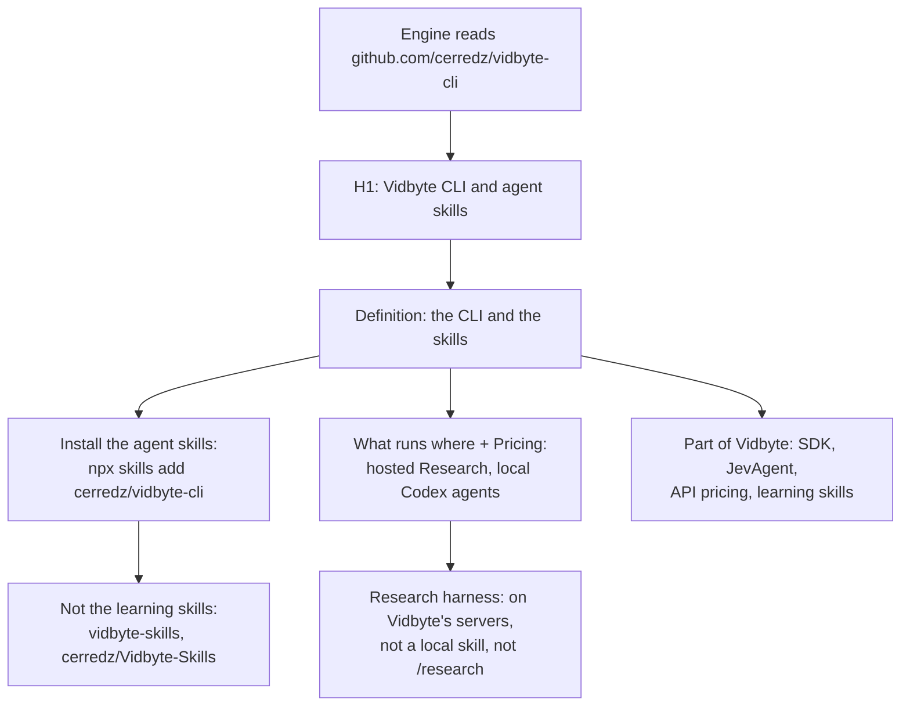

# Make this repository say what it holds (AEO checklist G-1, G-2, G-4, G-5, G-10 to G-12)

## Summary

AI answer engines read this repository directly; an aio run on 2026-10-25 retrieved or cited
its pages 10 times. They still answered wrong. The README's H1 was "Vidbyte CLI" and the word
"skill" appeared 0 times, so for "how do I install Vidbyte's agent skills" ChatGPT answered
`npx vidbyte-skills` and Claude answered `npx skills add cerredz/Vidbyte-Skills`: both are the
*learning* skills. Nothing said Research is hosted, so ChatGPT called it a local skill. Nothing
stated a price. SECURITY.md sent reports to `hello@vidbyte.ai`, a domain nobody has registered.

This change makes the README define the repository's two contents (the CLI and the agent
skills), give the skills install command, say where each agent runs and what it costs, and
point at vidbyte.pro. It uses the same canonical sentence as the CLI's PyPI summary and
`--help` (cerredz/vidbyte-cli-internal, `pyproject.toml`), word for word:

> Vidbyte CLI: start hosted Research harness runs, run local Codex coding-agent teams, and get ranked next actions from your terminal.

## Flow chart



## Usage example

```bash
npx skills add cerredz/vidbyte-cli                                # every agent skill
npx skills add cerredz/vidbyte-cli --skill research-a-competitor  # one skill
pipx install vidbyte-cli
vidbyte-cli research start "your question"   # a hosted Research harness run
```

## How it works

- **G-1** H1 "Vidbyte CLI and agent skills"; the canonical sentence; a definition of both
  contents; an "Install the agent skills" section with the `--skill <slug>` form; the
  learning-skills disambiguation and its own install command. The skills table is generated
  from each `skills/*/SKILL.md` (frontmatter `name` and `min-cli-version`, and the H1). Slugs
  with a page in cerredz/Vidbyte `next-app/constants/agent-skills/` (19, each HTTP 200 on
  2026-10-26) link `vidbyte.pro/agents/skills/<slug>`; the other 4 link their SKILL.md. A
  `min-cli-version` above 0.2.0 is labeled "needs the next vidbyte-cli release (not on PyPI
  yet)".
- **G-2** "Research harness (hosted research threads)" heading, "Research runs on Vidbyte's
  servers. It is not a local skill, and the `/research` learning skill is unrelated.", and the
  `/docs/harnesses/research` link.
- **G-4** SECURITY.md email becomes `contact@vidbyte.pro`, the address vidbyte.pro publishes.
- **G-5** "What runs where" and "Pricing" (33 lines together) and "Part of Vidbyte". Every
  price is read from cerredz/Vidbyte source (listed in the PR body). The commands in the table
  were checked against the vidbyte-cli 0.2.0 wheel on PyPI: all of them ship there; only the
  Suggestion Agent's gateway billing needs the next release.
- **G-10** The marketplace description names the CLI, the agent skills, and the Research
  harness; the plugin's homepage becomes `/docs/cli/agent-skills`, and it gains the keywords
  claude-code, codex, agent-skills, deep-research, and coding-agents. No plugin is added.
- **G-11** `.github/pull_request_template.md` with an "About" footer: the canonical sentence,
  the two install commands, and the two docs links.
- **G-12** The tracked `scripts/__pycache__/*.pyc` is removed, and `.gitignore` ignores
  bytecode.

## Files changed

`README.md`, `SECURITY.md`, `.claude-plugin/marketplace.json`,
`plugins/vidbyte/.claude-plugin/plugin.json`, `.github/pull_request_template.md` (new),
`.gitignore` (new), `scripts/__pycache__/test-what-else-needs-doing.cpython-311.pyc` (deleted),
and this doc. No `skills/*` file changes.

## Risks

- The skills table and its version labels go stale when a skill is added or the CLI ships to
  PyPI; regenerate the table then.
- The canonical sentence is shared with the CLI's PyPI summary and `--help`; change all of them
  together.
- G-3 (skills that ask for an unreleased CLI) is fixed only by the CLI release (C-1).

## Verification

- `python -m json.tool` on both JSON files.
- The repository has no workflows; the `scripts/test-*.py` suites still pass.
- `grep -c "Research harness" README.md` is at least 1, `grep -n vidbyte.ai SECURITY.md` is
  empty, `git ls-files '*.pyc'` is empty, and the raw README contains
  `npx skills add cerredz/vidbyte-cli`.
