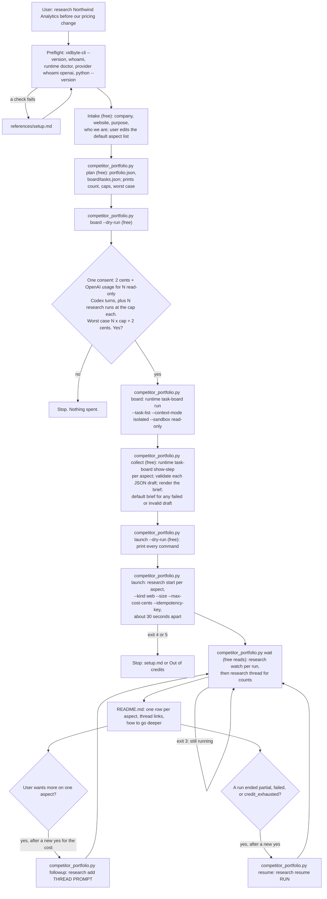

# research-a-competitor

## Summary

Add the public agent skill `skills/research-a-competitor/`. A founder, product manager, or
marketer names one competitor, and the skill builds a competitor intelligence portfolio: one
Vidbyte research run per aspect of that company (product, pricing, positioning, team and hiring,
growth, social presence, customers and reviews, recent news), each started from a research brief
in one fixed format, and a local index that links every run.

It works in four stages. A free Python script, `competitor_portfolio.py`, plans the portfolio and
writes one Task Board task per aspect. One `vidbyte-cli runtime task-board run` (2 cents plus the user's OpenAI usage) gives
each aspect its own fresh, read-only Codex agent, which drafts that aspect's research questions and
filters. The script checks each draft, renders it into the fixed brief template, and starts one
`vidbyte-cli research start` per aspect, capped with `--max-cost-cents`. Then it waits with
`research watch`, reads each thread's counts with `research thread`, and writes
`competitor-intel/<company>/README.md`: one row per aspect with its status, sources, findings,
cap, thread id, and a link that opens the thread on vidbyte.pro.

The slug is `research-a-competitor`: it is what the user asks for ("research this competitor for
me"), it names the problem rather than an agent, and no skill on `main`, on any branch or open PR
of cerredz/vidbyte-cli, or under `worktrees-cli-public/skill/` uses it. The Vidbyte backlog's
`competitor-map` idea (one thread per competitor, refreshed over time) is a different shape; this
skill could become its first step later.

## Flow chart



## Usage example

```bash
npx skills add cerredz/vidbyte-cli --skill research-a-competitor
```

Then, in the coding agent:

```text
> Research Northwind Analytics (northwind.example) for me. We're about to change our pricing.
```

The agent runs the preflight, shows the eight default aspects, and on "drop social media" runs:

```bash
python3 <skill>/scripts/competitor_portfolio.py plan --company "Northwind Analytics" \
  --website northwind.example --purpose "We are deciding our own pricing changes." --drop social
```

It prints 7 aspects, `--size small`, a cap of 500 cents each, and a worst case of $35.02. After a
yes, the agent runs `board`, `collect`, `launch`, and `wait`. `board` calls, from
`competitor-intel/northwind-analytics/`:

```bash
vidbyte-cli --json --no-input runtime task-board run --task-list board/tasks.json \
  --context-mode isolated --sandbox read-only --no-stop-on-error --retries-per-task 1 \
  --turn-timeout 900 --checkpoint-root board --checkpoint-id ci-northwind-analytics-20261011-3fa2c1 \
  --report-file board/report.md --idempotency-key research-a-competitor:northwind-analytics:board:20261011-143005
```

and `launch` calls, once per aspect:

```bash
vidbyte-cli --json --no-input research start --kind web --size small --max-cost-cents 500 \
  --idempotency-key research-a-competitor:northwind-analytics:pricing:20261011-3fa2c1 \
  -- "Competitor intelligence brief: Northwind Analytics - Pricing and packaging. ..."
```

## How it works

- **Where research runs start: from the host, not inside the tasks.** The user's literal design
  had each task's Codex agent run `research start` itself. The CLI source rules that out:
  - `TaskBoardCommand._session` sets `VIDBYTE_API_KEY` to an empty string in every task agent's
    environment, on purpose ("Filters parent secrets so the child Codex process inherits only its
    key"). `CredentialResolver.resolve` treats a set-but-empty `VIDBYTE_API_KEY` as an error
    (`VIDBYTE_API_KEY is empty or invalid.`, exit 4) and does not fall back to the keyring. A
    `research start` inside a task fails before it is sent. The same is true in 0.2.0.
  - The board passes Codex only its provider overrides (`TaskBoardCodexConfig`), so `read-only`
    and `workspace-write` tasks have Codex's default of no network. Only `full-access` has network,
    and it turns the sandbox off entirely; the CLI help reserves it for tasks that "genuinely have
    to reach outside the workspace".
  - Working around both (unsetting the variable, reading the keyring from an unsandboxed agent)
    would defeat a deliberate security control and hand an unsandboxed model the user's Vidbyte
    key. It would also break contract section 5: the agent, not the script, would choose the cap
    and the idempotency key, and once the key worked, nothing would stop other paid commands.
    `VIDBYTE_X402_PRIVATE_KEY` is not stripped from the task environment either, so even
    `billing top-up --confirm` would be in reach.

  So the fallback design applies: each task's agent drafts its aspect's brief as one JSON object
  in its final message, and the host agent's script starts every research run. Nothing is lost:
  `research start` returns immediately anyway, and the script enforces the cap, the size, the
  kind, and the idempotency key, which a model cannot change.
- **Sandbox `read-only`.** The task agents only write a JSON answer; they read nothing and edit
  nothing. `read-only` is the narrowest mode, so no file in the user's workspace can change during
  the board.
- **The task list.** `plan` writes `board/tasks.json`, a flat JSON array of task strings, which
  `--task-list` reads in board order (`TaskBoardTaskFiles._json_tasks`). JSON avoids the Markdown
  form's split on `## ` headings. Each task is about 3,000 characters, far under the 20,000 limit.
  Each task names the company, the website, the purpose, the aspect and its scope, the other
  aspects to stay out of, today's date, a suggested date window, and the guardrail for that aspect.
  It asks for 3 to 7 questions specific to this company, up to 6 source types to prefer, and the
  filters (`exclude_domains`, `published_after`), returned as one JSON object.
- **Board settings.** `--context-mode isolated` (each aspect is drafted independently, with a
  fresh context), `--no-stop-on-error` (aspects are independent), `--retries-per-task 1` (a retry
  costs only OpenAI usage and nothing on disk changes), `--turn-timeout 900` (a draft takes a few
  minutes; a stuck agent should not hold the board for the default five days), checkpoints inside
  the portfolio folder so `collect` can read each step for free.
- **Collect.** `runtime task-board show-step` returns `data.step.result_text`, the agent's whole
  final message. The script takes the JSON object from it, checks every field (question count and
  length, hostnames, a real date not in the future), drops what fails, and fills the gap from the
  aspect's default questions and filters. It ignores any `include_domains` an agent adds anyway,
  and never excludes the company's own website. An aspect whose task failed gets the default brief. Each
  aspect is marked `agent`, `agent, repaired`, or `default`, and `briefs.md` shows every brief.
- **The format.** The backend research harness has no report writer. Its README says post-source
  synthesis was removed; a run is discovery (Exa search, then `save_source`) followed by one
  structured extraction per source, with a fixed schema: `summary`, `relevance`, `key_claims`,
  `recommendations`, `evidence`, `limitations`, `source_role`, `evidence_strength`,
  `coverage_topics`. The prompt does reach both stages: discovery gets it as the validated request
  (`context.py`), and every extractor gets it as `research_prompt` (`source_input`). So a section
  template in the prompt cannot lay out a report, but it does steer what is searched and what each
  source's fields say. The skill therefore uses one fixed brief template for every aspect: title
  line, company, who is asking and why, scope, other aspects to skip, numbered questions, sources
  to prefer, and "How to record each source", which maps the user's format onto the extractor's
  fields (key claims with their dates, evidence quotes, relevance to which question, a
  recommendation for the user's purpose, limitations for self-reported or undated claims). The
  fixed document format lives in the local `README.md`.
- **Run settings.** `--kind web` (papers do not help here), `--size small` by default (15 target
  sources, 4 search calls), `--max-cost-cents 500` by default. 500 cents is the backend's own
  default cap for a run (`orchestration.defaults.max_run_cost_cents`) and the cap Vidbyte's MCP
  server uses with `--size small`; the backend accepts 25 to 2,500 (`run_budget`), so `plan`
  refuses anything else. The cap is a hard ceiling (`UsageSession.authorize` refuses any spend
  past it), so the worst case is exactly N x cap plus 2 cents.
- **No `--include-domain`.** The backend's `ResearchRunCreateRequestDto` checks `include_domains`
  against `ResearchIncludeDomain`, an allowlist of reviewed research hosts (`arxiv.org`,
  `pubmed.ncbi.nlm.nih.gov`, and similar). Any other host, such as a competitor's website, is a
  422, which 0.2.0 prints as `The Vidbyte API rejected the request.` (exit 2); the CLI's own model
  does not check the list. So no run is restricted to the company's site. For `product` and
  `pricing`, the brief says "Start with the company's own pages on <website>, then check them
  against other sources." `--exclude-domain` stays free-form on the backend and is passed when a
  brief asks for it.
- **Idempotency.** Each research run's key is
  `research-a-competitor:<company>:<aspect>:<YYYYMMDD>-<6 hex>`, made once by `plan` and stored.
  Re-running `launch` skips aspects that already have a run and resends a failed start with the
  same key, so a retry never pays twice. The random part keeps two portfolios of the same company
  on the same day apart: the backend answers a reused key with different content with 409, which
  0.2.0 reports as exit 2 with a message worded for `resume`. The board gets a new key per
  `board` call; `--key` reuses one only to recover a lost admission.
- **Pacing.** `research start` weighs 14 of the 30 weighted requests per minute on the lowest API
  tier (`ENDPOINT_WEIGHTS`, `api_tier_1`), so `launch` waits 30 seconds between starts, and on a
  rate-limited start (exit 1, `API_UNAVAILABLE`, retryable) waits the hinted time and resends with
  the same key, up to three times.
- **Waiting.** `research watch` follows one run; in `--json` mode its progress lines are dropped
  and one final document is printed. `wait` watches the unfinished runs one after another within a
  time budget (default 480 seconds, so it fits a 10-minute shell timeout) and exits 3 while any run
  is still going. It then calls `research thread` for `source_count` and `artifact_count`.
- **Cost reporting.** No research command returns a run's charge: `ResearchRunStatus` has no cost
  field, and the public API serves only run status, the portfolio list, and thread details. The
  index states the cap and links `https://vidbyte.pro/research?view=usage`, which lists every
  research request's charge.
- **Thread links.** `https://vidbyte.pro/research?view=create&thread=<thread_id>` opens a thread
  for its signed-in owner (`next-app/app/research/page.jsx`, `workspaceThreadToken`;
  `ResearchWorkspaceClient` builds the same URL from the `encrypted_id` the CLI prints as
  `thread_id`).
- **Going deeper.** `research add <thread_id> "<prompt>"` adds a run to an existing thread. The
  script's `followup` subcommand builds a short brief around the user's question, passes the same
  `--kind`, `--size`, and cap, records it, and `wait` follows it. It is a new charge and needs its
  own yes.
- **Resuming.** `research resume <run_id>` continues a `partial`, `failed`, or `credit_exhausted`
  run with its original prompt and takes no run options. The backend reopens the same usage
  ledger (`continue_run`: "the baseline prevents already-settled usage from being charged
  twice"), and `UsageSession` checks `billed_cents + required` against the run's original cap, so
  a resume never takes a run past its cap. The script's `resume` subcommand picks the aspect's
  latest resumable run, saves its key before the request, and resends a lost resume with the same
  key.
- **Team and hiring, not employees.** LinkedIn requires login and its terms forbid scraping, and
  the research harness reads public web pages. The team aspect is framed as founders and
  executives the company lists publicly, headcount trend, and hiring signals (open roles by team,
  location, and seniority) from the careers page, job boards, press, and the public company page
  if search engines index it. Every brief and the Guardrails forbid profiling individual
  non-executive employees.
- **Python, not bash.** The contract does not require `.sh` scripts. The values contain company
  names, quotes, and long briefs that break bash, PowerShell, and `cmd.exe` quoting in different
  ways, and PowerShell 5.1's `>` writes UTF-16. The script is standard-library Python 3.8+, runs
  `vidbyte-cli` with argument lists and no shell, sets `PYTHONIOENCODING=utf-8` for it, and writes
  UTF-8 files itself. `vidbyte-cli` needs Python 3.11+, so a Python is present wherever the skill
  runs.

## Files

| File | Change |
|---|---|
| `skills/research-a-competitor/SKILL.md` | New. The skill, in contract section 4's order. |
| `skills/research-a-competitor/scripts/competitor_portfolio.py` | New. `plan`, `board`, `collect`, `launch`, `wait`, `followup`, `resume`; standard library only. |
| `skills/research-a-competitor/references/setup.md` | New. Byte-for-byte copy of the canonical file. |
| `skills/research-a-competitor/references/troubleshooting.md` | New. Byte-for-byte copy of the canonical file. |
| `docs/design/research-a-competitor.md` | New. This document. |

No other file changes. This repository has no `AGENTS.md` and no CI workflow, so the gate is local.

## CLI surface and min-cli-version

Every command and option the skill uses is in `contracts/cli-commands.json` on the internal
`main` and in the 0.2.0 wheel on PyPI (checked with `--help` from a scratch install):
`runtime task-board run` (`--task-list`, `--context-mode`, `--sandbox`, `--no-stop-on-error`,
`--retries-per-task`, `--turn-timeout`, `--checkpoint-root`, `--checkpoint-id`, `--report-file`,
`--idempotency-key`, `--retry-failed-only`), `runtime task-board show-step` (`--checkpoint-root`,
`--checkpoint-id`, `--index`), `research start` and `research add` (`--kind`, `--size`,
`--exclude-domain`, `--published-after`, `--language`, `--max-cost-cents`, `--idempotency-key`),
`research resume` (`--idempotency-key`), `research watch` (`--timeout`), `research status`,
`research thread`, `whoami`, `runtime doctor`, and `provider whoami`. So `min-cli-version` is
`0.2.0`. Two 0.2.0 differences matter and the script handles both: `research status` has no
`data.error_code` yet (read when present), and a request the CLI's model refuses, such as a prompt
over 20,000 characters, is not yet a clean usage error, so the script checks every value first.

## Risks and open questions

- **No report text in the CLI.** The user reads each aspect's findings on vidbyte.pro. A
  `research artifacts` command (or a report export) would let the index hold the findings too.
- **No cost per run in the CLI.** The index shows the cap and links the Usage view instead.
- **The 409 message.** A reused key with different content exits 2 with "The run is not in a state
  that can be continued." The per-portfolio random part makes this unlikely.
- **Rate and token limits.** On the lowest API tier, eight starts take about four minutes, and a
  key's 30-minute token window could refuse a late start. `launch` retries, then stops; running it
  again later continues where it left off.
- **Draft quality.** A task agent has no network and drafts from what it knows about the company.
  For a company it does not know, the questions stay generic for the company's category. The
  default brief is always a valid fallback.
- **Board tasks that fail without a reason.** During testing, one board was admitted by mistake
  through a development build of the CLI on a machine whose Codex setup was not checked (see
  Verification). All 8 tasks failed within seconds, with no tokens reported, and the CLI records
  only `Task N failed.`, so the cause is unknown. The skill handles it: `collect` gives each
  failed aspect the default brief, and the user can still launch. A failure reason in
  `show-step` would let the skill say what to fix.
- **Codex outside a git repository.** The board runs Codex in the portfolio folder. The SDK's
  app-server launch has no git check, but no board task has completed end to end.
- No intended paid end-to-end run was made, because it spends real money.

## Verification

1. Every `vidbyte-cli` command and option in `SKILL.md` and the script checked against
   `contracts/cli-commands.json` on the internal `main` (all present), and against `--help` and
   the source of the 0.2.0 wheel installed from PyPI into a scratch virtual environment.
2. With a fake `vidbyte-cli`, passed with `--cli`, that records its arguments and returns canned
   JSON documents, every subcommand run end to end on a fictional company: `plan` (8 aspects with
   `--drop`, `--focus`, and `--add`), `board --dry-run`, `board` (a second call refused),
   `collect` (valid, repairable, not-JSON, and failed steps), `launch --dry-run`, `launch` (a
   rate-limited start resent with the same key; credit exhaustion at the fourth start, exit 5,
   then the same key resent), `wait` (finished, still running with exit 3, and partial),
   `resume`, and `followup`. Usage errors exit 2.
3. Every argument list the script sent to the fake CLI in the final run (49 invocations) parsed by
   the real 0.2.0 Click tree with `make_context`, which builds each command's context without
   invoking it. `board/tasks.json` loaded by 0.2.0's `TaskBoardTaskFiles.read_task_list`, and
   every brief and flag set validated by 0.2.0's `ResearchRunCreateRequest`.
4. Free mode check: `runtime task-board run --print-prompt` is the only run mode that never pays,
   and it needs an existing board, so it cannot preview a new one. The free proof of the board
   command is therefore `board --dry-run` plus step 3.
5. One unintended paid call happened during testing: a test shell's `PATH` resolved
   `vidbyte-cli` to a development build instead of the fake. It admitted one board (2 cents; all
   8 tasks failed, no tokens reported) and sent one `research start`, which the API refused with
   a 422 before any run was created. That refusal is how the `include_domains` allowlist was
   found. Every later test passed the fake with `--cli`.
6. `cmp` of both `references/` files against the canonical copies; `git diff` checked for leaked
   names, paths, or tokens before every commit.
