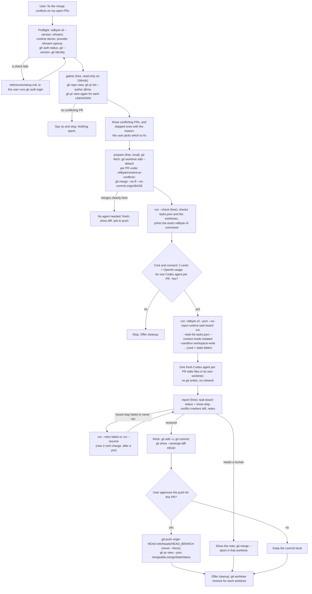

# resolve-pr-conflicts

## Summary

Add the public agent skill `skills/resolve-pr-conflicts/`. A developer, often working with coding
agents, has several open pull requests against the same base branch. Each time one of them merges,
the others pick up conflicts, and GitHub shows "This branch has conflicts that must be resolved".
Fixing them one by one by hand is slow, repetitive, and it is easy to drop one side's change.

The skill finds the user's open pull requests that GitHub reports as `CONFLICTING`, lets the user
pick which ones to fix, starts the merge of the base branch into each pull request branch in its
own git worktree, and then runs one Vidbyte Task Board (`vidbyte-cli runtime task-board run`,
2 cents per board plus the user's own OpenAI usage) with one task per pull request. Each task's
Codex agent resolves its pull request's conflicts so that both sides' intent survives, runs the
project's own checks, and reports. The user's coding agent then commits each resolved merge, shows
the resolution diff, and pushes only the pull requests the user approves, with a plain `git push`.

This is a simpler version of an earlier idea, "land-my-open-prs", that ordered pull requests into a
dependency graph, sent hard conflicts to the ensemble agent, and merged pull requests. The user cut
it down to: "just try to resolve merge conflicts on open pr with our task board agent". So this
skill has no ensemble, no `--type dag` ordering, and never merges a pull request.

The slug is `resolve-pr-conflicts`. It names the problem the user has ("my PRs have conflicts")
and the words they type, not the agent, as contract section 2 asks. `fix-conflicting-prs` was the
other candidate; "resolve" is the word GitHub itself uses ("Resolve conflicts" button), so it is
the better search term. "land-my-open-prs" no longer fits, because the skill does not land
anything. No skill on `main`, in any open or closed pull request, or in a local `skill/*` worktree
uses the slug.

## Flow chart



## Usage example

```bash
npx skills add cerredz/vidbyte-cli --skill resolve-pr-conflicts
```

Then, in the coding agent, inside a clone of the repository:

```text
> three of my PRs went red with conflicts after the last merge, can you fix them?
```

The agent runs the preflight, then the free gather step:

```bash
python3 <skill>/scripts/resolve_pr_conflicts.py gather
```

```text
Repository acme/api (your permission: WRITE). 5 open pull requests by @me.

Conflicting, ready to fix (3):
  #212    Retry webhook delivery             feat/retry-webhooks -> main
  #215    Add rate limit headers             feat/rate-limit -> main
  #219    Move config loading to settings    refactor/settings -> main (draft)
Conflicting but skipped (1):
  #208    Bump parser                        fork-branch -> main
           skipped: from a fork; this skill pushes only to branches in acme/api
Mergeable, nothing to do (1).
```

The user picks #212 and #219. The agent prepares them for free:

```bash
python3 <skill>/scripts/resolve_pr_conflicts.py prepare --pr 212 --pr 219
python3 <skill>/scripts/resolve_pr_conflicts.py run --check
```

It asks: "This runs one Vidbyte Task Board over 2 pull requests (#212, #219). It costs 2 cents from
your Vidbyte balance plus OpenAI usage on your own account for 2 Codex agents, one per pull
request. Each agent edits files only in its own worktree under .vidbyte/resolve-pr-conflicts/.
Nothing is committed until you see the result, and nothing is pushed until you approve each pull
request. Run it?" After a yes:

```bash
python3 <skill>/scripts/resolve_pr_conflicts.py run --yes
```

which runs, from inside `.vidbyte/resolve-pr-conflicts/`:

```bash
vidbyte-cli --json --no-input runtime task-board run \
  --task-list tasks.json \
  --context-mode isolated \
  --sandbox workspace-write \
  --no-stop-on-error \
  --retries-per-task 0 \
  --turn-timeout 3600 \
  --checkpoint-root boards \
  --checkpoint-id rpc-20261011-181500 \
  --report-file report.md \
  --idempotency-key resolve-pr-conflicts:20261011:7f3a9c > result.json
```

Then `report`, `finish --pr 212`, the resolution diff, and, after the user's yes,
`git -C .vidbyte/resolve-pr-conflicts/pr-212 push origin HEAD:refs/heads/feat/retry-webhooks`.

## How it works

- **One Python script, six subcommands.** `scripts/resolve_pr_conflicts.py` uses only the Python
  standard library and calls `gh`, `git`, and `vidbyte-cli` through `subprocess` with argument
  lists, never a shell. The contract does not require `.sh` scripts. Python is used because
  `vidbyte-cli` already needs Python 3.11+, so Python is present wherever the skill runs, and
  because pull request titles and branch names would need different quoting in bash, PowerShell,
  and `cmd.exe`. The script itself runs on Python 3.8+.
  - `gather`: free and read-only on GitHub. Lists the conflicting pull requests.
  - `prepare --pr N ...`: free and local, plus a `git fetch`. Creates the worktrees, starts each
    merge, writes `tasks.json` and `state.json`.
  - `run`: the one paid step. It refuses to spend without `--yes`, which the host agent passes
    only after the user's yes. `--check` validates everything and prints the exact command for
    free; `--retry-failed` and `--resume` continue a board.
  - `report`: free and offline. Reads the board through `runtime task-board status` and
    `show-step`, and checks each worktree for leftover conflict markers.
  - `finish --pr N`: free and local. Commits one resolved merge and prints the diff and push
    commands.
  - `cleanup`: free and local. Removes the skill's worktrees, never with `--force`.
- **Gather.** `gh repo view --json nameWithOwner,viewerPermission,defaultBranchRef`, then
  `gh pr list --state open --author @me --limit 100 --json number,title,url,headRefName,baseRefName,mergeable,mergeStateStatus,isCrossRepository,isDraft,body`.
  `--author LOGIN` and `--all-authors` widen it, `--base BRANCH` narrows it. GitHub computes
  `mergeable` lazily and answers `UNKNOWN` right after the base branch moves, so every `UNKNOWN`
  pull request is asked again with `gh pr view N --json mergeable,mergeStateStatus`, up to five
  times, three seconds apart. A `CONFLICTING` pull request is skipped, with the reason printed,
  when it comes from a fork (`isCrossRepository`), or when the user's `viewerPermission` is not
  `ADMIN`, `MAINTAIN`, or `WRITE`, because the skill must push to the head branch in this
  repository. Every field and flag was checked with `gh pr list --help`, `gh pr view --help`, and
  `gh repo view --help` (gh 2.87).
- **Where the task agents can write.** The CLI starts every task's Codex agent with its working
  directory set to the directory `vidbyte-cli` was started in (`build_task_board(board, host,
  Path.cwd())`, then `CodexClientSettings(cwd=...)`), and passes the board's `--sandbox` value
  to Codex as the thread's sandbox mode, with no extra writable roots. In `workspace-write`, Codex
  lets the agent write only inside that working directory (plus temp folders), with no network,
  and keeps `<root>/.git` read-only, including a worktree's `.git` pointer file and the gitdir it
  points to (`default_read_only_subpaths_for_writable_root` in `codex-rs/protocol/src/permissions.rs`).
  The child also gets the parent's environment with every provider key blanked except the stored
  OpenAI key.
- **So the host agent does every git write.** A worktree's gitdir lives in the main repository's
  `.git/worktrees/`, and its objects in `.git/objects`; neither is writable for a sandboxed agent.
  A task agent therefore cannot run `git merge`, `git add`, `git commit`, or `git merge --abort`.
  This changes the split the user first described (the agent merges, commits, and aborts): here
  the free `prepare` step starts each merge, the agent only edits files and runs checks, and the
  host agent commits (`finish`) or aborts after the board. The agent's instructions forbid git
  writes outright, so the result is the same on a platform whose sandbox is weaker. It also means a
  task agent can never move a branch, push, or lose work in git.
- **Worktree location.** `prepare` creates one detached worktree per pull request at
  `<repo>/.vidbyte/resolve-pr-conflicts/pr-<N>/` and runs the board with that state folder as its
  working directory. The state folder is the agents' only writable root: it holds every worktree
  and the notes folder, and the user's own checkout around it stays out of reach. `prepare` adds
  `/.vidbyte/resolve-pr-conflicts/` to `info/exclude` (from `git rev-parse --git-path
  info/exclude`, shared by every worktree), so nothing in it can be staged or committed, and the
  nested worktrees never show in the user's `git status`. Detached worktrees work even when the
  user has the pull request branch checked out in their own checkout, where
  `git worktree add <path> <branch>` would refuse.
- **Merge, not rebase.** `prepare` runs
  `git -c merge.conflictStyle=diff3 merge --no-ff --no-commit <remote>/<base>` on top of
  `<remote>/<head>`. A merge was chosen over a rebase because:
  - the merge commit has the current pull request head as its first parent, so the later push is a
    plain fast-forward; a rebase rewrites the branch and needs `--force`, which the skill never uses;
  - the conflicts are resolved once, for the whole branch, while a rebase replays every pull
    request commit and can stop on the same conflict several times;
  - review comments stay attached to the commits reviewers already saw;
  - one `git merge --abort` returns the worktree to the pull request head.
  `diff3` markers add the common ancestor's version (`|||||||`), which shows the agent what each
  side changed. `--no-ff` makes sure the result is always a merge commit. If the merge finishes
  without conflicts here (GitHub's answer was stale), the pull request needs no agent: it is
  marked `clean`, left out of the board, and goes straight to `finish`.
- **Task list.** `tasks.json` is a flat JSON array of task strings, the `--task-list` format in
  `TaskBoardTaskFiles.read_task_list`. A `.md` task list would split on every level-two heading,
  and both the task text and pull request bodies contain them. Each task names the worktree's
  absolute path, the head and base branches, the three commits (pull request head, base, merge
  base), and the conflicted files; it quotes the pull request title and body (cut to 4,000
  characters) as data inside `<pull-request>` tags; and it tells the agent to read the project's
  conventions, study both sides with read-only git commands (`git log`, `git show :1:/:2:/:3:`),
  keep both sides' intent, remove every marker, run the project's checks if it can find them, run
  no git command that writes, and leave no scratch files. If it cannot resolve a conflict with
  confidence, it stops, writes `notes/pr-<N>.md` in the state folder naming the files and why,
  and reports `STATUS: needs-human`. Its final message is a report of at most 1,000 characters
  (`STATUS`, `FILES`, `CHECKS`, `NOTES`), so the 1,200-character step summary holds all of it.
  Every task stays far below the 20,000-character limit.
- **Run flags.**
  - `--task-list tasks.json`: the whole board in one reviewable file, one task per pull request.
  - `--context-mode isolated`: the pull requests are independent; no agent sees another's result.
  - `--sandbox workspace-write`: the agents must edit files (`read-only` cannot), and nothing
    needs `full-access`, which would also allow network and pushes. It is the default; the skill
    passes it so the choice is visible.
  - `--no-stop-on-error`: one failed pull request must not cancel the rest.
  - `--retries-per-task 0`: a retry would start on the failed attempt's half-edited files.
    `run --retry-failed` instead resets those worktrees to a fresh conflicted merge first.
  - `--turn-timeout 3600`: one hour per pull request, instead of the five-day default.
  - `--checkpoint-root boards --checkpoint-id <id>`: every step is saved, so the free `status` and
    `show-step` readers work, and `--retry-failed-only` and `--resume-from` can continue a board.
  - `--report-file report.md`: a readable history of the board.
  - `--max-tokens N`: only when the user sets a budget.
  - Kept at their defaults: `--type linear` (no ordering is needed), no `--model` or
    `--reasoning-effort` (Codex uses what the user configured), no `--on-checkpoint` hook (each
    pull request has its own worktree, so nothing needs resetting between tasks).
- **Retry and resume.** `run --retry-failed` reads `runtime task-board status`, resets the
  worktree of every failed step (`git merge --abort`, then the same merge again), and runs with
  `--retry-failed-only`. `run --resume` resets every pending step's worktree and runs with
  `--resume-from <lowest pending index>`. Both reuse the stored task list and repeat the same
  settings, which the CLI's manifest check requires, and each is a new 2-cent charge. The CLI's
  own `resume_command` is never pasted, because it does not reset the worktrees.
- **Deliver.** `report` sorts each pull request into `resolved` (step completed, agent reports
  `resolved`, no markers left), `needs-human` (the agent said so, or markers are left), `failed`
  (the board step failed), or `not-run`. For a resolved one, `finish --pr N` checks the worktree
  is still the prepared merge, refuses if any conflict marker is left, stages tracked files with
  `git add -u` (untracked files an agent left behind are listed, not committed), commits with the
  repository's own hooks, and checks the commit's two parents. The agent shows
  `git -C <worktree> show --remerge-diff HEAD` (git 2.36+; the script prints a fallback for older
  git), asks, then pushes with `git -C <worktree> push <remote> HEAD:refs/heads/<head>` and
  re-checks with `gh pr view N --json mergeable,mergeStateStatus`. A rejected push means the
  branch moved; the skill stops and never forces. For a pull request that needs a human, it shows
  the note and runs `git -C <worktree> merge --abort` unless the user wants to finish the merge
  by hand there.

## Files

| File | Change |
|---|---|
| `skills/resolve-pr-conflicts/SKILL.md` | New. The skill, in contract section 4's order. |
| `skills/resolve-pr-conflicts/scripts/resolve_pr_conflicts.py` | New. `gather`, `prepare`, `run`, `report`, `finish`, `cleanup`; stdlib only. |
| `skills/resolve-pr-conflicts/references/setup.md` | New. Byte-for-byte copy of the canonical file. |
| `skills/resolve-pr-conflicts/references/troubleshooting.md` | New. Byte-for-byte copy of the canonical file. |
| `docs/design/resolve-pr-conflicts.md` | New. This document. |

No other file changes. There is no `AGENTS.md` and no CI workflow in this repository, so the gate
is local.

## CLI surface and min-cli-version

Every command and option the skill uses is in `contracts/cli-commands.json` on the internal
repository's `main`: `runtime task-board run` (`--task-list`, `--context-mode`, `--sandbox`,
`--no-stop-on-error`, `--retries-per-task`, `--turn-timeout`, `--checkpoint-root`,
`--checkpoint-id`, `--report-file`, `--retry-failed-only`, `--resume-from`, `--max-tokens`,
`--idempotency-key`), `runtime task-board status` and `show-step` (`--checkpoint-root`,
`--checkpoint-id`, `--index`), `whoami`, `runtime doctor`, and `provider whoami`. The 0.2.0 wheel
from PyPI, the newest release, has every one of them, including the `--resume-from` alias of
`--from`, and its task-list reader is byte-identical to `main`'s. So `min-cli-version` is
`0.2.0`. The price, 2 cents flat per board, is the backend catalog entry `runtime.task-board@1`
and the command's own help text.

## Risks and open questions

- **No free dry run in the CLI.** `runtime task-board run` has no `--dry-run`; `--print-prompt`
  needs an existing checkpointed board. `run --check` covers what the CLI would reject before
  payment (task count and size, the JSON shape, worktree state, `vidbyte-cli` on `PATH`), and the
  verification below parsed the exact arguments with the released Click command.
- **Sequential.** The Task Board runs one agent at a time; ten pull requests take ten agent turns.
- **No network for agents.** The checks an agent can run depend on the dependencies already
  installed in each worktree. The skill asks the host agent to install them first when the
  project needs them, and the agent says when a check could not run.
- **Pushing to someone else's branch.** With `--author` or `--all-authors`, a push changes another
  person's pull request. The skill asks for that pull request by number before pushing.
- **Linear-history repositories.** A repository that requires linear history and rebase merges
  will not accept the merge commit; the skill names this when it sees a rejected merge and stops.
- **Nested worktrees.** While they exist, a tool that scans every folder of the user's checkout
  (some test runners and editors) may see a second copy of the code. The skill offers cleanup at
  the end.
- **Windows.** Codex's Windows sandbox differs from Seatbelt and Landlock; the agent's
  instructions forbid git writes regardless.
- No paid end-to-end run was made, because it spends real money.

## Verification

1. Every `vidbyte-cli` command path and option in `SKILL.md` and the script checked against
   `contracts/cli-commands.json` on the internal `main` and against the 0.2.0 wheel's `--help`.
2. The exact `run` arguments (new board, `--retry-failed-only`, `--resume-from`) parsed by the
   0.2.0 Click command with `make_context` (no invocation, no admission), and the generated
   `tasks.json` read by 0.2.0's own `TaskBoardTaskFiles().read_task_list` and checked against the
   planner's limits.
3. `gather` run against a real GitHub account (read-only calls only); output kept out of the repo.
4. `gather`, `prepare`, `run --check`, `report`, `finish`, and `cleanup` run on a throwaway local
   repository with a bare `origin`, five synthetic pull requests (changed on both sides, changed
   versus deleted, added on both sides, a clean merge, and one left for a person), and `gh`
   answers from a stub that also returns `UNKNOWN` once. Simulated agent edits and board steps
   written with 0.2.0's own `TaskBoardCheckpointer`, so `report` reads them through the real
   `status` and `show-step`. The retry and resume commands passed 0.2.0's manifest check against
   that board, and the push was a fast-forward to the bare remote.
5. `python -m py_compile` and `--help` for every subcommand; `cmp` and `git hash-object` of both
   `references/` files against the canonical copies; `git diff` checked for leaked names, URLs,
   paths, or tokens before every commit.
