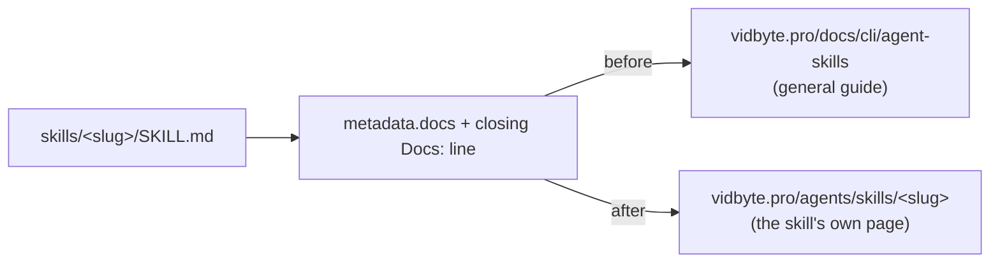

# Docs links for the four newly listed skills

## Summary

Four skills (automate-recurring-chores, find-unfinished-agent-work, predict-the-review, product-ideas-after-merge) pointed `metadata.docs` and their closing `Docs:` line at the general guide, `https://vidbyte.pro/docs/cli/agent-skills`, because vidbyte.pro had no page for them. cerredz/Vidbyte#841 listed all four on 2026-10-26, and `https://vidbyte.pro/agents/skills/<slug>` now answers 200 for each. The writing contract (`docs/agent-skills/write-agent-skill/SKILL.md`, checklist) says to use the skill's own page once it has one, so this change switches the four links. Indexers such as Context7 and DeepWiki read `metadata.docs`, so each skill now leads to a page about that skill.

## Flow chart



## Usage example

```bash
grep -n "vidbyte.pro/agents/skills/predict-the-review" skills/predict-the-review/SKILL.md
# 11:  docs: "https://vidbyte.pro/agents/skills/predict-the-review"
# 436:Docs: <https://vidbyte.pro/agents/skills/predict-the-review>
```

## Files and verification

- `skills/{automate-recurring-chores,find-unfinished-agent-work,predict-the-review,product-ideas-after-merge}/SKILL.md`: two lines each.
- `plugins/vidbyte/.claude-plugin/plugin.json` keeps the general guide as the plugin's homepage, since it covers every skill.
- Verified: each new URL returns 200 on vidbyte.pro, its `.md` copy returns 200, and `scripts/test-automate-recurring-chores.py` and `scripts/test-find-unfinished-agent-work.py` pass.
