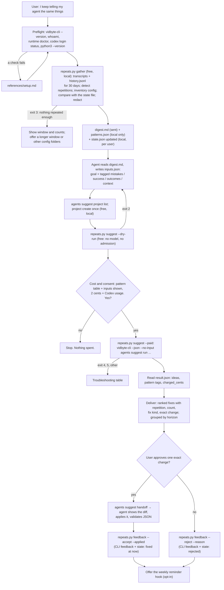

# stop-repeating-yourself

## Summary

Add the public agent skill `skills/stop-repeating-yourself/`. Most people set up their coding
agent once and never tune it. Then they say the same things to it every week: "use pnpm", "don't
add comments", "now commit and push", "no, in the worktree". They approve the same `git status`
prompt fifty times, paste the same explanation of the repository into new sessions, and keep a
`CLAUDE.md` that is either empty or so long that the agent skips it.

The skill makes repetition its lens. A bundled, stdlib-only Python script reads the local Claude
Code and Codex transcripts and both `history.jsonl` files, and finds everything the user had to
say or do more than once: repeated corrections, preferences restated at the start of sessions,
the same request phrased again, the same paths, links, and pasted text, the same permission
approvals, the same follow-up after the agent said it was done, "yes, go ahead" after the agent
stopped to ask, and the same failing command. It records each pattern's count, sessions, and two
short redacted examples, and checks what is already configured (`CLAUDE.md`, `AGENTS.md`,
`settings.json` permissions and hooks, skills, commands, memory, Codex `config.toml` and rules). A
repetition that persists despite a rule is flagged, because a rule is then not enough and a hook,
script, or skill is the better fix.

After the user approves the redacted digest, one `vidbyte-cli agents suggest run` (2 cents at
`--count 10`, plus model usage on the user's own Codex account) proposes durable fixes: a rule, a
skill or slash command, a hook, a read-only permission allowlist entry, a memory entry, or a small
script. The user gets a ranked list, each item with the repetition, how often it happened, the
fix, and the exact change. A change is applied only after the user approves that exact change,
through `agents suggest handoff`.

The skill is built to run weekly. A small state file remembers each pattern's fingerprint, when
it was first seen, and when a fix was applied or rejected, so every run reports new patterns,
patterns that stopped after their fix, and patterns that continue despite a fix.

## Flow chart



## Usage example

```bash
npx skills add cerredz/vidbyte-cli --skill stop-repeating-yourself
```

Then, in the coding agent:

```text
> I keep telling Claude and Codex the same things. Find what I repeat and fix it for good.
```

The agent runs the preflight, then:

```bash
python3 "<skill>/scripts/repeats.py" gather
```

It reads `digest.md`, writes `inputs.json`, checks the request for free, shows the pattern table
and every value that will be sent, and asks: "This runs the Vidbyte Suggestion Agent once over 14
repetition patterns from 63 sessions. It sends the redacted digest and these inputs to the model
through your own Codex login. It costs 2 cents from your Vidbyte balance, plus model usage on your
Codex account. It changes no files; each fix is applied later, only after you approve it. Run
it?" After a yes:

```bash
python3 "<skill>/scripts/repeats.py" suggest --out "<out_dir>" --paid
```

which runs, from inside `<out_dir>`:

```bash
vidbyte-cli --json --no-input agents suggest run \
  --goal "Find the changes that would stop me from having to repeat myself to my coding agents ..." \
  --category leverage --category quick_wins --category simplification --category risk_prevention \
  --count 10 --horizon any \
  --mistakes "[P1] ..." --mistakes "[P2] ..." --success "[P7] ..." --outcomes "[P3] ..." \
  --context "[setup] ..." \
  --forbidden "allowlisting commands that write, delete, push, or spend money" \
  --forbidden "switching off permission prompts or the sandbox altogether" \
  --files digest.md \
  --project stop-repeating-yourself \
  --idempotency-key "stop-repeating-yourself:20261011:3f9a1c"
```

The user picks a fix, sees the exact diff, says yes, and the agent applies it and records it:

```bash
vidbyte-cli --json agents suggest handoff --input "<out_dir>/result.json" --idea idea-002
python3 "<skill>/scripts/repeats.py" feedback --out "<out_dir>" --idea idea-002 --accept --applied
```

A week later the same request reports, for example: "P1 stopped after its fix (0 times in 18
sessions since Oct 11); P3 continues despite its CLAUDE.md rule (4 times since)".

## How it works

- **Sources (free, local, read-only).** `repeats.py gather` reads, for a rolling window (default
  30 days, which is also Claude Code's default transcript retention):
  - Claude Code transcripts, `<config dir>/projects/*/<session>.jsonl`, for `$CLAUDE_CONFIG_DIR`
    (else `~/.claude`) plus every `--claude-dir`. It reports other `~/.claude*` folders but never
    reads them unasked. Subagent files, sidechain records, and SDK sessions are skipped.
  - Claude Code `history.jsonl`: `{display, pastedContents, timestamp, project, sessionId}`. It
    adds prompts of sessions whose transcript is gone, and it is the source for pasted text:
    `pastedContents` holds either `content` or a `contentHash` whose text is in
    `paste-cache/<hash>.txt`, so the same paste is found by hash.
  - Codex rollouts, `$CODEX_HOME` (else `~/.codex`) `sessions/YYYY/MM/DD/rollout-*.jsonl`, with
    the same skips (SDK, subagent, automation threads) as `pick-up-where-my-sessions-left-off`.
  - Codex `history.jsonl`: `{session_id, ts, text}`, for prompts of sessions with no rollout.
- **Formats confirmed on real files** (Claude Code 2.1.29x, codex-cli 0.16x):
  - Human prompts: Claude Code `type: user` records with `origin.kind: human`, or older records
    filtered by shape (no `isMeta`, no tool result, not injected text), exactly as in the sibling
    skill. Codex `user_message` events and `UserMessage` items.
  - Permission approvals: Claude Code writes `permissionDecision: {decision, source, reasonType}`
    on each tool-result record. `source: "user_temporary"` with `decision: "accept"` is a prompt
    the user approved once; `source: "config"` was allowed by a rule or mode; `user_reject` is a
    refusal. Codex marks a command that needs the user's approval with `sandbox_permissions:
    "require_escalated"` in a `shell_command` function call; the output `exec command rejected by
    user` is a refusal. Commands already covered by a `prefix_rule` in `rules/default.rules` are
    not counted.
  - Turn ends (for follow-ups and go-aheads): Claude Code assistant `stop_reason: end_turn` with
    text; Codex `task_complete`.
- **Detectors.** Each prompt is split into sentences. Each detector writes candidates, and
  candidates are grouped by fingerprint: exact keys for commands, paths, links, pastes, and
  follow-up labels; for free text, word-set similarity (Jaccard 0.5 or more on stemmed content
  words, seeded by the first member so a group does not drift). A group becomes a pattern when it
  appears in at least two sessions (three for requests, paths, links, and errors).

  | Kind | What counts |
  |---|---|
  | `correction` | A short, directive sentence after the first prompt: "no, use pnpm", "don't add comments", "run the tests first", "instead of ...". |
  | `start_preference` | A directive sentence in the first prompt of a session: "always work in a worktree", "be brief". |
  | `repeated_request` | The same task asked again across sessions (whole-prompt similarity 0.6 or more). Skill or slash-command candidate. Slash commands are counted separately as skills already in use. |
  | `repeated_context` | The same file path, link, pasted block, or long explanatory sentence in prompts of different sessions and different requests. |
  | `approval` | The same command approved by hand: Claude Code `user_temporary` accepts, Codex escalations that ran. Each has a safety class (`read_only`, `runs_code`, `writes`, `unknown`) from the command's first words. |
  | `rejected_action` | The same tool call refused by the user in several sessions. |
  | `follow_up` | A short prompt right after a finished turn that asks for commit, push, a pull request, tests, lint, a type check, a build, docs, or worktree cleanup. Keyed by the set of asks, such as `commit+push`. |
  | `go_ahead` | "yes", "continue", "go ahead" after the agent stopped to ask. |
  | `repeated_error` | The same non-check command failing the same way in three or more sessions, such as `python3` not found on Windows. |

- **Existing configuration.** The script inventories, per config folder and for `--project-dir`
  folders: `CLAUDE.md` and `AGENTS.md` (size, line count, headings), `settings.json` and
  `settings.local.json` (permission mode, allow/ask/deny counts, hook events), skill and command
  names, `.mcp.json` server names, Claude Code memory files, Codex `config.toml`
  (`approval_policy`, `sandbox_mode`, MCP server names), Codex `rules/default.rules` prefix-rule
  count, Codex skills, prompts, and `AGENTS.md`. For each pattern it searches instruction and
  memory files for lines that contain the pattern's key words. A match goes into the digest as
  "Already configured: <file> line N"; a pattern that still repeats there is marked "repeats
  despite this rule", which tells the Suggestion Agent to propose a hook, check, script, or skill
  instead of another rule.
- **Fix kinds.** The digest names the fix kinds that fit each pattern: a rule for corrections and
  preferences, a skill or slash command for repeated requests, a rule or a reference file for
  repeated context, an allowlist entry only for `read_only` approvals (the exact Claude Code
  `Bash(<prefix>:*)` entry and Codex `prefix_rule(...)` line are printed), a hook or a command for
  follow-ups, a rule for go-aheads, and a rule or script for repeated errors. A rule meant for
  both tools goes in `AGENTS.md`, with `@AGENTS.md` in `CLAUDE.md` so Claude Code imports it.
- **State file.** `state.json` lives in a per-user state folder, outside every repository:
  `%LOCALAPPDATA%\Vidbyte\vidbyte-skills\stop-repeating-yourself\` on Windows,
  `~/Library/Application Support/vidbyte-skills/stop-repeating-yourself/` on macOS, and
  `$XDG_STATE_HOME/vidbyte-skills/stop-repeating-yourself/` (default `~/.local/state/...`)
  elsewhere; `--state-dir` overrides it. Reasons: repetition crosses repositories, so the memory
  is per user, not per repository; a file outside every repository can never be committed; the
  temp folder is cleaned, so it cannot hold a weekly memory; `~/.claude` and `~/.codex` belong to
  the agents and this skill never writes there on its own; and these are the same platform folders
  `vidbyte-cli` uses for its own state (`platformdirs` with `roaming=False`). The file holds, per
  pattern: a fingerprint id, kind, a short redacted label, key words, first and last seen, a count
  history per run, and the fix (`accepted`, `applied`, or `rejected`, with the time, the idea
  title, and a one-line summary). It holds no transcript text beyond the redacted label and key
  words, and no session ids.
- **Since the last run.** On each `gather`, every current pattern is matched to the state by
  fingerprint (exact key, or key-word similarity 0.5 or more within the same kind). A pattern with
  an applied fix is re-counted only after the fix time, over every candidate (not only those above
  the threshold), giving: `new`, `open`, `stopped_after_fix` (no repeats since the fix, with at
  least three sessions since), `too_early` (fewer sessions since the fix), `continues_despite_fix`
  (one or more repeats since), and `rejected`. A stored pattern with no fix that no longer appears
  is `faded`. The digest opens with this section, and the summary prints it.
- **Typed inputs.** The coding agent writes `inputs.json` from the digest: `mistakes` (the
  strongest repetitions), `success` (fixes that worked: patterns that stopped after their fix,
  skills the user already runs often), `outcomes` (fixes that did not hold), `context` (current
  configuration), `capability`, `constraint`, and `avoid`. Every value except `constraint` and
  `avoid` starts with `[P3]`, `[P1 P4]`, `[setup]`, or `[all]`. The tags trace ideas to patterns,
  and they keep the CLI's verbatim suppression from deleting good ideas: `_rejected_terms` drops
  any idea whose title, summary, or actions contain a `--mistakes`, `--completed`,
  `--in-progress`, `--avoid`, or `--forbidden` value word for word, and "use pnpm" would match an
  idea titled "Add a rule: use pnpm". The script re-redacts, checks tags against
  `patterns.json`, and caps counts and lengths.
- **Run.** Same mechanics as `sessions.py`: no shell, run from inside the output folder,
  `--files digest.md` as a relative path (the path string reaches the model), stdout to
  `result.json`, stderr shown and saved. `--paid` makes and saves one idempotency key and refuses a
  folder that already holds a paid attempt unless recovering it with `--idempotency-key`.
- **Flag choices.**
  - `--category leverage quick_wins simplification risk_prevention`: a rule, skill, or hook is one
    asset that pays off in every later session; small config edits are quick wins; a bloated
    `CLAUDE.md` needs simplification; a hook that runs lint before "done" prevents a recurring
    failure. All four ids are in the registry on `main`.
  - `--count 10`: one admission covers up to ten ideas (2 cents), and ten fixes fit one weekly
    review.
  - `--horizon any`, passed explicitly: any other value is a silent filter after review that can
    return fewer ideas than asked and still charge. Deliver groups by each idea's own label.
  - `--forbidden` twice: never allowlist commands that write, delete, push, or spend money, and
    never "fix" approvals by turning prompts or the sandbox off altogether.
  - `--project stop-repeating-yourself`: created once with `project create` (free, local), so
    accepted and rejected fixes shape later runs and an idea that repeats a rejected fix word for
    word is dropped.
  - `--files digest.md`, not `--attach`, so ideas can cite the digest (`ctx-NNN`) and pass the
    evidence gate.
- **Deliver and apply.** Ideas are shown in rank order, grouped by horizon, each with its pattern
  tags resolved through `patterns.json` (label, count, sessions, status), the fix kind, and the
  exact change. For the idea the user picks, the agent runs `agents suggest handoff`, drafts the
  exact edit (file, before and after), and applies it only after a yes for that exact edit. It
  copies a settings file into the output folder before editing it, and checks JSON with
  `python3 -m json.tool` after. Then `repeats.py feedback --accept --applied` records the CLI
  feedback and marks the idea's patterns as fixed at that time; `--reject` records a rejection.
- **Weekly reminder (opt-in).** `repeats.py status --remind` reads only the state file and prints
  one line when the last run is seven or more days old, and nothing otherwise. Deliver offers a
  Claude Code `SessionStart` hook that runs it, so the agent offers the next run on its own. It is
  a settings change, so it is shown and applied only after a yes. No scheduled job ever makes a
  paid run.

## Why Python

Same reasons as the sibling skill: JSONL parsing, regular-expression redaction, and free-text
arguments break in shell pipelines on Windows. The script uses only the standard library and runs
on Python 3.8+; `tomllib` is used for `config.toml` when present (3.11+), with a line scan as the
fallback.

## Files

| File | Change |
|---|---|
| `skills/stop-repeating-yourself/SKILL.md` | New. The skill, in the contract's section order. |
| `skills/stop-repeating-yourself/scripts/repeats.py` | New. `gather`, `suggest` (dry run or paid), `feedback` (CLI feedback plus state), `status`. Stdlib only. |
| `skills/stop-repeating-yourself/references/setup.md` | New. Byte-for-byte copy of the canonical file. |
| `skills/stop-repeating-yourself/references/troubleshooting.md` | New. Byte-for-byte copy of the canonical file. |
| `docs/design/stop-repeating-yourself.md` | New. This document. |

## CLI surface and min-cli-version

Every command and long option is in `contracts/cli-commands.json` on the internal repository's
`main`: `agents suggest run` (`--goal`, `--category`, `--count`, `--horizon`, `--mistakes`,
`--success`, `--outcomes`, `--context`, `--capability`, `--constraint`, `--avoid`, `--forbidden`,
`--files`, `--project`, `--dry-run`, `--idempotency-key`), `agents suggest handoff` (`--input`,
`--idea`), `agents suggest project list`, `agents suggest project create` (`--key`, `--title`,
`--description`), `agents suggest feedback accept|reject` (`--project`, `--suggestion`,
`--reason`), `whoami`, and `runtime doctor`. PyPI's newest release, 0.2.0, has no paid admission
and no `--idempotency-key`, so `min-cli-version` is `0.3.0` and the skill is not published until
0.3.0 is on PyPI. The price, 2 cents per block of up to ten requested ideas, comes from
`SuggestionAdmissionLimit` and the admission progress text on `main`.

## Risks and open questions

- **Heuristic detection.** Corrections and requests are found by patterns and word overlap, not
  by a model, so some groups are noise and some repeats are missed. The digest shows two examples
  per pattern, the user sees the table before anything is sent, and the Suggestion Agent's critic
  drops ideas without evidence.
- **Approval signals are new.** `permissionDecision` exists only in recent Claude Code versions;
  older transcripts give no approval counts. Codex escalations are counted only when the policy
  asks the user. Users who run with prompts off see no approval patterns, which is correct.
- **Undocumented formats.** Transcript and history formats change between releases. Fields are
  read defensively and unparsed lines are counted, so a change degrades the digest instead of
  crashing it.
- **Redaction is pattern-based.** Same redactor as the sibling skill. Pasted blocks are never
  copied into the digest whole: only a redacted first line and a count.
- **Overlap.** The parallel `agent-mistakes-to-guardrails` skill works from pull-request review
  history on GitHub; this one works from the local transcripts. They can point to each other once
  both ship.
- **Horizon filter and suppression.** Reported as CLI gaps: `--horizon` filters silently after
  review, and verbatim suppression of `--mistakes` values can drop ideas that quote them.
- No paid end-to-end run was made, because it spends real money. The paid path was tested with a
  stand-in `vidbyte-cli` that records its arguments.

## Verification

1. Every `vidbyte-cli` command path and long option in `SKILL.md` and `repeats.py` checked against
   `contracts/cli-commands.json` on the internal `main`.
2. `repeats.py gather` against small synthetic fixtures (Claude Code transcript and history with
   `permissionDecision` and pastes, a Codex rollout with escalations and `task_complete`, a Codex
   history file, a `CLAUDE.md` rule that a correction keeps repeating, and planted secrets): every
   detector fires, statuses are right across two runs with a recorded fix, and no secret, email,
   or home path reaches `digest.md`.
3. `repeats.py gather` against the real folders on this Windows machine, output kept outside the
   repository and scanned for home paths, the login name, emails, and token patterns. Only counts
   are reported; nothing real is committed.
4. `repeats.py suggest --dry-run` with a written `inputs.json` against a CLI built from the
   internal `main`, with a guard that refuses any non-dry run: exit 0, `stop_reason: dry_run`,
   every manifest entry `included`, no charge.
5. The paid-run guards and `feedback` tested with a stand-in `vidbyte-cli` first on `PATH`,
   confirmed with `command -v vidbyte-cli` before each test.
6. `cmp` of both `references/` files against the canonical copies; `python -m py_compile` under
   the oldest available Python; a diff grep for real names, paths, and ids before each commit.
