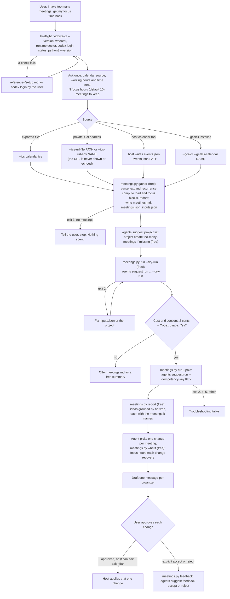

# too-many-meetings

## Summary

Add the public agent skill `skills/too-many-meetings/`. It is for founders, managers, and
engineers whose calendar has filled up one reasonable "yes" at a time, until no two-hour block is
left for deep work. A bundled, free, standard-library Python script reads two weeks back and two
weeks ahead of the user's calendar, from any of four sources: an exported `.ics` file, the
calendar's private iCal address (read from an environment variable or a file, never from the
chat), the coding agent's own calendar tool (which writes a documented `events.json`), or
`gcalcli`. It measures meeting hours per week, the focus blocks of two hours or more that are left,
the recurring meetings with their size and frequency, which meetings the user organizes and which
they only attend, RSVP state, back-to-back chains, meetings with more than 8 people, and 1:1s. It
writes a redacted `meetings.md` (no email addresses, no meeting links, no dial-in codes, no
descriptions) and a local `meetings.json`.

Then, after the user's yes, one `vidbyte-cli agents suggest run` (2 cents for one block of up to
ten suggestions, plus model usage on the user's own Codex login) asks the Suggestion Agent to get
back N focus hours a week, with the user's must-keep meetings as constraints and "declining or
leaving meetings without telling the organizer" as a forbidden action. The run uses a suggestion
project, so later runs learn which kinds of cuts this user accepts. The coding agent turns the ideas
into one recommendation per meeting (drop, shorten, make async, delegate, or batch onto one day),
the script's free `whatif` command computes the focus hours each change recovers, alone and
together, and the agent drafts a polite message to each organizer. The skill never changes the
calendar. A host with a calendar tool applies a change only after the user approves that change.

## Flow chart



## Usage example

```bash
npx skills add cerredz/vidbyte-cli --skill too-many-meetings
```

Then, in the coding agent:

```text
> I have too many meetings. Help me get 8 focus hours a week back.
```

The agent runs the preflight, asks for the calendar source, working hours and time zone, and the
meetings to keep, then runs:

```bash
python3 "<skill>/scripts/meetings.py" gather --ics ~/Downloads/work-calendar.ics \
  --tz America/New_York --work-hours 09:00-17:00 --focus-goal 8 \
  --keep "customer calls" --keep "1:1s with my reports"
vidbyte-cli --json agents suggest project list
python3 "<skill>/scripts/meetings.py" run --out-dir "<OUT_DIR>" --dry-run
```

After the user's yes, `meetings.py run --out-dir "<OUT_DIR>" --paid` runs, from inside `OUT_DIR`:

```bash
vidbyte-cli --json --no-input agents suggest run \
  --goal "Get back 8 focus hours a week. ..." \
  --project too-many-meetings \
  --category stop_or_defer --category simplification --category delegation \
  --horizon any --count 6 \
  --constraint "Keep these meetings as they are: customer calls; 1:1s with my reports." \
  --forbidden "declining or leaving meetings without telling the organizer" \
  --outcomes "Past 2 weeks: 24.5 meeting hours a week ..." \
  --context "[M1] \"Weekly all-hands\": weekly on Mon, 60 min ..." \
  --files meetings.md \
  --idempotency-key "too-many-meetings:20261011:3f9a1c"
```

Then `meetings.py report`, and for the changes the agent picks from the ideas:

```bash
python3 "<skill>/scripts/meetings.py" whatif --out-dir "<OUT_DIR>" \
  --drop M4 --shorten M1=25 --async M2 --delegate M7 --move M9=thu
```

## How it works

### Calendar sources

- **`.ics` file** (`--ics PATH`, repeatable): Google (Settings, Import and export, Export), Apple
  Calendar (File, Export), and Outlook desktop (save the calendar as an iCalendar file) all write
  one.
- **Private iCal address** (`--ics-url-env NAME` or `--ics-url-file PATH`): Google's "secret
  address in iCal format", Outlook's published calendar link, or an iCloud calendar link. The
  script reads the URL from the variable or file, turns `webcal://` into `https://`, refuses any
  other scheme, downloads at most 50 MB with a 60-second timeout, and never prints the URL: errors
  name only the HTTP status or the error type. The download stays in memory and is never saved.
- **The host agent's calendar tool** (`--events-json PATH`): the host lists the expanded
  occurrences in the window and writes them in a documented JSON shape (one entry per occurrence:
  title, start, end, all_day, status, show_as, my_response, organizer, attendees, series_id,
  description). Response and show-as values from the Google Calendar API and Microsoft Graph are
  accepted under their own spellings.
- **gcalcli** (`--gcalcli`, `--gcalcli-calendar NAME`): runs
  `gcalcli --nocolor agenda --tsv --nodeclined --details id --details email [--calendar NAME] START END`
  as an argv list, with no stdin and a 120-second timeout. gcalcli 4.5.1's TSV output (checked in
  its source) starts with a header row and has no attendee, organizer, RSVP, or recurrence columns,
  so attendee-based numbers are reported as unknown for this source. The series comes from the
  instance id (`<series>_<YYYYMMDDTHHMMSSZ>`), and the organizer is approximated by the creator
  email when `--me` is given. Declined events are hidden by `--nodeclined`.

### The ICS parser

Standard library only. It unfolds lines, unescapes TEXT values, reads quoted parameters, and
handles:

| Feature | Support |
|---|---|
| `RRULE` `FREQ` | `DAILY`, `WEEKLY`, `MONTHLY`, and `YEARLY` without `BY` parts. `HOURLY`, `MINUTELY`, and `SECONDLY` are reported as unsupported. |
| `INTERVAL`, `COUNT`, `UNTIL`, `WKST` | Yes. `COUNT` counts before `EXDATE`, as RFC 5545 says. `UNTIL` as a date, a UTC time, or a local time. |
| `BYDAY` | Weekly days; monthly with ordinals (`2TU`, `-1FR`) or plain days; daily as a filter. |
| `BYMONTHDAY`, `BYSETPOS` | Monthly (including negative days, and Outlook's "last weekday" `BYSETPOS=-1`). |
| `BYHOUR`, `BYMINUTE`, `BYSECOND`, `BYWEEKNO`, `BYYEARDAY`, `BYMONTH`, `EXRULE`, `RDATE;VALUE=PERIOD`, `RANGE=THISANDFUTURE` | Reported as unsupported by name. Only the first date and the overrides of that series are counted. Nothing is guessed. |
| `EXDATE`, `RDATE` | Yes, with `TZID`, UTC, date values, and comma lists. |
| `RECURRENCE-ID` overrides | Yes: a moved, retimed, or cancelled instance replaces its original, and an override whose series is missing counts on its own. |
| All-day events | Not meetings and not busy. An all-day event that reads as time off (out of office, vacation, holiday, PTO, or Outlook's `OOF`) removes its days from the working days. |
| `STATUS:CANCELLED` | Not counted, but reported. |
| Declined RSVP (`PARTSTAT=DECLINED`) | Not counted as busy or as meeting time, but reported. Tentative and unanswered invites count as busy and are flagged. |
| `TRANSP:TRANSPARENT`, `X-MICROSOFT-CDO-BUSYSTATUS:FREE` | Shown as free: not counted. |
| `TZID` time zones | `zoneinfo` (Python 3.9 or newer) for IANA names; otherwise the file's own `VTIMEZONE` blocks (which is how Outlook's Windows zone names and Windows machines without the `tzdata` package still work); otherwise the user's time zone with a warning. |

Rooms and resources (`CUTYPE=RESOURCE` or `ROOM`, Google resource addresses) and `ROLE=NON-PARTICIPANT`
attendees do not count as people. The user is found by `--me` addresses, else by `X-WR-CALNAME`
when it is an address (Google's export), else by the address that appears on most meetings. The
address is used in memory only and shown masked (`j***@example.com`) so the user can confirm it.

### Distill

The window is the 14 days before today and the 14 days from today, in the user's time zone
(`--tz`; default the calendar's `X-WR-TIMEZONE`, then this computer's local time), split into four
7-day weeks. For each working day (`--work-days`, `--work-hours`, default Monday to Friday 09:00 to
17:00), busy time is every timed event the user has not declined and that is not cancelled or shown
as free. Events whose titles read as focus time ("focus", "deep work", "no meetings") are not busy.
A focus block is a free stretch of at least 120 minutes (`--min-focus-minutes`) inside working
hours; focus hours are the hours inside those blocks. Meeting hours are the union of meetings with
at least one other person (or with unknown attendees), so overlaps are not counted twice.

Occurrences are grouped into series (UID, `series_id`, or the gcalcli series id). Each series gets
a tag, `M1`, `M2`, ..., in order of hours per week, with its repeat rule in words, typical length,
times in the window, people (internal and external, with external domains only), organizer (you or
someone else), RSVP, 1:1 and "more than 8 people" flags, whether it has an agenda (from the
description, read once and never written out), its part in back-to-back chains (meetings with gaps
under 5 minutes), and the focus hours a week that dropping it would recover in the next two weeks.

Redaction applies to every value written: email addresses become `[email]`, URLs become `[link]`,
phone numbers `[phone]`, and dial-in, meeting-id, and passcode numbers `[code]`, plus the common
secret-token formats. Descriptions, locations, conference data, and attendee names are never
written. Organizer display names are kept in `meetings.json` only, which is never sent, so the
agent can address its drafts.

`gather` writes three files into a new folder in the system temp directory:

| File | Sent to the model? |
|---|---|
| `meetings.md`: the digest above, as tables. | Yes, with `--files meetings.md`, passed as a relative path from inside the folder so the user's home path never reaches the model. |
| `inputs.json`: the goal, the project key, and the values for `--constraint`, `--forbidden`, `--outcomes` (the weekly numbers), and `--context` (one tagged line per heavy meeting, at most 12). | Its values, yes. The agent may edit it. |
| `meetings.json`: the full analysis, including each occurrence and the working-day intervals in UTC, so `whatif` can recompute without the time zone database. | No, never. |

### Ask

`meetings.py run` validates `inputs.json`, redacts each value again, and runs the command from the
usage example. Why the settings:

- `--goal`: the user's N, plus the definition of a focus hour, and the request to name meetings by
  tag and say what each change recovers.
- `--category stop_or_defer`, `simplification`, `delegation`: drop or defer, shorten or replace
  with a written update, and send someone else. All three ids exist in the CLI's category registry.
- `--horizon any`: any other value drops ideas with another horizon label after review, so a run
  could return fewer ideas and still be charged. The report groups ideas by their own label.
- `--count 6`: one 2-cent block; six cuts can be reviewed in one sitting.
- `--constraint`: the meetings the user keeps (default "customer calls" and "1:1s").
- `--forbidden "declining or leaving meetings without telling the organizer"`. The CLI also drops
  any idea whose text repeats a forbidden value word for word, which is harmless here.
- `--outcomes`, `--context`: one fact per value; each meeting value starts with its tag, so the
  evidence an idea cites maps back to the meeting.
- `--files meetings.md`, not `--attach`: a `--files` file is citable evidence.
- `--project too-many-meetings`: loads the accepts and rejects of earlier runs.

The paid-run guard is the one from `pick-up-where-my-sessions-left-off`: `run` needs exactly one of
`--dry-run` or `--paid`; `--paid` makes one key, saves it in `idempotency-key.txt`, and refuses to
start if the folder already holds a paid attempt, unless `--idempotency-key` recovers that same
admission. Before a paid run, the script also runs `codex login status` and refuses on a non-zero
exit, because the CLI checks only that `codex` is on `PATH` before it charges.

### Deliver

`report` lists the ideas grouped by horizon, each with the meetings it names (tags in the cited
evidence and in the idea text, then exact titles) and their numbers. The agent picks one change per
named meeting and runs `whatif` with `--drop`, `--shorten TAG=MINUTES`, `--async`, `--delegate`,
`--move TAG=DAY[@HH:MM]`, or `--every-other`. `whatif` applies each change to the next two weeks,
alone and then all together (focus hours do not add up, because freed time merges with
neighbouring free time), and prints the focus hours and meeting hours each change recovers, the
total against the goal, and the organizer to write to. The agent drafts one message per organizer
and asks for approval per change. `feedback` records explicit accepts and rejects with the idea's
exact title.

## CLI surface and min-cli-version

Every command path and long option the skill uses is in `contracts/cli-commands.json` on the
internal repository's `main` (`55e5b43`): `agents suggest run` with `--goal`, `--project`,
`--category`, `--horizon`, `--count`, `--constraint`, `--forbidden`, `--outcomes`, `--context`,
`--files`, `--dry-run`, and `--idempotency-key`; `agents suggest project list` and `create`
(`--key`, `--title`, `--description`); `agents suggest handoff` (`--input`, `--idea`); and
`agents suggest feedback accept` and `reject` (`--project`, `--suggestion`, `--reason`), plus
`whoami` and `runtime doctor`. PyPI's newest release, 0.2.0, lacks `--idempotency-key` and the paid
admission on `agents suggest run`, so `min-cli-version` is `0.3.0`, and the PR must not merge until
0.3.0 is on PyPI.

## Files

| File | Change |
|---|---|
| `skills/too-many-meetings/SKILL.md` | New. The skill, in the contract's section order. |
| `skills/too-many-meetings/scripts/meetings.py` | New. `gather`, `run`, `report`, `whatif`, `feedback`. Standard library only, Python 3.9 or newer; every external command is an argv list with no shell. |
| `skills/too-many-meetings/tests/test_meetings.py` | New. `unittest` tests with inline synthetic `.ics` fixtures for every recurrence case, the sources, redaction, `whatif`, and the paid-run guard against a fake `vidbyte-cli` on a `PATH` that holds nothing else. |
| `skills/too-many-meetings/references/setup.md` | New. Byte-for-byte copy of the canonical file. |
| `skills/too-many-meetings/references/troubleshooting.md` | New. Byte-for-byte copy of the canonical file. |
| `docs/design/too-many-meetings.md` | New. This document. |

## Risks and open questions

- **Provider exports differ.** Published Outlook and iCloud calendars may leave out attendees, or
  show only free and busy. The script reports how many meetings carried attendee data and says when
  attendee-based numbers are unknown, instead of guessing.
- **Public links.** An iCloud public calendar or an Outlook published calendar can be read by
  anyone who has the link. The skill prefers an exported file for those providers and tells the
  user to stop publishing when done.
- **Heuristics.** 1:1 means exactly two people; "external" means another email domain, which
  approximates customer calls; agenda detection reads the description after removing links and
  join boilerplate. The user's keep list and approval cover the cases these miss.
- **gcalcli is thin.** It gives times, titles, series, and the declined filter only.
- **No real calendar or paid run was used in testing.** Paid paths were tested only with a fake
  `vidbyte-cli`.

## Verification

1. Contract check: every `vidbyte-cli` invocation in `SKILL.md` and in `meetings.py` parsed against
   `contracts/cli-commands.json` on the internal `main`.
2. A real `--dry-run` of the exact argv `meetings.py run --dry-run` builds, using a CLI installed
   from the internal `main` into a scratch virtual environment: exit 0, `stop_reason: dry_run`,
   every `context_manifest` entry `included`.
3. `python -m unittest` on `tests/test_meetings.py` with Python 3.11 (with `tzdata`) and Python 3.13
   without `tzdata` (forcing the `VTIMEZONE` fallback): weekly, every-other-week, weekday, daily,
   monthly by ordinal day, by month day, and last weekday rules; `COUNT`, `UNTIL`, `EXDATE`,
   `RECURRENCE-ID` (moved and cancelled), all-day and time-off days, cancelled events, declined
   RSVPs, `TZID` across a daylight-saving change, unsupported rules reported, redaction, `events.json`,
   a fake `gcalcli`, `whatif`, and the paid-run guard and recovery with a fake `vidbyte-cli` and a
   fake `codex`.
4. `cmp` of each `references/` file against `git show origin/main:` of the canonical copy.
5. A grep of the diff for email addresses, home paths, and tokens before every commit.
