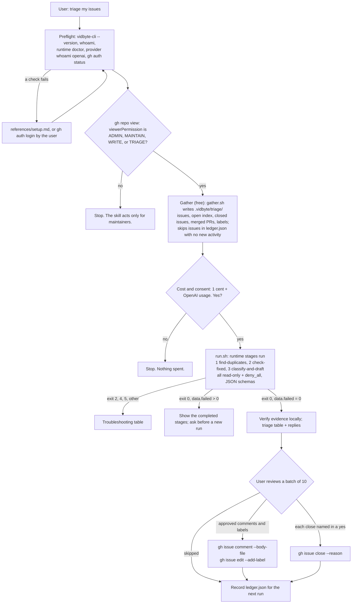

# triage-issue-backlog

## Summary

Add the public agent skill `skills/triage-issue-backlog/`. It serves a maintainer whose public
GitHub tracker has hundreds of open issues: many are duplicates, already fixed on the default
branch, missing reproduction details, or stale. The skill gathers the backlog with free, read-only
`gh` and `git` reads, runs one Vidbyte Stages Agent run (`vidbyte-cli runtime stages run`, 1 cent
plus the user's own OpenAI usage) with three read-only stages, and hands back a triage table with
a drafted reply per issue. Nothing is posted, labelled, or closed until the user approves it, in
batches. It only triages and drafts; fixing belongs to `burn-down-issues`, and the Bug Finder
ledger belongs to `triage-bugs`.

## Flow chart



## Usage example

```bash
npx skills add cerredz/vidbyte-cli --skill triage-issue-backlog
```

Then, in the coding agent, inside a clone of the repository:

```text
> Triage my issues. Find the duplicates and anything we already fixed.
```

The agent runs the preflight, writes and runs `.vidbyte/triage/gather.sh`, says "This costs
1 cent from your Vidbyte balance plus OpenAI usage on your own account; nothing is posted until
you approve it. Run it?", then runs `bash .vidbyte/triage/run.sh`, which calls:

```bash
vidbyte-cli --json --no-input runtime stages run \
  --stage-name find-duplicates --stage-system-prompt "$SYS1" --stage-prompt "$P1" \
  --stage-context "$CTX" --stage-output-schema "$S1" \
  --stage-sandbox read-only --stage-approval deny_all --stage-effort high \
  ... (check-fixed, classify-and-draft) ... \
  --idempotency-key "$KEY" \
  -- "$TASK" > .vidbyte/triage/result.json
```

## How it works

- **Gather (free).** `gather.sh` writes trimmed JSON to `.vidbyte/triage/` and adds that folder to
  `.git/info/exclude`, so it never reaches a commit and no tracked file changes. The batch is the
  100 least recently updated open issues (`--search "sort:updated-asc"`), bodies cut to 1,500
  characters and the last three comments to 500. Extra files: every open issue's number and title
  (for duplicates outside the batch), the 300 most recently created closed issues, pull requests merged since the
  oldest issue in the batch with the issues each one closes, and the repository's labels. Stage
  agents run with no network (Codex's read-only policy sets `networkAccess` false), so every GitHub
  fact they need must be in these files; they read git history locally after `git fetch`.
- **Run (1 cent).** Three sequential stages. `{{previous}}` carries stage 1's clusters into
  stage 2 and stage 2's output (clusters copied forward plus fixed issues) into stage 3, because
  in sequential mode stage 3 sees only stage 2's output. Every stage gets the same
  `--stage-context` with the repository, branch, date, stale period, and file paths, because only
  stage 1 sees TASK. Stage text limits are 20,000 characters for each prompt, system prompt,
  context, schema, and TASK; the data stays in files for that reason.
- **Schemas.** 0.2.0 forwards `--stage-output-schema` to Codex unchanged, while `main` rewrites it
  into OpenAI's strict form (`CodexOutputSchema.strict_mapping`). The skill writes schemas already
  in strict form (every object closed, every property required, no defaults), so both versions
  send the same schema. Verified: `strict_mapping(schema) == schema` for all three.
- **Deliver.** The agent checks the result locally (JSON parses, one item per issue, each fixing
  commit is an ancestor of `origin/<branch>`, each PR and canonical issue is in the gathered files,
  each label exists), then shows a table and batches of 10 drafted replies. Comments go up with
  `gh issue comment --body-file`, labels with `gh issue edit --add-label`, and closes with
  `gh issue close --reason "not planned"` (duplicates, stale) or `--reason completed` (fixed). gh
  2.87.2 offers only `completed` and `not planned`; GitHub marks a duplicate from a comment that
  starts "Duplicate of #N", so the reply carries that line and is posted before the close.
- **Remember.** `ledger.json` maps each reviewed issue to its action and `checked_at`, the issue's
  GitHub `updatedAt` after the last write. A rerun skips an issue whose `updatedAt` is not later than
  `checked_at`, and fetches extra issues to keep the batch full.

## Files

| File | Change |
|---|---|
| `skills/triage-issue-backlog/SKILL.md` | New. The skill, from `write-agent-skill/references/skill-template.md`. |
| `skills/triage-issue-backlog/references/setup.md` | New. Byte-for-byte copy of the canonical file. |
| `skills/triage-issue-backlog/references/troubleshooting.md` | New. Byte-for-byte copy of the canonical file. |
| `docs/design/triage-issue-backlog.md` | New. This document. |

No `AGENTS.md` exists in this repository and no CI workflow runs on it, so the gate is local:
`npx skills add <worktree> --list` must list the slug, and the `write-agent-skill` review
checklist must pass.

## CLI surface and min-cli-version

Every option the skill passes to `runtime stages run` is in `contracts/cli-commands.json` on
`cerredz/vidbyte-cli-internal` `main` and in the `v0.2.0` tag: the option declarations in
`src/vidbyte_cli/commands/runtime/stages.py` are identical, and `runtime stages run --help` from
the PyPI 0.2.0 wheel lists them all. The differences between 0.2.0 and `main` are the strict-schema
rewrite, a `reason` field on failed steps, a printed recovery key, and the `runs` ledger. The skill
needs none of these, so `min-cli-version` is `0.2.0`. The price, 1 cent flat per run, comes from
the backend catalog entry `runtime.stages@1` (`admission_floor_cents=1`, `PREPAID_WALLET_FLAT`).

## Risks and open questions

- No end-to-end run was made: the build rules forbid paid commands. The stage prompts, the
  output size of stage 3 for 100 issues, and the one-hour stage turn limit
  (`StagesLimit.TURN_TIMEOUT_SECONDS = 3600`) are untested in practice.
- `metadata.writes-files` is `"false"`: no stage writes, and the skill writes only untracked working
  files under `.vidbyte/triage/`, excluded through `.git/info/exclude`. Open question: does the
  website's "edits files" flag mean any file at all?
- The shared `references/troubleshooting.md` mentions `runs`, which is 0.3.0 only. This skill saves
  its own result document and never sends the agent to `runs`.
- Newer gh releases may add a `duplicate` close reason; the skill uses only what 2.87.2 offers.
- Windows: the scripts need bash (Git Bash) and Python 3 (`python3` or `python`), because
  PowerShell 5.1 strips the inner double quotes of JSON arguments passed to native programs.

## Verification

1. Contract and tag check of every option (done above).
2. Free offline checks: the 0.2.0 wheel's `runtime stages describe` output and `--help`; Click
   parsing of the skill's exact `run.sh` arguments through the 0.2.0 command object and
   `StagesCommand._settings`, without invoking the command; the strict-schema identity check.
3. `gather.sh` run against a small public repository (read-only `gh` calls).
4. `npx skills add <worktree> --list` lists `triage-issue-backlog`.
5. `git hash-object` of each reference copy equals the canonical blob on `vidbyte` `origin/main`.
