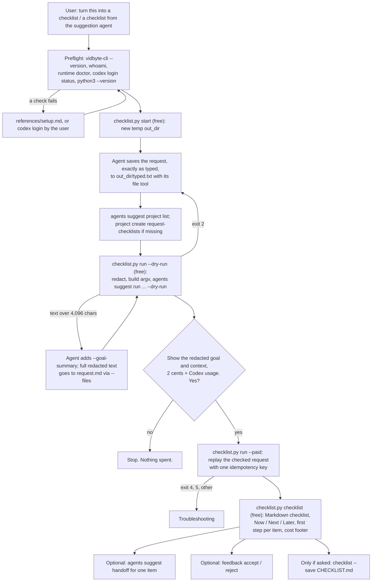

# turn-my-request-into-a-checklist

## Summary

Add the public agent skill `skills/turn-my-request-into-a-checklist/`. A user types a request into
Claude Code or Codex ("add rate limiting to the public API", "prepare for my investor call
Thursday", "figure out why signups dropped"), and the coding agent starts at once. The user never
sees what a careful person would list first: what must be true before starting, the first concrete
steps, how to check the result, and what could go wrong. The user asked for a general, simple
skill: run the Vidbyte Suggestion Agent on what they just typed, then turn what it recommends into
a checklist.

The skill runs only when the user invokes it. A small stdlib-only Python script reads the typed
text from a file, redacts secrets, emails, and home paths, builds the `vidbyte-cli agents suggest
run` command as an argument list (never through a shell), and checks it with a free dry run. After
the user's yes, one paid run (2 cents at the default `--count 8`, plus model usage on the user's
own Codex account) returns reviewed ideas, and the script prints them as a Markdown checklist
grouped by Now, Next, and Later, each item with its first step. Unlike its sibling skills, there
is no gather-and-distill stage: the input is one request and a few lines of context.

## Flow chart



## Usage example

```bash
npx skills add cerredz/vidbyte-cli --skill turn-my-request-into-a-checklist
```

Then, in the coding agent:

```text
> add rate limiting to the public API. Before you start, turn this into a checklist with the suggestion agent.
```

The agent runs the preflight, then:

```bash
python3 "<skill>/scripts/checklist.py" start
# the agent writes "add rate limiting to the public API" to <out_dir>/typed.txt
vidbyte-cli --json agents suggest project list
vidbyte-cli --json agents suggest project create --key request-checklists --title "Checklists from my requests" --description "..."
python3 "<skill>/scripts/checklist.py" run --out "<out_dir>" --dry-run \
  --context "Repository: billing-api, branch main." \
  --constraint "The change must ship before Friday's release."
```

It shows the redacted goal and context and asks: "This runs the Vidbyte Suggestion Agent once on
the request above. It costs 2 cents from your Vidbyte balance, plus model usage on your Codex
account, and changes no files. Run it?" After a yes:

```bash
python3 "<skill>/scripts/checklist.py" run --out "<out_dir>" --paid
python3 "<skill>/scripts/checklist.py" checklist --out "<out_dir>"
```

The paid step runs, from inside `<out_dir>` and without a shell:

```bash
vidbyte-cli --json --no-input agents suggest run \
  --goal "add rate limiting to the public API" \
  --category prerequisite --category immediate_next_steps \
  --category verification --category risk_prevention \
  --horizon any --count 8 \
  --context "Repository: billing-api, branch main." \
  --constraint "The change must ship before Friday's release." \
  --project request-checklists \
  --idempotency-key "turn-my-request-into-a-checklist:20261011:3f9a1c"
```

## How it works

- **Trigger.** On demand only: the message that invoked the skill, or "the thing I just asked"
  (the user's previous message). The skill never installs a hook. See "Trigger decision".
- **Input.** The coding agent writes the request, exactly as typed, to `<out_dir>/typed.txt` with
  its own file tool, so no shell ever sees the text and no quoting can break it. `run` reads it as
  UTF-8, normalizes line endings, and redacts it with the `Redactor` patterns copied from
  `pick-up-where-my-sessions-left-off/scripts/sessions.py` (token formats, `NAME=value` and
  `secret: value` assignments, emails, home paths in every spelling, the login name).
- **Goal limit.** The CLI refuses a goal over 4,096 characters
  (`SuggestionRunInput._validate_goal` in `commands/agents/suggestion/request_builder.py`). Up to
  that, the redacted text is the goal. Over it, `run` requires `--goal-summary` (one sentence the
  agent writes, at most 600 characters), writes the full redacted text to `request.md`, and passes
  `--files request.md` as a relative path from inside the `out_dir`, because the path is recorded
  as the context source.
- **Other inputs.** `--context` (at most 3 short facts the agent already knows: repository folder
  name, branch, one line about the current task), and, only when the user said them,
  `--constraint`, `--completed`, `--in-progress`, and `--avoid` (at most 3 each, 400 characters
  each). The CLI drops any idea whose title, summary, first action, or actions contain a
  `completed`, `in_progress`, `avoid`, `mistakes`, or `forbidden` value word for word
  (`_rejected_terms` and `suppress_rejected` in `services/suggestions/`), so `run` refuses those
  values under four words: a short value such as "tests" would delete every idea that mentions
  it, after the run was paid for.
- **Categories.** `prerequisite`, `immediate_next_steps`, `verification`, `risk_prevention`,
  checked against `SuggestionCategories` (31 ids). They map one to one onto what a checklist
  needs: what must be true first, what to do now, how to know it worked, what to guard against.
  Choosing four sends their full authored prompt assets to the generator. With no `--category`,
  the generator gets only a one-line summary of all 31 lenses and can return `big_bets`,
  `long_term_directions`, or `business_growth` ideas, which are not checklist items. `investigation`
  was considered for debugging requests; `immediate_next_steps` already covers a first diagnostic
  step, and a fifth full prompt asset adds Codex usage on every run.
- **Count and cost.** `--count 8` by default: one admission block (2 cents) covers up to ten, and
  eight items fit on one screen. The user may ask for 2 to 100; `run` prints `cost_cents`
  (2 cents per block of ten, from `prompts/count.md` and `suggest.py`). `--horizon any`, because
  any other value filters ideas after review while the charge stays the same.
- **Guard.** `run --dry-run` writes `request.json` (the exact request) and, when the CLI returns
  `stop_reason: dry_run` with every manifest entry `included`, `dry-run.ok` holding a SHA-256 of
  the request and of `request.md`. `run --paid` takes no input options, replays `request.json`,
  and refuses when `dry-run.ok` is missing or does not match, when `idempotency-key.txt` or
  `result.json` already exists (unless `--idempotency-key` repeats the saved key to recover an
  unfinished admission), and when the command contains `--dry-run`. The key is
  `turn-my-request-into-a-checklist:<YYYYMMDD>:<6 hex>`.
- **CLI location.** `run` and `feedback` take `--cli <path>` (default: `vidbyte-cli` on `PATH`),
  print the resolved path before every call, and refuse a `.bat` or `.cmd` on Windows, because
  `cmd.exe` would reinterpret `&`, `|`, and `%` in the user's text.
- **Checklist.** `checklist` reads `result.json` and prints Markdown: `# Checklist: <request>`,
  then `## Now`, `## Next`, `## Later` (each idea's own `horizon`), rank order inside each group,
  one `- [ ] <title>` per idea with an indented `First step: <first_action> (idea-00N)` line, and
  the readiness when it is not `ready`. Grouping by horizon was chosen over a flat rank order
  because a checklist reads as a sequence, and a flat list can put a `later` item above a `now`
  item. A footer gives `charged_cents`, the handoff command with the real `out_dir`, and how to
  record feedback. `needs_input` prints the agent's question; an empty slate prints the stop
  reason. It writes `<out_dir>/checklist.md`; `--save <path>` writes a copy into the workspace
  only when the user asks, and never overwrites a file.
- **Learning.** One shared project, `request-checklists`, created on first use before the dry run
  (a dry run with a missing project exits 2). `feedback` copies the idea's exact title into
  `agents suggest feedback accept|reject`, because rejection suppresses by exact text. Feedback is
  offered once and never pressed.

## Trigger decision

On demand, not on every prompt. Each run is charged (2 cents plus Codex usage), and the contract
(section 5, rule 1) requires telling the user the cost and waiting for a yes before every command
that charges. The contract does not mention a standing approval such as "yes to the next 5 runs,
up to 10 cents", and each run sends different text that the user must see redacted before it
leaves the machine. So the skill keeps one yes per paid run and does not offer a session-wide
approval.

## Files

| File | What it is |
|---|---|
| `skills/turn-my-request-into-a-checklist/SKILL.md` | The skill, in the contract's section order. |
| `skills/turn-my-request-into-a-checklist/scripts/checklist.py` | Stdlib-only helper, Python 3.8+: `start`, `run`, `checklist`, `feedback`. |
| `skills/turn-my-request-into-a-checklist/references/setup.md` | Byte-identical copy of the canonical file. |
| `skills/turn-my-request-into-a-checklist/references/troubleshooting.md` | Byte-identical copy of the canonical file. |
| `docs/design/turn-my-request-into-a-checklist.md` | This document. |

## Risks and open questions

- **Automatic mode (not built).** Claude Code could run the skill on every prompt through a
  `UserPromptSubmit` hook in `settings.json`, which receives the prompt text on stdin. Codex can
  run a program after each turn through the `notify` setting in `config.toml`, or through
  whatever hook it offers for the same purpose. Any of these would charge 2 cents plus Codex usage
  on every prompt, including "thanks" and "yes", send text the user never reviewed, and replace
  per-run consent with a standing charge. If users ask for it, a safe version would be a hook
  that only suggests the skill for long requests and still asks before paying.
- **Standing approval.** Not supported, for the reasons in "Trigger decision". If the contract
  later allows it, the cap would belong in the helper (runs and cents per session), not in prose.
- **Shared project.** One `request-checklists` project spans every repository and topic, so a
  rejection about one request shapes checklists for others. That is the price of "general and
  simple"; a per-repository key is a later option.
- **Redaction is pattern-based.** It removes common secret formats, not every secret. The user
  sees the redacted goal and context before the paid run.
- **Release.** The paid admission and `--idempotency-key` are not in vidbyte-cli 0.2.0 on PyPI.
  `min-cli-version` is `0.3.0`, and the PR must not merge before that release.

## Verification

1. Every `vidbyte-cli` command path and long option in `SKILL.md` and the script checked against
   `contracts/cli-commands.json` on the internal `main`.
2. A real `run --dry-run`, short text and long text, executed by a `vidbyte-cli` built from the
   internal `main` with its config, cache, state, data, and legacy folders redirected to a scratch
   folder, the keyring backend disabled, and the API URL pointed at a closed local port: exit 0,
   `stop_reason: dry_run`, every manifest entry `included`.
3. The paid path, the guard's refusals, and `feedback` exercised only with a recording fake
   `vidbyte-cli` passed through `--cli`, with no `vidbyte-cli` on `PATH` (checked with
   `command -v` in the same shell call), and every recorded call compared with the expected list.
4. `checklist` rendered from a synthetic `result.json` that validates against the CLI's own
   `SuggestionResult` model.
5. Redaction of planted secrets checked in `request.json`, `request.md`, and the fake's recorded
   argv.
6. Every script test run under a real Python 3.8 interpreter.
7. `cmp` of both `references/` files against the canonical copies; the diff grepped for leaked
   names, paths, and tokens before every commit.

## Update: usage-billed Suggestion Agent (2026-10-19)

From vidbyte-cli 0.3.2 (cerredz/vidbyte-cli#162), `agents suggest run` buys no Vidbyte admission,
does not run on the user's Codex, and has no `--idempotency-key` option: passing it fails with exit
2 and `No such option '--idempotency-key'.` before anything runs. This skill now follows the
pattern `next-actions-from-obsidian` and the other usage-billed skills use. Where the sections
above say otherwise, this section wins.

- **No admission, no key, no Codex.** The 2-cent-per-block admission, `--idempotency-key`,
  `idempotency-key.txt`, and the key-recovery path are gone. Every generator, critic, and revision
  step is one model call through Vidbyte's model gateway, billed to the Vidbyte balance at the
  model's per-token rate plus 2%. A paid run writes `paid-run.txt` first, and the script refuses a
  second paid run (or a new dry run) in a folder that has that marker or a `result.json`.
- **Model and cap.** No `--model` or `--reasoning-effort` is passed, so both roles run on gpt-6-sol
  at high reasoning effort ($2 / $0.20 cached / $10 per million input / output tokens).
  `build_argv` adds `--max-total-tokens 400000` to both the dry and the paid run, so the dry run
  checks the exact paid command.
- **Count and cost.** `--count` still takes 2 to 100 and defaults to 8, but it no longer sets the
  price: a larger count asks for longer replies, which are more output tokens. The dry-run report
  shows `max_total_tokens` instead of `cost_cents`. The bound is the same as
  `next-actions-from-obsidian`'s, about $2.93 in the worst case, stated as "under about $4", at
  any count, because every call's output is capped at 32,000 tokens.
- **Report fields.** `run` reports `models`, `usage` (`model_calls`, `input_tokens`,
  `cached_input_tokens`, `output_tokens`), and `estimated_cost_usd` instead of `charged_cents` and
  `idempotency_key`; the checklist footer ends with a usage line instead of the cents line.
- **Preflight.** `vidbyte-cli --json runtime doctor` and `codex login status` are dropped; the key
  needs the `models:invoke` permission instead, and exit 4 now also covers a key without it.
  `references/setup.md` and `references/troubleshooting.md` are the new canonical copies.
