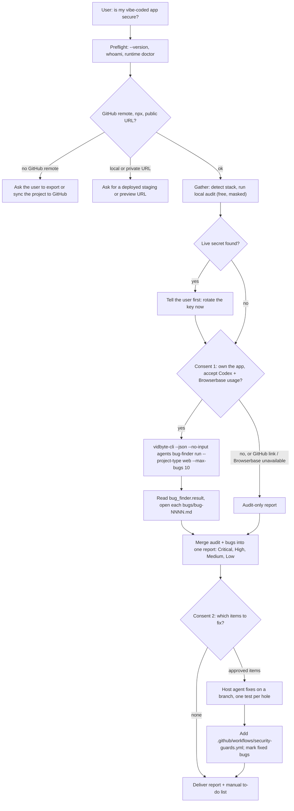

# vibe-coded-to-production

## Summary

Add a public agent skill, `skills/vibe-coded-to-production/`, for the founder whose app was built
with Lovable, Bolt, v0, Replit, or Cursor, is live with real users, and has never been checked for
the holes AI-built apps repeat. The skill has the user's coding agent run a free local audit of the
repository, run one Vidbyte Bug Finder hunt against the deployed app and its GitHub code, merge
both into one report ordered by harm, and then, with the user's consent, fix the approved items
with a regression test for each and a CI workflow that runs those tests. It matters because
"is my app secure?" and "make my Lovable app production ready" are searched every day by people
who cannot judge the answer themselves, and every install of the skill is also an install of
`vidbyte-cli`.

## Flow chart



## Usage example

The user installs the skill and asks in their own words:

```bash
npx skills add cerredz/vidbyte-cli --skill vibe-coded-to-production
# then, in Claude Code / Codex / Cursor:
#   "I built this with Lovable and we launch Monday. Is it secure?"
```

The agent's run, after preflight, the local audit, and the user's yes:

```bash
vidbyte-cli --json --no-input agents bug-finder run \
  --github-repo acme/launchpad \
  --project-type web \
  --app-url "https://preview.launchpad.app" \
  --max-bugs 10

# after a fix for bug-0002 lands with its test:
vidbyte-cli --json --no-input agents bug-finder mark \
  --github-repo acme/launchpad --bug bug-0002 --state fixed
```

## How it works

- **Contract.** The file follows `skills/agent-skills/write-agent-skill/SKILL.md` on the vidbyte
  repository's `main`: frontmatter with every `metadata` field, the fixed twelve-section order,
  the consent and spending rules, exact commands with root options first, and byte-for-byte
  copies of `references/setup.md` and `references/troubleshooting.md`.
- **Agent and commands.** Only the Bug Finder: `agents bug-finder run` and
  `agents bug-finder mark`, plus the free `runs list` and `runs last` to recover the result of a
  long run. Every command path and long option is in `contracts/cli-commands.json` on
  `cerredz/vidbyte-cli-internal` `main` (contract commit `9703b53`).
- **Verified facts the skill relies on** (all from `src/vidbyte_cli/` on internal `main`):
  - `--max-bugs` is `click.IntRange(1, 50)`, default 5 (`BugFinderLimit`). The skill uses 10.
  - `--project-type` is one of `web`, `cli`, `sdk`; `--app-url` is required for `web` and refused
    for the others.
  - `_check_app_url` refuses non-http(s) addresses, addresses without a host or with a login,
    whitespace, more than 2,000 characters, and the hosts `localhost`, `127.0.0.1`, `0.0.0.0`,
    `::1`, and `*.localhost`, with "app url must be reachable from the internet, not a local
    address". It does not refuse private ranges such as `10.0.0.0/8`; the skill refuses them
    itself because Browserbase's cloud browser cannot reach them.
  - The run buys no Vidbyte admission, takes no `--idempotency-key`, and sends nothing to the
    Vidbyte backend. Codex usage is billed to the user's own Codex login and Browserbase time to
    the user's Browserbase account. Each turn is cut off after 3,600 seconds, and the run takes at
    most `--max-bugs` turns.
  - A missing GitHub link or Browserbase key exits 4 offline before anything is cloned. `github
    link` needs `VIDBYTE_GITHUB_CLIENT_ID`, because no Vidbyte GitHub app is registered yet.
  - The result is `kind: "bug_finder.result"` with `data.run_id`, `repository`, `project_type`,
    `commit_sha`, `max_bugs`, `stop_reason` (`no_bug_found`, `known_bug_reported`,
    `max_bugs_reached`), `bugs[]` (`id`, `title`, `severity`, `state`, `outcome`,
    `artifact_json`, `artifact_markdown`), `coverage`, and `ledger_file`. Artifacts and the
    ledger live under `bug-finder/projects/<owner>/<name>/` in the Vidbyte data directory.
  - `mark --state` accepts `candidate`, `confirmed`, `fixed`, `regressed`, `rejected`, `intended`,
    `wont-fix`; the result is `kind: "bug_finder.bug.marked"`.
- **Fix step: the host agent fixes directly; no priced fixing run.** Considered
  `runtime task-board run --task-list hardening.md --context-mode isolated` (two cents plus
  OpenAI usage) and `runtime persistence`. Rejected both for this situation:
  - Security fixes need the user's answers mid-fix ("should every signed-in user read `posts`, or
    only the author?"). A task-board or persistence agent cannot ask the user.
  - The fixes share one test setup and one CI workflow. Isolated task-board agents would each
    invent their own scaffolding, and windowed context would undo the isolation.
  - A vibe-coded app's hardening list is usually short, and the host agent already holds the
    merged report and the repository. A priced run adds cost without adding judgment.
  - It keeps the skill to one Vidbyte agent run, which is what the contract's goal asks for.
- **Regression guards.** A dependency-free `node --test` file checks the migrations for tables
  without RLS and `true` write policies, and tracked files for secret-named client variables and
  secret-shaped values. Route-level tests use the project's own runner. A
  `.github/workflows/security-guards.yml` runs both on every push and pull request.
- **Status `preview`.** The Bug Finder is not labelled preview anywhere, but `github link` cannot
  work for an ordinary user until a Vidbyte GitHub app exists (`references/setup.md` step 3 tells
  the agent to say the Bug Finder is not ready). The skill degrades to an audit-only report in
  that case. See open questions.

## Files

| File | Change |
|---|---|
| `skills/vibe-coded-to-production/SKILL.md` | New. The skill. |
| `skills/vibe-coded-to-production/references/setup.md` | New. Byte-for-byte copy of the canonical file (blob `df22649`). |
| `skills/vibe-coded-to-production/references/troubleshooting.md` | New. Byte-for-byte copy of the canonical file (blob `e5dd2a3`). |
| `docs/design/vibe-coded-to-production.md` | New. This document. |

No `AGENTS.md` exists in this repository, and it has no CI workflows, so "green" means the local
validation below passes.

## Risks and open questions

- **Not on PyPI yet.** PyPI's newest `vidbyte-cli` is 0.2.0, which has no `agents bug-finder`,
  `github link`, `browserbase login`, or `runs`. 0.3.0 (cerredz/vidbyte-cli-internal PR #159,
  branch `feat/release-0-3-0`) contains `main` unchanged for every command this skill uses, so
  `min-cli-version` is `0.3.0`. The PR must not merge until 0.3.0 is on PyPI.
- **GitHub client ID.** Until a Vidbyte GitHub app is registered, most users cannot run
  `github link`. Should the skill ship as `preview`, or wait?
- **Preflight `whoami`.** The contract requires it, but the Bug Finder needs no Vidbyte key. The
  skill runs it and tells the agent that exit 4 does not block this skill. Is that the intended
  reading of the contract for a free agent?
- **Cost wording.** The Vidbyte charge is zero; the real spend is the user's Codex and Browserbase
  usage, which the skill can bound (10 turns, 10 sessions, one hour each) but not price.
- **Live-app side effects.** The Bug Finder signs up and submits forms. The skill prefers a
  staging or preview URL and asks before hunting production.
- **Audit commands.** They use `git grep` (searches exactly the committed files, and git is always
  present) and Node.js for masking, not ripgrep: in Claude Code `rg` can be a shell function that
  `xargs` cannot call. Every audit command was run verbatim against a throwaway repository with
  planted fake secrets, an RLS-less table, a `using (true)` policy, an open route, and an
  unverified webhook, and each one reported the hole with the value masked.

## Verification

- `git hash-object` of each copied reference equals
  `git -C <vidbyte> rev-parse origin/main:skills/agent-skills/write-agent-skill/references/<file>`.
- Every `vidbyte-cli` command path and long option in `SKILL.md` is checked by script against
  `contracts/cli-commands.json` on internal `main`, and `--help` for `agents bug-finder run`,
  `agents bug-finder mark`, `runs list`, and `runs last` is read from a local build of
  `feat/release-0-3-0` (`vidbyte-cli, version 0.3.0`) in a scratch virtual environment.
- `npx -y skills add <worktree> --list` lists `vibe-coded-to-production`.
- The write-agent-skill review checklist is walked item by item in the PR body.
- Not run: the end-to-end run against a real app with the released CLI, because 0.3.0 is not on
  PyPI and this task forbids spending runs.
