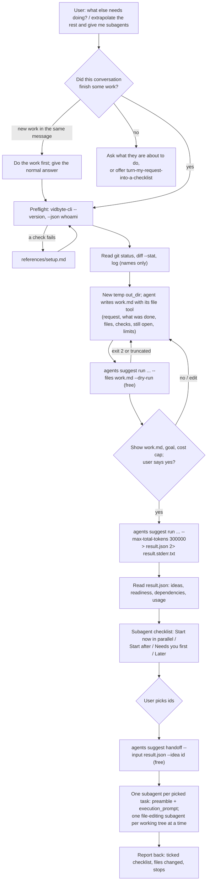

# Design Doc: what-else-needs-doing

**Status:** Draft
**Author:** Claude
**Created:** 2026-10-14
**Last Updated:** 2026-10-14

---

## 1. Overview

Add the public agent skill `skills/what-else-needs-doing/` to cerredz/vidbyte-cli, and list it on
`/agents/skills` in the Vidbyte repository. A user asks their coding agent for one thing, and the
agent does exactly that one thing. The request only held what was on the user's mind when they typed
it, so the work around it is missing: callers the change did not update, the migration it needs
before it ships, the claim nobody checked, the guard it now requires, and the nearby fix that is
cheap only while the context is open. After the coding agent has answered, this skill writes a short
summary of the request and the finished work, sends it to the Vidbyte Suggestion Agent in one
usage-billed `vidbyte-cli agents suggest run`, and turns the reviewed follow-up work into a
checklist of subagent tasks. Each task has a ready prompt from the free `agents suggest handoff`
command, and the coding agent starts one subagent per task the user picks.

## Flow chart



---

## 2. Goals & Non-Goals

### Goals
- Ship `skills/what-else-needs-doing/SKILL.md` that meets the write-agent-skill contract on
  cerredz/vidbyte-cli `main` (frontmatter, section order, consent, exact commands).
- Run the Suggestion Agent once, after the coding agent's answer, on a summary of the request and
  the finished work, through five lenses chosen for follow-up work: `completion`,
  `immediate_next_steps`, `verification`, `risk_prevention`, `adjacent_opportunity`.
- Deliver the result as a checklist of subagent tasks grouped by when they can start, and start
  only the tasks the user picks, each from the free handoff packet, with file-editing tasks kept
  apart.
- Keep every command portable across macOS, Linux, and Windows (bash, zsh, PowerShell 5.1 and 7)
  with no bundled script and no Python requirement beyond `vidbyte-cli` itself.
- Add a `coming-soon` listing at `next-app/constants/agent-skills/what-else-needs-doing/catalog.js`
  in the Vidbyte repository, registered in `catalog.js`.

### Non-Goals
- Running on every prompt, through a hook or any other automation. Every run is billed and needs
  its own yes.
- A learning project (`agents suggest project` and `feedback`). Kept out to keep the skill to one
  paid command and one free command; a later revision can add it the way sibling skills do.
- Committing, pushing, or opening pull requests for the subagents' work.
- Marking the listing `available`. That waits on vidbyte-cli 0.3.2 reaching PyPI and on the
  backend pricing gpt-6-sol (Vidbyte PR #691 tracks both for the sibling skills).
- Rewriting sibling skills that still describe the retired 2-cent admission.

---

## 3. Background & Context

- **Why now.** The user asked for a skill for "extrapolating work": people hold only a few things in
  working memory, so one request carries the main change and leaves out the work around it. The
  Suggestion Agent's categories already include the lenses for this, and its handoff packets are
  execution-ready prompts, which map one to one onto subagents.
- **Nearest sibling.** `turn-my-request-into-a-checklist` runs *before* work starts and lists
  prerequisites, steps, checks, and risks for the request itself. This skill runs *after* the work
  and looks outward from it. Other candidates do not overlap: `find-unfinished-agent-work` (open
  PR #27) mines past sessions across harnesses, `product-ideas-after-merge` (open PR #24) runs in
  CI, and the backlog's `launch-readiness` is a pre-ship risk review.
- **CLI facts this design rests on** (verified in cerredz/vidbyte-cli-internal at `767de8d`):
  - `agents suggest run` is usage-billed since CLI #162: no admission, no `--idempotency-key`;
    every generator, critic, and revision call goes through Vidbyte's model gateway at the model's
    rate plus 2%. Default model gpt-6-sol for both roles at high reasoning effort; two rounds, so
    about five calls. gpt-6-sol is $2 / $0.20 cached / $10 per million tokens
    (vidbyte-sdk `test_catalog_pricing_contract.py`).
  - 0.3.0 and 0.3.1 were never published (CLI #165); 0.3.2 is the first release with this billing.
    PyPI serves only 0.2.0 on 2026-10-14.
  - `--count` 2 to 100 (default 5); `--horizon` default `any`; `--max-total-tokens` 1 to
    20,000,000, checked before each new call, never interrupting one.
  - Explicit `--category` values each load their full authored prompt; ideas whose primary category
    is outside the selection are dropped.
  - Values of `--completed`, `--in-progress`, `--avoid`, `--mistakes`, and `--forbidden` are
    case-insensitive substring needles: any idea whose title, summary, first action, or actions
    contain one is dropped after the calls are billed (`service.py` `_rejected_terms`,
    `selection.py` `suppress_rejected`).
  - Ideas must cite a manifest ref; `--files` gives a file a `ctx-NNN` ref, `--attach` does not.
  - Each idea carries `readiness`, `horizon`, free-text `dependencies`, `effort_estimate`, and a
    `handoff` whose `execution_prompt` (at most 16,384 characters) ends with `Authority:
    not_granted_by_this_handoff` and `Report: ...`.
  - `agents suggest handoff --input` reads the file as `utf-8-sig`; redirected stdout is UTF-8
    since `IOStreams.system()` (2026-10-10). Windows PowerShell 5.1's `>` writes UTF-16, which the
    handoff cannot read.
  - Missing permission message: `The stored Vidbyte API key is missing the models:invoke
    permission.` (exit 4, before anything is billed).
- **Constraints.** No root `--output` option exists, so the result must be redirected to a file;
  the host's tool output would truncate a result with eight handoff packets.

---

## 4. Requirements

### Functional Requirements
1. The skill runs only when the user asks, and only after the coding agent has finished the work
   it is extrapolating from; new work in the same message is done first.
2. With no finished work in the conversation, the skill asks what the user is about to do or
   offers `turn-my-request-into-a-checklist`, and runs nothing.
3. Preflight checks `vidbyte-cli --version` (0.3.2 or newer) and `vidbyte-cli --json whoami`, and
   names the models:invoke permission and the exact message a missing one produces.
4. The coding agent writes `work.md` in a new temp folder outside every repository, with fixed
   headings, names only (no file contents, diffs, or logs), secrets replaced by `[REDACTED]`, at
   most 12,000 characters.
5. The only free text on the command line is the goal, built from a fixed template and limited to
   letters, digits, spaces, commas, periods, and hyphens.
6. A free dry run validates the full request before consent.
7. Before the paid run, the user sees `work.md` in full, the goal, the lenses and count, and the
   cost bound, and answers yes. One yes covers one run.
8. The paid run passes `--max-total-tokens 300000` and redirects stdout to `result.json` and
   stderr to `result.stderr.txt`, using `cmd /c` on Windows PowerShell.
9. The deliverable is a checklist of subagent tasks grouped as Start now (in parallel), Start
   after, Needs you first, and Later, each with id, lens, whether it edits files, first action,
   completion check, and effort.
10. Only picked tasks start. Each subagent gets a fixed preamble plus the handoff's
    `execution_prompt`; at most one file-editing subagent runs per working tree at a time; a task
    that depends on another starts after that one reports back.
11. Hosts without subagents get each prompt in a fenced block instead.
12. The skill reports the run's token usage and an estimated cost, and the subagents' outcomes.
13. The website entry passes `defineAgentSkill`, copies the frontmatter description verbatim, and
    lists only commands N050 resolves.

### Non-Functional Requirements
- **Cost:** one run is bounded at 300,000 tokens: at most about $3 (300,000 × $10 per million ×
  1.02 = $3.06) plus the call already running when the cap is reached.
- **Security:** no key in chat or on a command line; `work.md` is redacted and shown before it
  leaves; subagents may not commit, push, deploy, delete, install, spend, or start agents.
- **Portability:** identical behavior on bash, zsh, PowerShell 5.1 and 7; verified quoting of the
  `cmd /c` form on PowerShell 5.1.26100.
- **Observability:** the skill reports `data.usage` and `data.stop_reason`; stderr is saved.
- **Reliability:** the run gets a background start or a 20-minute host timeout, because a killed
  command loses already-billed calls.

---

## 5. High-Level Design

The skill is a single `SKILL.md` plus the two shared references; there is no bundled script.
Sibling skills ship a Python helper to keep user text away from the shell. Here the same goal is
met by putting all user-derived text in a file the agent writes with its own file tool (`work.md`),
which `--files` passes by relative path from inside the output folder. The command line carries
only skill-chosen flags and one template goal sentence made of shell-inert characters.

Data flows in one direction: conversation and `git` facts → `work.md` (local, redacted, user-seen)
→ `agents suggest run` (Vidbyte gateway → OpenAI) → `result.json` (local) → `agents suggest
handoff` (local) → subagents in the user's own host. Vidbyte is billed only for the suggestion run;
the subagents run on the user's coding agent.

```
conversation + git ──> work.md ──> vidbyte-cli agents suggest run ──> result.json
                                     (gateway, gpt-6-sol, 5 calls)        │
                                                                          v
   subagent per picked task <── preamble + execution_prompt <── agents suggest handoff
```

Key decisions: five lenses instead of all 31 (all-category runs see one-line summaries and return
long-term bets); `--count 8` (one screen of tasks); no `--horizon` (a post-review filter that can
silently empty a billed run); no typed `--completed`/`--in-progress` (substring suppression);
`--max-total-tokens 300000` (the input is a short summary, smaller than the 60,000-character
digests siblings cap at 400,000).

---

## 6. Detailed Design

### 6.1 Public skill

**File(s):** `skills/what-else-needs-doing/SKILL.md`
**Type:** New file

#### What it does
Teaches a coding agent the whole flow from the request to started subagents.

#### Interface / API
Frontmatter: `name: what-else-needs-doing`; `metadata.agent: "suggestion-agent"`;
`metadata.commands: "agents suggest run, agents suggest handoff"`; `metadata.cost` states the model,
rates, about five calls, and the 300,000-token cap; `metadata.writes-files: "true"` (picked
subagents may edit the workspace); `metadata.min-cli-version: "0.3.2"`; `status: stable`.
Sections in the contract order: The problem, How vidbyte-cli solves it, Goal and done-when,
Preflight, Gather inputs, Steps, CLI commands, Cost and consent, Run, Read the result, Deliver,
Troubleshooting, Guardrails.

#### Logic / Algorithm
1. Decide the request and confirm finished work exists.
2. Preflight.
3. Read `git` names-only facts; create the temp folder; write `work.md`; write the goal.
4. Dry run; fix until exit 0 and `work.md` is `included`.
5. Consent; paid run with redirection.
6. Read `result.json`; build the grouped checklist from `readiness`, `horizon`, `dependencies`,
   and whether `suggested_actions` edit files.
7. On the user's pick, run `handoff` per id and start subagents under the parallel rules.
8. Report outcomes and usage; offer cleanup.

#### Edge Cases & Error Handling
- `needs_input` → show `data.parent_message`; a rerun is a new charge.
- `no_suggestions` with `token_limit`, `gateway_limit`, or `provider_failed` → report and stop.
- `partial` → normal; show what came back.
- Exit 2 / 4 / 5 / other → the troubleshooting table; exit 5 never tops up without a yes.
- `work.md` truncated → shorten and re-run the dry run.
- An idea whose `dependencies` mention a task the user did not pick → shown, not started.

### 6.2 Shared references

**File(s):** `skills/what-else-needs-doing/references/setup.md`, `.../troubleshooting.md`
**Type:** New files, byte-for-byte copies of `docs/agent-skills/write-agent-skill/references/`.

### 6.3 Verification script

**File(s):** `scripts/test-what-else-needs-doing.py`
**Type:** New file. A stdlib-only contract check of the skill against the write-agent-skill rules,
the CLI contract, and (optionally) the Vidbyte catalog entry.

### 6.4 Website listing (Vidbyte repository)

**File(s):** `next-app/constants/agent-skills/what-else-needs-doing/catalog.js` (new),
`next-app/constants/agent-skills/catalog.js` (modified: one import, one `ENTRIES` line after
`TURN_MY_REQUEST_INTO_A_CHECKLIST`).
`status: "coming-soon"`, `minCliVersion: "0.3.2"`, `writesFiles: true`, `agents:
["suggestion-agent"]`, `topics: ["planning", "project-management"]`, commands `vidbyte-cli agents
suggest run` and `vidbyte-cli agents suggest handoff`. Highlights state the cost as a token cap
without dollar figures, because N038 does not check skill entries.

---

## 7. Data Model Changes

N/A - no schema, database, or persisted type changes. The catalog entry is content-as-data checked
by the existing `defineAgentSkill` validator.

---

## 8. API Changes

N/A - no endpoints. The skill uses existing `vidbyte-cli` commands only.

---

## 9. File Change Manifest

| Action | File Path | Reason |
|--------|-----------|--------|
| CREATE | `docs/design/what-else-needs-doing.md` (vidbyte-cli) | This design doc |
| CREATE | `skills/what-else-needs-doing/SKILL.md` (vidbyte-cli) | The public skill |
| CREATE | `skills/what-else-needs-doing/references/setup.md` (vidbyte-cli) | Shared setup copy |
| CREATE | `skills/what-else-needs-doing/references/troubleshooting.md` (vidbyte-cli) | Shared troubleshooting copy |
| CREATE | `scripts/test-what-else-needs-doing.py` (vidbyte-cli) | Verification script |
| CREATE | `docs/design/agent-skill-what-else-needs-doing.md` (Vidbyte) | Copy of this design doc |
| CREATE | `next-app/constants/agent-skills/what-else-needs-doing/catalog.js` (Vidbyte) | Listing entry |
| MODIFY | `next-app/constants/agent-skills/catalog.js` (Vidbyte) | Import and order the entry |

---

## 10. Testing Plan

### Unit Tests (`scripts/test-what-else-needs-doing.py`)
- `frontmatter` → `name equals the folder name` — [Hidden Assumption]
- `frontmatter` → `description starts with "Use when", is at most 1024 chars, has no $ figure` — [Edge Case]
- `frontmatter` → `every metadata value except status is quoted` — [Silent Failure]
- `frontmatter` → `min-cli-version is 0.3.2 and matches the body's --version line` — [Silent Failure]
- `sections` → `the ## headings equal the contract order exactly, with no "## When"` — [Hidden Assumption]
- `commands` → `every vidbyte-cli line puts root options before the command path` — [Silent Failure]
- `commands` → `every command path and long option exists in contracts/cli-commands.json` — [Hidden Failure]
- `commands` → `the CLI commands table lists every command path the body runs, and metadata.commands matches` — [Silent Failure]
- `categories` → `every --category value is a registry id` — [Hidden Failure]
- `run` → `the paid run passes --max-total-tokens equal to the cap in metadata.cost` — [Silent Failure]
- `run` → `no --idempotency-key, --completed, --in-progress, or --horizon appears in any command` — [Hidden Assumption]
- `run` → `the goal template uses only shell-inert characters` — [Edge Case]
- `references` → `setup.md and troubleshooting.md are byte-identical to the canonical copies` — [Silent Failure]
- `siblings` → `every skill the body names exists under skills/ on this branch` — [Hidden Assumption]
- `website` → `the Vidbyte entry's description equals the frontmatter, and its version, writes-files, and commands agree` — [Silent Failure]
- `negative` → `the checker fails on a mutated copy (renamed section, extra option, changed description)` — [Hidden Failure]

### Integration Tests
- Vidbyte: `node scripts/test-agent-skills-directory.mjs` (catalog contract, filter, loader),
  `python lint/run.py` (N050 resolves both commands), `npm run lint`, `npm run build` (the
  coming-soon page renders without fetching), `python scripts/run_ci.py`.
- Silent path: a description drift between repos only surfaces on the deployed page; the
  verification script's cross-repo check catches it before merge.

### Manual / QA Test Cases
1. Given vidbyte-cli 0.3.2 installed from source, when the dry run command in the skill runs from a
   temp folder holding a sample `work.md`, then it exits 0 with `stop_reason: dry_run` and `work.md`
   `included` — [Hidden Assumption]
2. Given Windows PowerShell 5.1, when the `cmd /c` form redirects, then `result.json` starts with
   `{` (no BOM) and `handoff --input` reads it — [Hidden Failure]
3. Given no finished work in the conversation, when the user invokes the skill, then nothing runs
   and the sibling is offered — [Edge Case]

---

## 11. Dependencies & External Services

| Dependency | Version / Endpoint | Purpose | Risk |
|------------|--------------------|---------|------|
| vidbyte-cli | 0.3.2 (unreleased; PyPI has 0.2.0) | `agents suggest run`, `handoff` | Listing stays coming-soon until released |
| Vidbyte model gateway | gpt-6-sol | Billed model calls | Backend SDK pin must price gpt-6-sol (PR #691 note) |
| User's coding agent | any host with subagents | Runs picked tasks | Hosts without subagents get prompts instead |

---

## 12. Rollout & Deployment

- Public PR first (cerredz/vidbyte-cli), then the Vidbyte listing PR, per add-agent-skill.
- The listing ships as `coming-soon`, so the detail page never fetches and the page stays out of
  search indexes. Flip to `available` together with the nine skills in PR #691 once 0.3.2 is on
  PyPI and production prices gpt-6-sol.
- Rollback: remove the Vidbyte entry and import first, then the public folder.

---

## 13. Open Questions

- [ ] Is `what-else-needs-doing` the slug the owner wants? Slugs are URLs and install names with
      no redirects; renaming is cheap only before merge.
- [ ] Should a later revision add the learning project (`follow-up-work`) the siblings use?
- [ ] Sibling skills declare `min-cli-version: 0.3.0` for usage-billed behavior that first ships in
      0.3.2; should they move to 0.3.2 for precision?

---

## 14. Alternatives Considered

### Alternative 1: Bundled Python script (as in turn-my-request-into-a-checklist)
- What: a stdlib script that redacts, builds argv, and runs the CLI without a shell.
- Why rejected: the only user-derived text here can live in a file the agent writes, so the script's
  main job disappears; a script adds a Python dependency, cross-platform launcher variants, and a
  test surface for no gain in this flow.

### Alternative 2: Typed inputs (`--completed`, `--in-progress`, `--constraint`)
- What: pass the finished work as typed flags, as session skills do.
- Why rejected: substring suppression would silently delete follow-ups that restate the finished
  work, and the values would need shell quoting on three shells. One `--files work.md` ref carries
  the same evidence.

### Alternative 3: All 31 categories, or `delegation`
- What: `--all-categories`, or add the `delegation` lens because tasks go to subagents.
- Why rejected: all-category runs see one-line summaries and drift to long-term bets; every task is
  delegated by construction, so the delegation lens adds no new work.

### Alternative 4: The MCP server
- What: route through `vidbyte_plan` / `vidbyte_run`.
- Why rejected: the contract forbids it for skills; MCP fixes the flags and adds a paid routing call.
