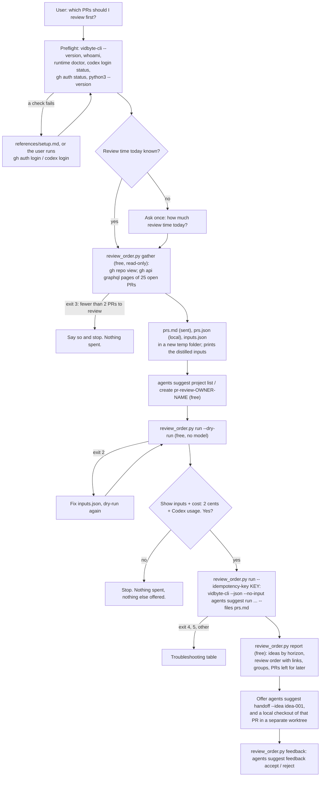

# which-pr-to-review-first

## Summary

Add the public agent skill `skills/which-pr-to-review-first/`. A maintainer or tech lead opens a
repository with 10 to 100 open pull requests and cannot review them all today. GitHub lists them
newest first, so the review order ends up first-in-first-out or random: a two-line fix that blocks
a stacked PR waits behind a 2,000-line refactor, a first-time contributor waits two weeks, a
security-sensitive change sits unread, and old PRs rot into merge conflicts.

The skill turns the whole open-PR queue of one repository into an ordered review list. A free,
bundled Python script reads every open pull request with read-only `gh api graphql` calls (size,
age, CI, merge conflicts, review state, stacked PRs, linked issues, the areas the changed files
touch, and the author's relationship to the repository), writes a compact digest, and, after the
user's yes, one `vidbyte-cli agents suggest run` (2 cents for up to 10 suggestions, plus the
user's own Codex usage) decides which PRs to review first and why. The script maps each returned
idea back to PR numbers and links, groups them (review now, next, later; quick approvals; blocking
other PRs; review with care), and the user's accepts and rejects are stored in a per-repository
suggestion project so later rankings learn this maintainer's priorities.

It is not `morning-triage`. That skill is one person's cross-repository morning plan; this one is
one repository's review queue. The skill never approves, comments, labels, merges, or closes
anything: it only reads GitHub.

The slug `which-pr-to-review-first` is the question the user asks, in their own words, which is
what contract section 2 asks for. `review-queue` and `prioritize-pr-reviews` were considered;
the first names a thing, not a problem, and the second reads like a feature name. No skill on any
branch of cerredz/vidbyte-cli uses the slug.

## Flow chart



## Usage example

```bash
npx skills add cerredz/vidbyte-cli --skill which-pr-to-review-first
```

Then, in the coding agent, inside a clone of the repository (or anywhere, with `--repo`):

```text
> we have 60 open PRs, which ones should I review first?
```

The agent runs the preflight, asks "How much time do you have for reviews today?", and, on "about
two hours, and the 2.4 release is what matters this week", runs:

```bash
python3 <skill>/scripts/review_order.py gather --review-hours 2 --priority "The 2.4 release this week matters most; stability fixes before features."
```

The script prints the counts, every distilled value, and `OUT_DIR=<temp folder>`. The agent makes
sure the `pr-review-acme-api` suggestion project exists, dry-runs the exact command for free,
shows the inputs, and asks for a yes for 2 cents plus Codex usage. After the yes:

```bash
python3 <skill>/scripts/review_order.py run --out-dir "<OUT_DIR>" --idempotency-key "which-pr-to-review-first:20261012:7f3a9c"
python3 <skill>/scripts/review_order.py report --out-dir "<OUT_DIR>"
```

`run` executes, from inside `<OUT_DIR>`, with every value passed as its own argument (no shell):

```bash
vidbyte-cli --json --no-input agents suggest run \
  --goal "Decide which open pull requests in acme/api the maintainer should review first, in order. ..." \
  --project pr-review-acme-api \
  --horizon any \
  --category prioritization --category bottleneck \
  --category quick_wins --category risk_prevention \
  --count 10 \
  --trajectory "The 2.4 release this week matters most; stability fixes before features." \
  --trajectory "Milestone \"2.4\" is due on 2026-10-16 (in 4 days); open pull requests in it: #311, #318." \
  --constraint "About 2 hours of review time today." \
  --forbidden "Approving, requesting changes on, commenting on, labelling, merging, or closing any pull request as part of this ranking." \
  --blockers "[#311] is the base branch of #318 and #322 (stacked pull requests); they cannot merge before it does." \
  --risks "[#305] touches database migrations (db/migrate/20261001_add_index.rb); open 9 days, no review yet." \
  --context "Open pull requests in acme/api at 2026-10-12 08:00 UTC: 64 open, 58 in this queue ..." \
  --files prs.md \
  --idempotency-key "which-pr-to-review-first:20261012:7f3a9c" > "<OUT_DIR>/result.json"
```

## How it works

- **One Python script, four subcommands.** `scripts/review_order.py` uses only the standard
  library (Python 3.8+) and calls `gh` and `vidbyte-cli` with argument lists, never a shell, so
  PR titles with quotes, `$`, `&`, or backticks reach the CLI unchanged on macOS, Linux, and
  Windows. `run` and `feedback` take `--cli <path>` (default: `vidbyte-cli` on `PATH`) and print
  the full path of the binary before every call, so a caller, or a test, can see and choose
  exactly which `vidbyte-cli` runs. It is copied and adapted from `morning-triage`'s
  `morning_triage.py` (structure, `gather` / `run` / `report` naming, the dry-run-or-key
  choice), with the `feedback` subcommand and the one-paid-attempt-per-folder rule from
  `pick-up-where-my-sessions-left-off`. Public skills install one folder at a time, so nothing
  is imported from a sibling.
- **Gather (free, read-only).** `gh api user` checks the login (the login is used to recognize
  the user's own PRs and review requests, and is shown as "you", never printed). `gh repo view`
  finds the repository when `--repo` is not given. Then one GraphQL query, sent with
  `gh api graphql`, reads open PRs newest first in pages of 25 (`totalCount`, `number`, `title`,
  `url`, `isDraft`, `createdAt`, `updatedAt`, `additions`, `deletions`, `changedFiles`,
  `author { __typename login }`, `authorAssociation`, `labels`, `reviewDecision`,
  `reviewRequests`, `latestReviews`, `mergeable`, `mergeStateStatus`, `baseRefName`,
  `headRefName`, `isCrossRepository`, `headRepositoryOwner`, `milestone`, `bodyText`,
  `closingIssuesReferences` with their labels, the last commit's `statusCheckRollup` with its
  check names, and `files`). This is the field list `gh pr list --json` offers, plus the author
  association and linked-issue labels that `gh pr list` cannot return. `gh pr list` itself is not
  used: it asks GitHub for 100 PRs per page, and with the check, file, and merge fields that
  request returned HTTP 502 on a busy public repository during testing. The script halves the
  page on a 502, 504, or timeout, and stops at `--limit` (default 100, at most 300). If the
  repository has more open PRs than `--limit`, the digest says how many of the oldest were not
  read and suggests `--limit`, `--label`, or `--base`.
- **Distill.** Every fetched PR gets plain facts and simple computed signals; the ranking is left
  to the agent.
  - Size: lines added plus removed, bucketed XS (10 or fewer), S (50), M (250), L (1,000), XL.
  - CI: passing, failing (with up to three failing check names), pending, waiting for a
    maintainer to approve the workflow run (`ACTION_REQUIRED`, common for first-time
    contributors), or no checks.
  - Merge: conflicts, behind the base branch, blocked by branch protection, clean, or unknown
    (GitHub computes mergeability lazily).
  - Review: the decision, the latest review per reviewer, and pending requests; the user's own
    reviews and requests appear as "you". Reviews by bots, such as an automated code reviewer, are
    listed apart as "automated review" and never count as a human review.
  - Stacks: a PR whose base branch is another open, same-repository PR's head branch is stacked
    on it, so the lower PR blocks the upper one.
  - Areas, from file paths: security-sensitive names, database migrations, API schema files
    (such as `.proto`, `.graphql`, and OpenAPI files), CI configuration, build and deploy files,
    dependency manifests, code, tests, docs; "docs only" and "tests only" when every file is one
    kind. Test files are checked first, so a test under an `auth/` folder counts as a test, not
    as security-sensitive. Only the first 100 files of a PR are read.
  - Author: member, owner, collaborator, contributor, first-time contributor, or bot.
  - Linked issues: the issues the PR closes, with labels that look like priority or severity.
  - Signals: `quick` (50 lines or fewer, CI passing or absent, no conflicts, no changes
    requested), `approved`, `blocks #N`, `stacked on #N`, `conflicts`, `waiting Nd, no review`
    (7+ days), `stale` (no activity for 30+ days), `first-time contributor`,
    `your review requested`, `priority issue`.
  - Drafts are left out unless `--include-drafts`; the user's own PRs are always left out (nobody
    reviews their own PR). Both counts appear in the digest.
  - Descriptions (`bodyText`, which drops HTML comments) are cut to 240 characters. Secrets
    (GitHub, Vidbyte, OpenAI, Slack, AWS tokens, JWTs, private keys, `password=`-style values)
    and email addresses are replaced with `[redacted]` in every value and in the digest.
- **Files.** `gather` writes, in a new temp folder outside the repository: `prs.md` (a header
  that marks all PR text as data, one table row per queued PR, then a short details block per PR
  with its link, labels, milestone, reviewers, failing checks, a few file paths, and the
  description excerpt; capped at 150,000 characters), `prs.json` (every fetched PR's facts, for
  `report`; never sent), and `inputs.json` (the values `run` passes; the agent may edit it).
- **Ask.** The flags follow the `agents suggest run` help text:
  - `--goal`: decide which PRs to review first, in order; name each PR as `#123`; say why it comes
    before the rest and which can wait; suggest only what to review, never approve or merge. A
    user's target (such as "everything for 2.4 reviewed by Friday") is appended here, because a
    target is part of the goal, not a past success.
  - `--constraint`: the review time today, from the one question; plus limits the user states.
  - `--trajectory`: the repository's stated priorities from the user, then up to three
    milestones that queued PRs belong to, nearest due date first.
  - `--success`: quick-review patterns that worked for this maintainer before, only when the user
    gives them ("a method or outcome that has worked for the caller before").
  - `--avoid`: directions the user does not want, only when given.
  - `--forbidden`: one fixed sentence that rules out approving, commenting, labelling, merging, or
    closing. It is long on purpose: the CLI removes any idea that repeats a `--forbidden` or
    `--avoid` value word for word, so a short value such as "merge" would remove good ideas.
  - `--blockers`: stack bases, up to 8, each starting with its tag, such as `[#311]`, and
    sorted by how many PRs wait above them in the stack, counted through the whole chain.
  - `--risks`: PRs touching security-sensitive paths, migrations, API schema files, or CI
    configuration, up to 8.
  - `--context`: one snapshot of the counts, plus the PRs where the user's review is requested
    directly.
  - `--files prs.md`: the digest, as a relative path from inside the temp folder, because the path
    string reaches the model and an absolute path would name the user's home folder. `--files`
    and not `--attach`, because a `--files` file gets a citable `ctx-NNN` reference and the CLI
    withholds ideas that cite evidence it never received.
  - `--category prioritization, bottleneck, quick_wins, risk_prevention`: rank against scarce
    review time and name what falls below the line; find PRs that hold others back; find small,
    safe reviews; and find PRs whose delay or careless review is costly. All four ids exist in
    `services/suggestions/categories.py`.
  - `--horizon any`: any other value is a filter applied after review, so ideas labelled with
    another horizon are dropped, the slate can come back short, and the run is still charged.
    The report groups ideas by their own horizon label instead.
  - `--count`: 5 for a queue of up to 10 PRs, 8 up to 40, 10 above; all one 2-cent block. One idea
    may name several PRs. A larger count costs 2 cents more per block of 10.
  - `--project pr-review-<owner>-<name>`: one project per repository, created once with
    `agents suggest project create`, so accepted and rejected suggestions shape later runs for
    this repository only.
- **Run guard.** `run` needs exactly one of `--dry-run` or `--idempotency-key`. The paid path
  refuses unless a dry run passed for the current `inputs.json` (its hash is saved with the dry
  run), writes the key to `idempotency-key.txt` before starting, and refuses a second key in the
  same folder: only the saved key may be reused, to recover an admission whose reply was lost,
  and never after a successful result.
- **Report (free).** `report` reads `result.json` and `prs.json`. It maps each idea to PRs from
  the `[#N]` tag of each typed value the idea cites in `handoff.evidence`, and from `#N` or
  "PR N" in the idea's title, summary, first action, and steps, keeping only numbers that are
  fetched PRs. It prints the ideas grouped by `horizon` (now, next, later), then one flat review
  order with each PR's link, its facts in one line, and the idea that put it there, then the
  groups "Quick approvals" (`quick_wins` ideas), "Blocking other pull requests" (`bottleneck`
  ideas and stack bases), and "Review with care" (`risk_prevention` ideas and PRs touching
  security-sensitive paths or migrations), then the queued PRs no idea named, and the charge.
- **Deliver.** The agent presents the report, offers `agents suggest handoff --idea idea-001`
  (free) so a coding agent can start the first review, and, after a yes, a local checkout of that
  PR in a separate worktree (`git worktree add`, then `gh pr checkout`). It records explicit
  accepts and rejects with `review_order.py feedback`, which copies the idea's exact title into
  `agents suggest feedback accept|reject --project pr-review-<owner>-<name>`.

## Files

| File | Change |
|---|---|
| `skills/which-pr-to-review-first/SKILL.md` | New. The skill, in contract section 4's order. |
| `skills/which-pr-to-review-first/scripts/review_order.py` | New. `gather`, `run`, `report`, `feedback`; stdlib only. |
| `skills/which-pr-to-review-first/references/setup.md` | New. Byte-for-byte copy of the canonical file. |
| `skills/which-pr-to-review-first/references/troubleshooting.md` | New. Byte-for-byte copy of the canonical file. |
| `docs/design/which-pr-to-review-first.md` | New. This document. |

No other file changes. There is no `AGENTS.md` and no CI workflow in this repository; the
`write-agent-skill` contract stands in for `AGENTS.md`, and the gate is local.

## CLI surface and min-cli-version

Every command and option the skill uses is in `contracts/cli-commands.json` on the internal
repository's `main`: `agents suggest run` (`--goal`, `--project`, `--horizon`, `--category`,
`--count`, `--trajectory`, `--constraint`, `--success`, `--avoid`, `--forbidden`, `--blockers`,
`--risks`, `--context`, `--capability`, `--decision`, `--files`, `--dry-run`,
`--idempotency-key`), `agents suggest handoff` (`--input`, `--idea`), `agents suggest feedback
accept|reject` (`--project`, `--suggestion`, `--reason`), `agents suggest project list`,
`agents suggest project create` (`--key`, `--title`, `--description`), `whoami`, and
`runtime doctor`, with the root options `--json` and `--no-input`.

PyPI's newest release is 0.2.0. It lacks `agents suggest run --idempotency-key` and predates the
paid admission, and contract rule 5 requires one idempotency key per priced run. So
`min-cli-version` is `0.3.0`, and the skill is not published until 0.3.0 is on PyPI. The price,
2 cents per block of up to ten requested suggestions, is the CLI's `--count` help.

## Risks and open questions

- **Unreleased CLI.** The skill needs 0.3.0; do not merge until it is on PyPI.
- **Heuristic areas.** Areas come from file names only. A file named `session.go` is marked
  security-sensitive whether or not it is; the digest says "by file name" so the agent weighs it.
- **Large queues.** Repositories with hundreds of open PRs are read newest first up to `--limit`
  (at most 300). The oldest PRs, often the ones rotting into conflicts, may be left out; the digest
  says so and names the filters that narrow the queue.
- **Mergeability lag.** GitHub computes `mergeable` on demand, so a first read often says
  `UNKNOWN`. The digest reports that as unknown instead of guessing.
- **Private repositories.** PR titles, file paths, and description excerpts reach the model through
  the user's own Codex login. Cost and consent says so before the run.
- **Prompt injection.** PR text is written by other people. The digest header, the goal, and the
  guardrails mark it as data, and the suggestion agents run read-only.
- No paid end-to-end run was made, because it spends real money.

## Verification

1. Every `vidbyte-cli` command path and option in `SKILL.md` and the script checked against
   `contracts/cli-commands.json` on the internal `main`.
2. `gather` run against a real public repository with many open PRs (read-only `gh` calls only);
   its output kept out of the repository.
3. `run --dry-run` fed with that output and executed by a `vidbyte-cli` built from the internal
   `main`, with its state folders redirected to a scratch folder: exit 0, `stop_reason`
   `dry_run`, every manifest entry `included`, `admission` null.
4. The paid path of `run`, `report`, and `feedback` exercised only with a fake `vidbyte-cli` that
   records its arguments, passed with `--cli` while no `vidbyte-cli` at all is on `PATH` (so an
   ignored `--cli` fails with exit 127 instead of reaching a real CLI), and every recorded call
   matched against the calls the tests expected; `report` checked against a synthetic
   `result.json`. The guard's refusals (no dry run, changed inputs, a second key, a finished
   result) checked too.
5. `cmp` of both `references/` files against the canonical copies; `git diff` checked for leaked
   names, paths, or tokens before every commit.

## Update: usage-billed Suggestion Agent (2026-10-11)

vidbyte-cli 0.3.0's `agents suggest run` no longer buys an admission or runs on the user's Codex.
This commit moves the skill to that model; cerredz/vidbyte-cli#22 is the reference, and where the
sections above disagree, this section wins.

- No admission, no 2-cent blocks, no idempotency key: every generator, critic, and revision step
  is one model call through Vidbyte's model gateway, billed to the Vidbyte balance at the model's
  per-token rate plus 2%. `run --idempotency-key KEY` is now `run --paid`; the script writes
  `paid-run.txt` just before the paid run and refuses a second paid run in a folder that holds it
  or `result.json`. `--count` no longer changes the price.
- Both roles run on gpt-6-sol at high reasoning effort ($2 / $0.20 cached / $10 per million input /
  output tokens, plus 2%). The dry and the paid run both pass `--max-total-tokens 400000`. With
  `--rounds 2` and no `--extra-compute` a run makes about five calls; the worst case (seven calls
  with two repair retries, 32,000 output tokens each, the cap plus one in-flight call) is about
  $2.93, stated to the user as "under about $4".
- `run` prints `models`, `usage` (`model_calls`, `input_tokens`, `cached_input_tokens`,
  `output_tokens`), and `estimated_cost_usd` instead of `charged_cents`; `report` ends with the
  usage and the estimate; `gather` prints the usage pricing instead of a cent cost per count.
- Preflight drops `runtime doctor` and `codex login status` and names the `models:invoke`
  permission the Vidbyte key needs instead (a key without it fails with exit 4 before anything is
  billed).
  Troubleshooting replaces admission recovery with `gateway_limit` and provider-failure guidance,
  and both `references/` files are the new canonical copies.
